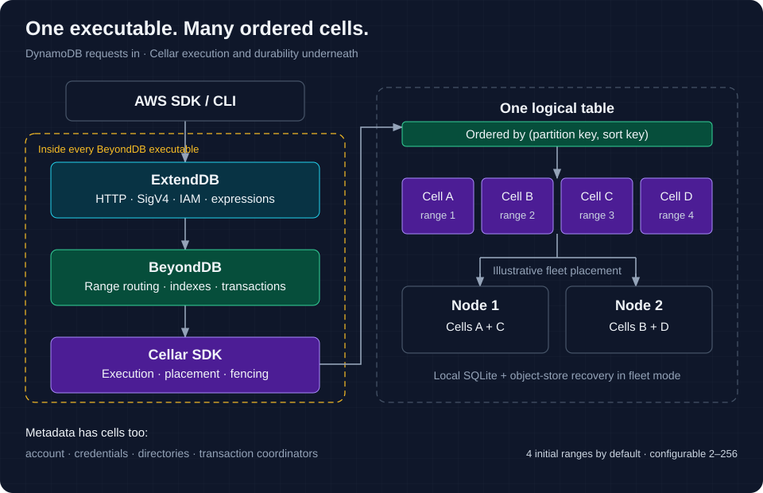

# BeyondDB

**A self-hosted DynamoDB-compatible service, built on ExtendDB and Cellar.**

Use familiar AWS SDKs and DynamoDB requests against your own server. BeyondDB
embeds the protocol frontend and storage runtime in one executable, and spreads
each table across ordered **partition-key + sort-key ranges** in multiple cells.

> **Status: in development.** Signed SDK and recovery tests cover core operations,
> transactions and selected index/Streams paths. Full DynamoDB compatibility,
> fleet-scale capacity, backup/PITR and safe format upgrades remain unfinished.
> Check the [API coverage](docs/api.md) before choosing a workload.

[Quick start](#quick-start) · [Architecture](#how-it-fits-together) ·
[Capabilities](#capabilities-and-limits) · [Development](#development) ·
[Documentation](#documentation)

## How it fits together



| Layer | Responsibility |
| --- | --- |
| **ExtendDB** | DynamoDB HTTP, SigV4, IAM evaluation, validation and expressions |
| **BeyondDB** | Table metadata, ordered range routing, indexes and cross-cell transactions |
| **Cellar** | Cell execution, placement, fenced ownership, peer transport and durability |

ExtendDB and Cellar run **inside the BeyondDB executable**. Cellar is pinned to
[`cellar-main = "=0.1.0"`](Cargo.toml); ExtendDB uses a reviewed Git revision.

### One table, many cells

A table starts with **four ordered data ranges** by default. Configure
`initial_partitions` from **2 to 256**; public single-cell tables are rejected.
Cells can share a node or live on different fleet nodes. Adding ranges does not
by itself add physical capacity.

```text
Logical order: (partition key, sort key)

          one table
   ┌─────────┬─────────┬─────────┬─────────┐
   │ range 1 │ range 2 │ range 3 │ range 4 │
   └────┬────┴────┬────┴────┬────┴────┬────┘
        │         │         │         │
      cell A    cell B    cell C    cell D

Point read/write → the cell containing the complete key
Query            → cells intersecting the requested PK/SK range
Scan             → a paginated walk across the table's ranges
```

A hot partition key can split across cells by sort key when the table has no
LSIs. GSIs have their own independently partitioned cells. See the
[ordered partitioning design](docs/ordered-cell-partitioning.md) for split,
pagination and LSI locality rules.

### Commit and recovery

A partition-local write commits its item, result, LSI changes, GSI journal and
stream intent in one cell command. Cross-cell transactions record a durable
coordinator decision and resolve participants idempotently. GSI projection is
asynchronous.

Local mode persists to the configured directory. Fleet mode uses an object
store for recovery; bucket publication is the default acknowledgement path.
Optional follower durability allows native follower fsyncs to race publication.
See [server configuration](docs/cellar-server.md) and
[follower durability](docs/follower-durability.md) for the tested boundaries.

## Quick start

This loopback demo needs **Rust 1.97+, Python 3, OpenSSL and the AWS CLI**.
Run the setup from the repository root. It creates a temporary data directory
and an admin credential for the local account.

### 1. Build and configure

```sh
cargo build --locked --bin beyonddb

umask 077
export BEYONDDB_HOME="$(mktemp -d)"
openssl rand -out "$BEYONDDB_HOME/peer.key" 32
openssl rand -out "$BEYONDDB_HOME/encryption.key" 32

python3 - "$BEYONDDB_HOME" <<'PYTHON'
import json
import sys
from pathlib import Path

root = Path(sys.argv[1]).resolve()
config = json.loads(Path("config/cellar.example.json").read_text())
config.update(
    node_name="local-demo",
    data_dir=str(root / "data"),
    peer_key_file=str(root / "peer.key"),
    encryption_key_file=str(root / "encryption.key"),
)
config["bootstrap"].update(
    access_key_id="AKIABEYONDDBDEMO00001",
    policy_file=str(root / "policy.json"),
)
policy = {"Version": "2012-10-17", "Statement": [
    {"Effect": "Allow", "Action": "dynamodb:*", "Resource": "*"}
]}
(root / "policy.json").write_text(json.dumps(policy))
(root / "config.json").write_text(json.dumps(config, indent=2))
PYTHON
```

### 2. Start the server

Keep this terminal open. Bootstrap reads the demo secret from stdin.

```sh
printf '%s' 'local-development-secret' | \
  "${CARGO_TARGET_DIR:-target}/debug/beyonddb" "$BEYONDDB_HOME/config.json" --bootstrap
```

The public listener is `http://127.0.0.1:8000`; the authenticated peer listener
is `127.0.0.1:9000`. After stopping the server, restart with the same configuration
and omit `--bootstrap`. Keep the data directory and encryption key together.
For external TLS serving or a fleet, follow the [server guide](docs/cellar-server.md).

### 3. Create, write and query

In a **second terminal**, configure the demo credentials and endpoint:

```sh
export AWS_ACCESS_KEY_ID='AKIABEYONDDBDEMO00001'
export AWS_SECRET_ACCESS_KEY='local-development-secret'
export AWS_DEFAULT_REGION='us-east-1'
export BEYONDDB_ENDPOINT='http://127.0.0.1:8000'

aws dynamodb create-table \
  --table-name Orders \
  --attribute-definitions AttributeName=pk,AttributeType=S AttributeName=sk,AttributeType=S \
  --key-schema AttributeName=pk,KeyType=HASH AttributeName=sk,KeyType=RANGE \
  --billing-mode PAY_PER_REQUEST \
  --endpoint-url "$BEYONDDB_ENDPOINT"

aws dynamodb wait table-exists \
  --table-name Orders --endpoint-url "$BEYONDDB_ENDPOINT"

aws dynamodb put-item \
  --table-name Orders \
  --item '{"pk":{"S":"customer#42"},"sk":{"S":"order#0001"},"total":{"N":"19.95"}}' \
  --endpoint-url "$BEYONDDB_ENDPOINT"

aws dynamodb query \
  --table-name Orders \
  --key-condition-expression 'pk = :customer AND sk BETWEEN :start AND :end' \
  --expression-attribute-values '{":customer":{"S":"customer#42"},":start":{"S":"order#0001"},":end":{"S":"order#0099"}}' \
  --consistent-read \
  --endpoint-url "$BEYONDDB_ENDPOINT"
```

The query returns the inserted order. The AWS CLI follows pagination by default.
For conditional updates, transactions, TTL and Streams examples, see the
[user guide](docs/user-guide.md).

## Capabilities and limits

| Area | Available paths | Remaining limits |
| --- | --- | --- |
| Tables and items | Table lifecycle, keyed CRUD, Query/Scan, batches, conditions, expressions and pagination | Some create/update options are rejected |
| Transactions | Durable `TransactWriteItems` and `TransactGetItems` across cells | Focused fault tests do not establish fleet-scale recovery |
| Indexes | `ALL` LSIs; GSIs created with a table support `ALL`, `KEYS_ONLY` and `INCLUDE` | Online GSI changes and non-`ALL` LSIs are unsupported |
| TTL and Streams | Bounded TTL sweeps; creation-time Streams with retained generations and retention sweeps | Stream policy changes and full lifecycle qualification remain open |
| Operations | Local persistence, bucket-backed recovery and optional follower durability | Backup, restore, PITR, account/IAM management and safe format upgrades are unfinished |
| Other DynamoDB features | See the [API matrix](docs/api.md) | PartiQL and Global Tables are not dispatched; local-file import/export is disabled |

The [API matrix](docs/api.md) distinguishes implemented paths from behavior
verified through signed SDK requests and owner restart. Fleet-scale throughput
and unattended recovery remain unqualified. Retired legacy test coverage is
listed [here](docs/retired-cellule-tests.md).

## Development

| Crate | Purpose |
| --- | --- |
| [`beyonddb`](Cargo.toml) | Executable, frontend composition and DynamoDB storage implementation |
| [`cellar-runtime`](crates/cellar-runtime) | Compiled commands, queries, SQL, identities and SDK integration |
| [`keyspace`](crates/keyspace) | Ordered key encoding, range planning and logical continuations |

```sh
cargo fmt --all --check
cargo clippy --workspace --all-targets --locked -- -D warnings
cargo test --workspace --locked
```

Workstations with the mounted Workspace volume should use a checkout-specific
`CARGO_TARGET_DIR` beneath `$HOME/Workspace/crabbuild-target`. The coalescing and transaction recovery fixtures need CPU/I/O isolation on small
machines. Run them with `cargo test --locked --test cellar_coalescing --test cellar_transactions -- --test-threads=1`.
Each fixture retains its concurrent client workload. Process tests are
ignored by default and require Docker, OpenSSL and the AWS CLI:

```sh
cargo test --locked --test cellar_process -- --ignored --test-threads=1
cargo test --locked --test server_binary -- --include-ignored --test-threads=1
```

See [contributor invariants](AGENTS.md),
[server qualification boundaries](docs/cellar-server.md#qualification-still-required) and
[independent protocol qualification](docs/implementation-status.md#independent-client-qualification).

## Documentation

| Goal | Guide |
| --- | --- |
| Deploy and configure a node | [Embedded Cellar server](docs/cellar-server.md) |
| Use AWS CLI and SDK requests | [User guide](docs/user-guide.md) |
| Check API support | [API coverage](docs/api.md) |
| Understand routing and splits | [Ordered cell partitioning](docs/ordered-cell-partitioning.md) |
| Understand transactions and indexes | [Transactions](docs/cross-cell-transactions.md) · [GSIs](docs/global-indexes.md) · [LSIs](docs/lsi-contract.md) |
| Work with change records | [Streams contract](docs/streams-contract.md) |
| Measure and qualify a workload | [Performance](docs/performance.md) · [Scaling](docs/scaling.md) |

Apache-2.0 licensed. See [LICENSE](LICENSE).
