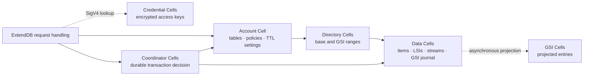

# BeyondDB

BeyondDB is an **in-progress, self-hosted DynamoDB-compatible service**. It
uses [ExtendDB](https://github.com/ExtendDB/extenddb) for the DynamoDB HTTP
protocol, SigV4, IAM evaluation, validation, and expressions. It uses
[Cellar](https://github.com/crabbuild/cellar) for fenced Cell ownership,
SQLite execution, LTX publication, and object-store durability. The reviewed
dependency revisions are pinned in [Cargo.toml](Cargo.toml).

An AWS SDK can send signed requests to BeyondDB's public endpoint. Core table
and item operations, transactions, TTL, selected secondary indexes, and a
partial Streams path have durable Cell implementations and focused restart
tests. **BeyondDB is not yet a complete or production-qualified DynamoDB
replacement.** See the [API coverage and gaps](docs/api.md) before choosing a
workload.

**Cellar migration branch:** the production manifest and domain handlers now use
Cellar. The executable passes local signed SDK/restart checks. Table ownership
now uses ordered `(PK, SK)` ranges across multiple cells, with a real serving
router/split fixture. Nine bucket-backed process cases and SDK handoff to a
second node pass. Historical Cellule results below are not Cellar qualification.
Broader API/index checks, legacy fixture migration and fleet fault matrices
remain unfinished.
See [migration status](CELLAR_MIGRATION.md) and the
[ordered range plan](docs/ordered-cell-partitioning.md).

## Start here

| Need | Read |
| --- | --- |
| Configure and start a node | [Embedded Cellar server](docs/cellar-server.md) |
| Send AWS CLI requests | [User guide](docs/user-guide.md) |
| Check an operation or limitation | [API coverage](docs/api.md) |
| Understand Cells, routing, and transactions | [Ordered cell architecture](docs/ordered-cell-partitioning.md) |
| Measure latency and throughput | [Performance guide](docs/performance.md) |
| Follow implementation evidence and open gates | [Implementation status](docs/implementation-status.md) |

## Architecture at a glance

ExtendDB owns the public HTTP, SigV4, IAM, validation, and expression layers.
BeyondDB implements ExtendDB's storage contracts with Cell-backed state,
routing, provisioning, and transaction coordination. Cellar owns fenced Cell
execution, peer transport, SQLite commands, and durability. ExtendDB and Cellar
are embedded in the BeyondDB executable. In fleet mode the object store holds
published state for owner recovery.

### BeyondDB's Cell types



Each box represents BeyondDB state hosted in Cellar, not an independent
HTTP service. An account Cell owns table metadata; data Cells own
ordered `(PK, SK)` ranges. A GSI is maintained asynchronously from a journal
committed with the base item. Cross-Cell transactions use a durable
coordinator decision and idempotent participant resolution.

### Partition every table across cells

Every new table starts with multiple ordered data ranges. `initial_partitions`
defaults to four and accepts counts from two through 256. The `CreateTable` tag
`beyonddb:cell-model` accepts `auto` or `partitioned`; `single` is rejected.
Point requests route by the full primary key. Query visits only intersecting
ranges, and a hot PK can split by SK when the table has no LSIs. GSIs have their
own ordered data cells. See [ordered cell partitioning](docs/ordered-cell-partitioning.md).

### When a write becomes durable

A partition-local mutation, its result, LSI changes, GSI journal entry, and
stream intent commit in one Cell command. The successful response follows
Cellar's durability proof. See the [embedded server guide](docs/cellar-server.md)
for the selected persistence mode.

Fleet mode requires bucket publication by default. Opt-in
`fleet.follower_durability: true` lets native follower fsyncs race bucket
publication. A RustFS crash fixture recovers acknowledged writes on a fresh
successor after deleting the failed owner's local directory while both bundle
and LTX uploads were withheld. Cellar controls enrollment, proofs and recovery;
see [follower durability](docs/follower-durability.md) for the tested boundary.
Local-only mode persists to the configured local directory.

## Current capability boundary

| Area | Current state |
| --- | --- |
| Tables and items | Create/describe/list/update/delete tables; keyed CRUD, Query, Scan, batches, conditions, expressions, and pagination have Cell paths. Some `CreateTable` and `UpdateTable` options are rejected. |
| Transactions | `TransactWriteItems` and `TransactGetItems` use durable coordination across Cells, with signed SDK restart tests. |
| Indexes | LSIs support `ALL` projection. GSIs created with a table support `ALL`, `KEYS_ONLY`, and `INCLUDE` through asynchronous projection. Online GSI changes and non-`ALL` LSI projections remain unsupported. |
| TTL and Streams | TTL settings and bounded expiry sweeps are Cell-backed. A stream enabled at table creation can journal writes and expose current and retained generations. Bounded retention sweeps cover active and dormant data Cells; stream policy updates and full lifecycle qualification remain open. |
| Operations | Backup, restore, PITR, account/IAM management, and safe data-format upgrades remain unfinished. Fleet-scale throughput and unattended recovery are unqualified. |
| Other DynamoDB features | PartiQL and Global Tables are not dispatched by pinned ExtendDB. Its local-file import/export extensions do not implement DynamoDB's S3 workflow; BeyondDB disables them. |

The table is a guide, not a blanket compatibility claim. The
[API matrix](docs/api.md) distinguishes implemented methods from operations
verified through signed SDK requests and owner restart.

## Minimal client example

After following the [deployment guide](docs/deployment.md), configure an
account's access key and point the AWS CLI at the public listener:

```sh
export AWS_ACCESS_KEY_ID='your-bootstrapped-key-id'
export AWS_SECRET_ACCESS_KEY='your-bootstrapped-secret'
export AWS_DEFAULT_REGION='us-east-1'
export AWS_CA_BUNDLE='/etc/beyonddb/public-ca.crt'
export BEYONDDB_ENDPOINT='https://ddb.example.com:8000'

aws dynamodb list-tables --endpoint-url "$BEYONDDB_ENDPOINT"
```

The CA bundle must trust the public listener certificate. A loopback listener
without TLS uses an `http://` endpoint and does not need `AWS_CA_BUNDLE`.
For runnable table and item commands, see the [user guide](docs/user-guide.md).

## Development and qualification

The ordinary test suite excludes ignored process tests. The latter start a
RustFS fixture, use signed AWS SDK calls, kill the server, and read committed
state after fenced recovery. They require Docker and the AWS CLI. Legacy peer
fixtures also require OpenSSL.
Use a unique target directory under `$HOME/Workspace/crabbuild-target` on
workstations with the mounted Workspace volume.

```sh
export CARGO_TARGET_DIR="$HOME/Workspace/crabbuild-target/beyonddb-docs-3c23"
cargo fmt --check
cargo clippy --all-targets -- -D warnings
cargo test --lib
cargo test --test cellar_process --locked -- --ignored --test-threads=1
cargo test --test server_binary -- --ignored --test-threads=1
```

The [independent client qualification instructions](docs/implementation-status.md#independent-client-qualification)
run ExtendDB's Python protocol tests against the BeyondDB binary. Passing
selected tests does not establish full DynamoDB compatibility. For scale
claims, use the [measured completion gates](docs/scaling.md#completion-proof).

## Design and evidence

- [Cross-Cell transaction protocol](docs/cross-cell-transactions.md)
- [Metadata ownership](docs/metadata-sharding.md)
- [Global secondary indexes](docs/global-indexes.md)
- [Streams contract](docs/streams-contract.md)
- [Local secondary index contract](docs/lsi-contract.md)
- [Scaling and measured limits](docs/scaling.md)

BeyondDB is licensed under Apache-2.0. Its contributor invariants are in
[AGENTS.md](AGENTS.md).
