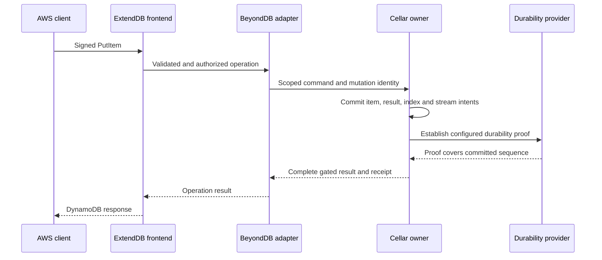

# BeyondDB architecture

BeyondDB composes a DynamoDB protocol frontend with independently durable,
ordered cells. A table is a logical generation and a directory of ranges; it is
not one database cell. Cells can share a node or span a fleet.

## Components and ownership

| Layer | Owns | Entry point |
| --- | --- | --- |
| ExtendDB | HTTP, SigV4, IAM evaluation, validation, expressions | Pinned frontend composed in [server.rs](../src/cellar/server.rs) |
| BeyondDB | Catalog, ordered routing, transactions, indexes, Streams and TTL | [backend](../src/backend.rs), [domain modules](../src/lib.rs) |
| Cellar | SQLite execution, fenced owners, placement, peer transport, log/bucket durability | [runtime adapter](../crates/cellar-runtime/src/lib.rs), [executable](../src/bin/beyonddb.rs) |
| Keyspace | Versioned ordering, range bounds and logical continuations | [keyspace](../crates/keyspace/src/lib.rs) |

Public request parsing stays outside cell handlers. Internal commands carry
bounded typed values and scoped identities; the internal gateway is not a public
DynamoDB API. Node movement preserves cell identity; a split creates new range
identities and changes the directory.

## Single-item write sequence

A lost reply after submission can leave an unknown outcome. HTTP status alone
does not prove non-execution. Preserve mutation identity and use the application's
replay/decision protocol; see [transactions](cross-cell-transactions.md).

## State and atomic boundaries

| State | Boundary |
| --- | --- |
| Table names, policies and lifecycle anchors | Account-scoped catalog commands |
| Ordered routes | Bounded directory cells, published after matching installations |
| Base items, LSIs and change intents | One partition-local command |
| GSI entries | Independent range cells, applied asynchronously and versioned |
| Transactions | Durable coordinator decision plus idempotent participant resolution |
| Credentials | Key-derived cells with encrypted credential secrets |
| Discovery inventory | Sharded metadata for managed cells; not ownership authority |

GSI visibility may lag a successful base write. A Query or Scan spanning cells is
not a whole-table snapshot. Strongly consistent point reads and transactional
multi-item reads have different contracts; API options remain subject to
[coverage limits](api.md).

## Ownership and recovery

The application supplies logical cell targets. Cellar discovers owners, fences
stale generations and restores committed state under its native authority
protocol. An unreachable owner with a valid lease does not authorize takeover.
Range epochs fence application routes; they do not replace native ownership.

Configured accounts receive startup recovery and ongoing maintenance. Request
paths can restore accessed data/index owners. Coordinator recovery resumes
unfinished decisions. These paths do not establish a fleet-wide recovery-time
bound for every idle cell.

| Continue with | Purpose |
| --- | --- |
| [Partitioning](ordered-cell-partitioning.md) | Key ordering, routing, split publication |
| [Metadata](metadata-sharding.md) | Directory and discovery topology |
| [Deployment](deployment.md) | Listeners, keys, persistence and peers |
| [Scaling](scaling.md) | Resource limits and capacity qualification |
