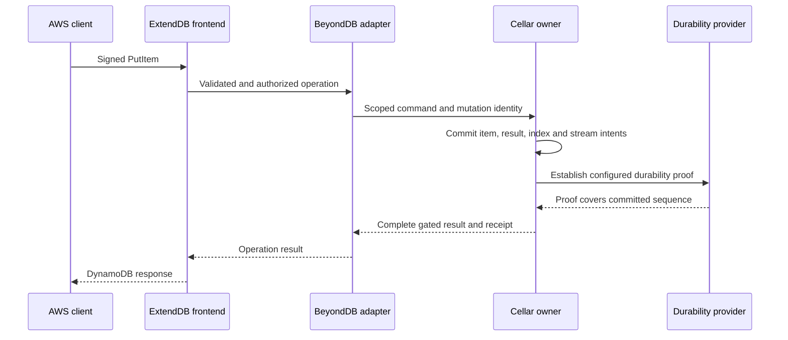
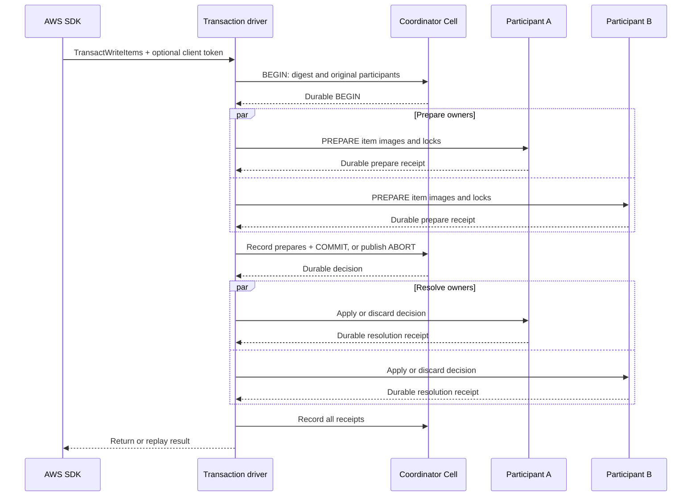
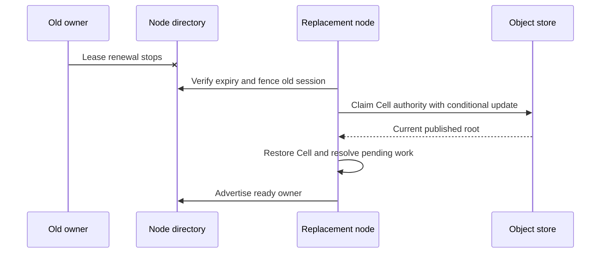

# Understand BeyondDB's architecture and durability

This page explains how a signed request becomes durable, which Cell owns each kind of state, and how another node recovers that state. BeyondDB uses two pinned projects: ExtendDB owns the DynamoDB protocol and security boundary; Cellar owns fenced execution and durable publication. BeyondDB connects them through Cell schemas, adapters, routing, provisioners, a transaction coordinator, and serving workers. The design does not establish fleet-scale performance.

Read the diagram from protocol validation through ordered routing to native
execution and durability. Every node embeds these layers.

| Term | Meaning in this design |
| --- | --- |
| **Cell** | A single-writer, durable unit of state executed by Cellar. |
| **Owner** | The node currently authorized to execute a Cell. |
| **Route** | The table generation, ordered interval, cell identity and range epoch used to find a Cell. |
| **LTX** | The published SQLite change format that lets a new owner restore a Cell. |
| **Fence** | An authority check that prevents an old owner or route from writing. |

## Components and ownership

The request path separates protocol work from state execution. The Cell types below have different ownership and recovery policies, even when they run on the same node.

Fleet mode configures an S3-compatible bucket with conditional create/update
semantics. Each node retains its own local data directory. Native peer requests
are authenticated; peer mTLS is not a JSON option in this executable. Isolate and
encrypt the private deployment network. Preserve the credential-encryption key
and peer key with their deployment state. See [deployment](deployment.md).

| State | Authority and atomic boundary |
| --- | --- |
| Account metadata and IAM policies | One account Cell command for each account-local mutation. The account still owns the table-name catalog and publication anchors. |
| Base items and LSIs | One data-range Cell owns a full-primary-key ordered interval. A write, its LSI changes, GSI journal entry, and stream intent share one command. |
| GSIs | Separate range Cells receive journal projections asynchronously and idempotently. Their read view can lag a base write. |
| Transactions | One durable coordinator records a participant set and COMMIT or ABORT decision. Each account/data participant stores prepare state and resolves that decision idempotently. |
| Credentials | Key-derived credential Cells store encrypted secrets and session tokens. |

## Single-item write sequence

The owner commits the base mutation and its dependent records together. The client receives success after the configured Cellar durability gate. Fleet
mode defaults to bucket publication; eligible follower proofs can be enabled.

A rejected command rolls back its application changes and preserves the recorded
rejection under the command contract. The router uses the current table generation, range, and owner epoch; the owner rejects stale routes so the router can refresh them. `GetItem`, `Query`, and `Scan` read the owning Cell and respect unresolved transaction intents.

## Cross-Cell transaction sequence

A cross-Cell transaction has one durable decision. Participant Cells store their prepared state and resolve that decision independently, so recovery can finish after a driver failure.

The original coordinator and participant identities survive routing changes. If a driver dies after publishing the decision, startup or serving recovery finishes participant resolution. A caller timeout leaves the outcome unknown until the durable decision is inspected. A client token distinguishes a matching replay from a different request. Cross-Cell transaction reads use shared key locks and captured images. Single-Cell reads use one atomic query with a compact internal response when it fits the query envelope. See the [transaction protocol and failure cases](cross-cell-transactions.md).

## Range split and GSI projection

Splitting changes a route only after the source has sealed and both children have copied and verified its contents. Global secondary index (GSI) projection follows a different path: a base write commits a journal entry, then an index worker applies it asynchronously.

Split plans are durable and replayable. The source cannot seal while prepared
transactions or pending GSI projection work would be lost. Directory
publication retains the plan until both children open. The route identifies
the table generation, Cell owner, and epoch, so a stale source cannot accept
new work after cutover. `Scan` continuation and broad split behavior remain
under qualification; see [metadata ownership](metadata-sharding.md).

For a GSI, the base command writes an immutable projection journal entry. A worker applies a versioned entry or tombstone to the index Cell. It removes the journal entry only after every required index acknowledges it durably. An unavailable index delays its own projection while healthy indexes can advance. GSI reads are therefore eventually consistent with base writes; a base transaction does not produce an atomic GSI view. See the [GSI design and limits](global-indexes.md).

## Failure recovery and current limits

Recovery first establishes that the old owner has lost authority. The replacement then claims the published root and replays unfinished work before advertising readiness.

An unreachable owner with a live lease stays fenced against takeover.
Configured account and credential Cells are recovered at startup; requests
can restore published idle or expired data/GSI owners. Coordinator recovery
resolves abandoned work. A fleet-wide scheduler for unaccessed data-only
owners, bounded recovery time, sustained overload behavior, and safe storage
history collection remain open. The [scaling plan](scaling.md) defines the
10,000-Cell/multi-TB target and the measurements needed to claim it.

## Source map

Use these entry points to follow a diagram into the implementation:

| Boundary | Entry point |
| --- | --- |
| Public server composition | [`src/cellar/server.rs`](../src/cellar/server.rs) and [`src/bin/beyonddb.rs`](../src/bin/beyonddb.rs) |
| Table and item adapter | [`src/backend.rs`](../src/backend.rs) and [`src/backend/data.rs`](../src/backend/data.rs) |
| Cell routing and ownership | [`src/routing.rs`](../src/routing.rs), [`src/directory.rs`](../src/directory.rs) |
| Transaction driver and coordinator | [`src/backend/transaction.rs`](../src/backend/transaction.rs), [`src/transaction_coordinator.rs`](../src/transaction_coordinator.rs) |
| GSI projection | [`src/global_index.rs`](../src/global_index.rs), [`src/backend/global_index.rs`](../src/backend/global_index.rs) |
| Stream journal, reads, and retention | [`src/stream_journal.rs`](../src/stream_journal.rs), [`src/backend/streams.rs`](../src/backend/streams.rs), [`src/backend/stream_retention.rs`](../src/backend/stream_retention.rs) |
