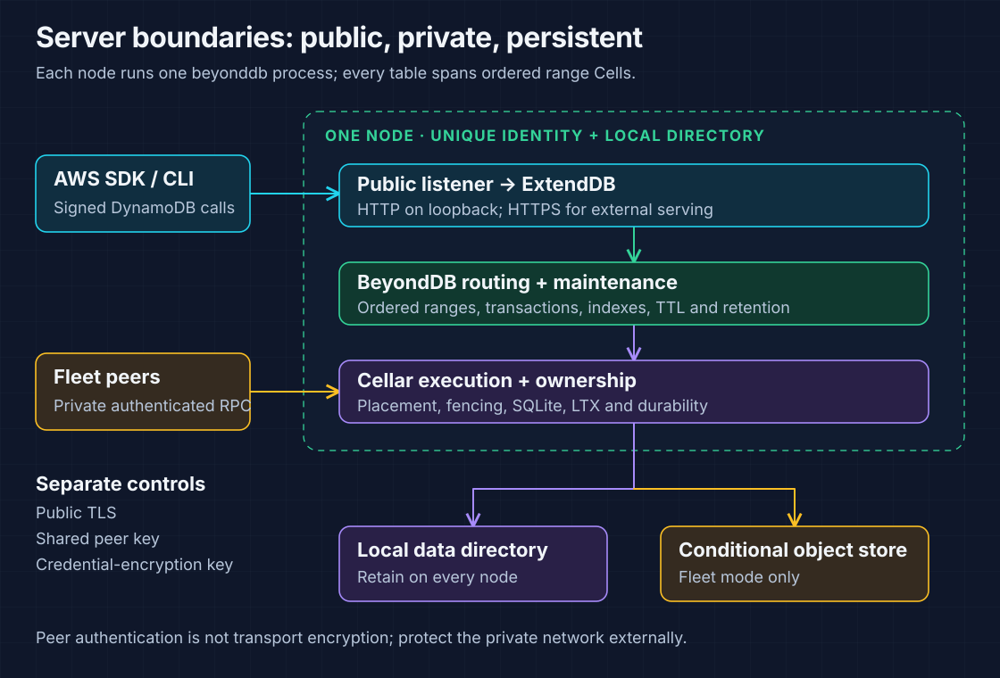
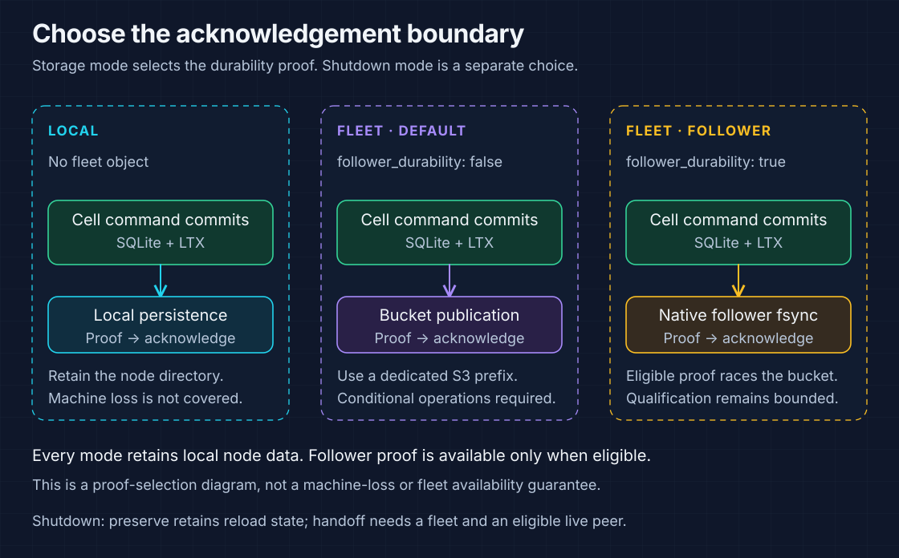
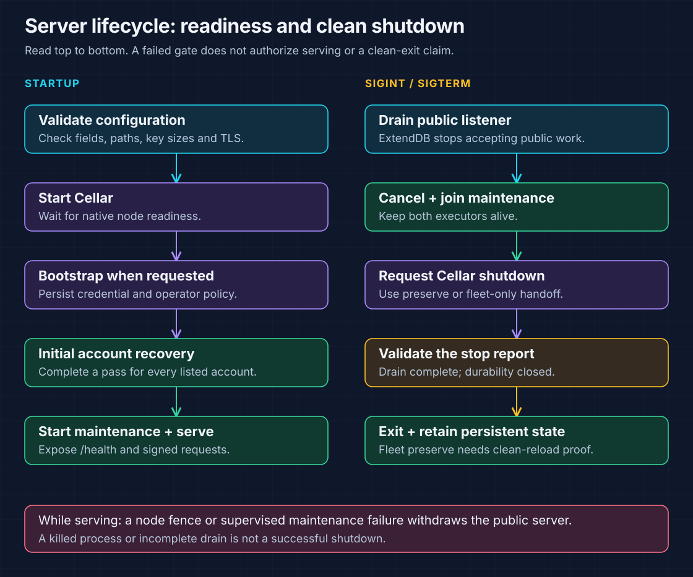

# BeyondDB server reference

Run one `beyonddb` executable per node. It embeds ExtendDB for the DynamoDB
frontend and Cellar for state execution and durability. Use this guide to choose
storage, configure a node, follow its lifecycle and inspect qualification evidence.

| I need to… | Start here |
| --- | --- |
| Understand node boundaries | [Server layout](#server-layout) |
| Select local or fleet persistence | [Persistence and shutdown](#persistence-and-shutdown) |
| Set listener, key and capacity fields | [Configuration](#configuration) |
| Bootstrap, start or stop a process | [Starting and stopping](#starting-and-stopping) |
| Understand maintenance, caching and retries | [Serving and caching](#serving-and-caching) |
| Select checks and interpret their limits | [Qualification still required](#qualification-still-required) |
| Inspect the original fault cases and measurements | [Detailed qualification record](#detailed-qualification-record) |

## Server layout



| Layer | Owns |
| --- | --- |
| ExtendDB | Public HTTP, SigV4, IAM evaluation, validation and operation handling |
| BeyondDB | Configuration, public TLS setup, ordered routing and application maintenance |
| Cellar | Cell execution, placement, fenced ownership, private peer transport and durability |

Every table spans ordered range Cells. The `accounts` list selects accounts for
maintenance; it does not place a table into one Cell. See [architecture](architecture.md)
for the Cell types and [deployment](deployment.md) for provisioning.

## Persistence and shutdown

Choose the **acknowledgement boundary** first, then choose how a node stops.



| Storage configuration | Acknowledgement / recovery boundary | Retain |
| --- | --- | --- |
| No `fleet` object | Local Cellar persistence; does not cover machine loss | Node data directory |
| `fleet.follower_durability: false` | Bucket-publication proof is the default acknowledgement path | Node data, bucket prefix and deployment keys |
| `fleet.follower_durability: true` | An eligible native follower fsync proof may race bucket publication; see [follower durability](follower-durability.md) | Node data, bucket prefix and deployment keys |

| `shutdown_mode` | Use when | Completion requirement |
| --- | --- | --- |
| `preserve` — default in both modes | Restarting the same logical node | Drain work and close local durability; fleet mode also requires the SDK's clean-reload proof and retained local directory |
| `handoff` — fleet only | Removing a node while an eligible live peer can adopt its Cells | Complete native transfer; cannot complete on the last eligible node; rejected without `fleet` |

Local-only nodes have no replication marker: they reopen closed local state through
normal recovery. A process kill is not a clean stop. Keep persistent state after exit.

## Configuration

Start with [config/cellar.example.json](../config/cellar.example.json). The parser
rejects unknown fields; [the executable's configuration structs](../src/bin/beyonddb.rs)
are the source of truth. Paths below are examples to provision for the service account.

### Node, network and keys

| Field | Requirement / default |
| --- | --- |
| `node_name` | Unique identity for each running node |
| `data_dir` | Persistent local directory; engine state is under `cellar-ordered-v1` |
| `region` | Deployment and request-signing region |
| `public_bind` | Public listener address; plaintext HTTP requires loopback |
| `public_endpoint` | Advertised URL; scheme must match the listener's TLS configuration |
| `public_certificate`, `public_private_key` | Optional PEM pair; both required for non-loopback public serving |
| `peer_bind`, `peer_advertise` | Private listener and reachable advertised `HOST:PORT` |
| `peer_key_file` | Exactly 32 raw bytes; matching peer key across fleet nodes |
| `encryption_key_file` | Exactly 32 raw bytes; preserve it to decrypt stored credential secrets |

### Application policy and capacity

| Field | Requirement / default |
| --- | --- |
| `accounts` | Accounts maintained by this deployment; default `[]` |
| `initial_partitions` | Initial base/GSI range count, **2–256**; default **4** |
| `max_active_cells` | Positive native residency limit for **all Cell types**; default **128** |
| `split_threshold_bytes` | Positive threshold supplied to range maintenance; default **268435456** (256 MiB) |
| `auth_cache_enabled` | Credential, authorization, table metadata and route caching; default **false** |
| `shutdown_mode` | `preserve` (default) or fleet-only `handoff` |
| `fleet` | Optional S3-compatible storage settings; absent means local persistence |
| `bootstrap` | Optional initial account, access key, principal and policy settings; applied with `--bootstrap` |

### Local node example

This complete configuration starts an **already bootstrapped** local node. Create
both key files and provision the account first using the [bootstrap steps](deployment.md#bootstrap-and-start).
For initial provisioning, use the checked-in example's `bootstrap` object.

```json
{
  "node_name": "bdb-node-1",
  "data_dir": "/var/lib/beyonddb",
  "region": "us-east-1",
  "public_bind": "127.0.0.1:8000",
  "public_endpoint": "http://127.0.0.1:8000",
  "peer_bind": "127.0.0.1:9000",
  "peer_advertise": "127.0.0.1:9000",
  "peer_key_file": "/etc/beyonddb/peer.key",
  "encryption_key_file": "/etc/beyonddb/encryption.key",
  "accounts": ["123456789012"],
  "initial_partitions": 4,
  "max_active_cells": 128,
  "split_threshold_bytes": 268435456,
  "auth_cache_enabled": false,
  "shutdown_mode": "preserve"
}
```

### Add fleet storage

Merge the following object into the node configuration. Create the bucket first
and provide its credentials in the **server process environment**. Keep the
DynamoDB client's bootstrapped identity separate from that storage identity.

```json
{
  "fleet": {
    "bucket": "my-beyonddb-bucket",
    "endpoint": "https://s3.example.com",
    "prefix": "beyonddb/ordered-v1",
    "follower_durability": false
  }
}
```

| Fleet setting | Meaning |
| --- | --- |
| `bucket` | S3-compatible bucket supporting conditional create/update |
| `endpoint` | Optional provider override; omit for the provider's standard endpoint |
| `prefix` | Nonempty, dedicated prefix for one compatible Cellar deployment |
| `follower_durability` | Default `false`; opt into eligible native follower fsync proofs |
| S3 client configuration | Built from the server environment; conditional-operation retries are disabled to preserve ambiguous ownership evidence |

### Security and unsupported knobs

| Control | What it protects | Operational boundary |
| --- | --- | --- |
| Public TLS | Client-to-public-listener traffic | Supply both PEM files and matching HTTPS URL for external serving |
| Shared peer key | Private peer authentication | Does **not** encrypt transport; isolate and encrypt the private network externally |
| Credential-encryption key | Stored access secrets and session tokens | Does **not** establish encryption of every application row or storage file |

The parser does **not** accept GCS/Azure URL configuration, peer mTLS fields,
`storage_url`, `sql_workers`, `disk_budget_bytes` or `node_retained_bytes`.
See [deployment](deployment.md#expose-https-and-add-nodes) before adding peers.

## Starting and stopping



### Build and bootstrap

Run from the repository root. Provision directories, keys and the operator-authored
IAM policy using [the deployment guide](deployment.md#build-and-provision).

```sh
cargo build --locked --bin beyonddb
```

For **initial provisioning only**, include the `bootstrap` object from the example
configuration. Its `account_id` must appear in `accounts`; `policy_file` must point
to the operator's IAM policy. Supply the new credential secret on stdin, for example
from a protected file mounted by your secret manager:

```sh
"${CARGO_TARGET_DIR:-target}/debug/beyonddb" /etc/beyonddb/config.json \
  --bootstrap < /run/secrets/beyonddb-bootstrap
```

Later starts omit `--bootstrap`:

```sh
"${CARGO_TARGET_DIR:-target}/debug/beyonddb" /etc/beyonddb/config.json
```

### Readiness gates

| Order | Gate | Failure / recovery behavior |
| --- | --- | --- |
| 1 | Configuration and Cellar startup | Public serving stays closed until native readiness |
| 2 | Optional bootstrap | Persist the credential and policy before serving |
| 3 | Initial transaction recovery for each configured account | Use each shard's observed pending boundary; continue healthy records/shards after failures, but report unresolved admission/resolution failure before maintenance starts |
| 4 | Maintenance and public serving | Start only after the initial pass succeeds; fleet observation can take longer than local startup |

Check from a second terminal after serving starts. These commands assume the local
HTTP example and a **client shell configured with the bootstrapped DynamoDB key**:

```sh
curl --fail http://127.0.0.1:8000/health
aws --endpoint-url http://127.0.0.1:8000 --region us-east-1 dynamodb list-tables
```

`/health` checks listener readiness. Follow signed `ListTables` with a write/read
and restart check; health alone does not qualify application durability.

### Coordinator recovery rules

| Observed state | Allowed recovery action | Preserved invariant |
| --- | --- | --- |
| Durable COMMIT / ABORT | Resolve the recorded original participants | Do not change the admitted participant set |
| Fresh BEGIN | Resume from immutable coordinator payloads | Keep original participant identities and epochs; startup does not authorize abort |
| Abandoned BEGIN aged ten minutes | Atomically check age and record ABORT in the coordinator command | The deadline does not authorize decision collection |
| Unavailable owner or uncertain mutation reply | Recover through the durable protocol | Neither observation establishes ABORT |

Coordinator discovery pages durable account registrations and retained pending
records. See [the transaction protocol](cross-cell-transactions.md) for resolution
and replay details.

### Clean shutdown checklist

SIGINT/SIGTERM drains ExtendDB's public listener, then BeyondDB cancels and joins
maintenance before requesting Cellar shutdown. Embedding callers can own a
`TaskGroup` and call its bounded `shutdown` first. Keep both caller-owned executors
alive until the node outcome returns.

A successful exit requires **every** condition below, as checked by
[the executable](../src/bin/beyonddb.rs):

| Stop-report condition | Required outcome |
| --- | --- |
| Public ingress, application work and Cells | Drained |
| Pending application events and dispatches | Zero |
| Logs | Quiesced |
| Local durability | Closed |
| Drain timeout / elapsed deadline | Neither occurred |
| Fleet `preserve` only | Clean-reload proof prepared and consistent with retained local state |

A node fence or failed supervised maintenance task withdraws public serving.
Check the process outcome and logs before restart; keep the node directory.
See [failure handling](operations.md#shutdown-and-replacement).

## Serving and caching

### Account maintenance

`accounts` drives table lifecycle, projection, TTL, retention and coordinator
maintenance. Empty or incomplete lists leave omitted accounts without those
workers. Base and GSI data remain in separately routed Cells.

| Maintenance responsibility | State it advances |
| --- | --- |
| Table lifecycle and range maintenance | Creation/deletion repair, capacity and split work |
| GSI projection and statistics | Published index ranges, pending projections and metadata samples |
| Transaction recovery | Discovered BEGINs and durable decisions |
| TTL and retention | Expiry work and retained stream records, including inventoried ranges |

### Cache policy

| Setting / event | Behavior |
| --- | --- |
| `auth_cache_enabled: false` — default | Use when testing fresh authorization and revocation |
| `auth_cache_enabled: true` | Use pinned ExtendDB cache defaults plus BeyondDB's bounded route metadata cache |
| Cross-node credential, policy or metadata change | May remain cached until expiry; local invalidation is not fleet-wide immediate revocation |
| Need a specific cache TTL | Inspect the pinned implementation before relying on one |

### Admission and retry boundaries

These limits are **source settings**, not JSON knobs. Raising client concurrency
can increase latency or admission errors.

| Boundary | Current behavior |
| --- | --- |
| Native per-Cell concurrency | **16** |
| Native handler budget | **30 seconds** |
| One HTTP gateway | **128** queued/submitted dispatches; **8** per target, with permits held through response completion |
| Pure SDK query backpressure | Bounded **30-second** window for HTTP 429/503 and the recognized Cellar 0.1.0 owner-resolution failure |
| Recognized HTTP 500 | Only the exact bounded `Worker failed: route failed: ResolveFailed` body; other 500s retain their failure |
| Commands, including transaction read-image capture | One transport attempt; HTTP status does not prove a mutation was unstarted |

The dispatch wrapper preserves the SDK body-size hint and retains permits through
completion. Read pacing does not cache credentials, authorization or item values.
Cellar still owns admission across gateways, execution and durability. Never infer
mutation rollback from cancellation or a lost reply.

## Qualification still required

The [qualification workflow](../.github/workflows/qualification.yml) defines
current native and process checks. The expandable record below preserves older
measurements and fault cases; it is not a report of the latest CI run.

| Evidence available | Still not established |
| --- | --- |
| Selected signed public operations and local restart | Full DynamoDB compatibility |
| Native peer/fencing faults and fresh-owner restoration | Automatic fleet recovery within a bound |
| Specific follower recovery process fixture | Independent-host follower-loss tolerance or a complete fleet fencing/follower-log matrix |
| Capacity and admission fixtures | Sustained throughput, overload behavior or fleet capacity |
| Retained state and process-loss cases | Backup/PITR or safe upgrades of development roots |
| Migrated native contracts | Removed contracts listed in [the retirement inventory](retired-tests.md) |

Use fresh storage for incompatible formats. Do not open roots from another runtime
or reuse a hash-layout root as ordered-layout state. Record binary revision,
`Cargo.lock`, configuration, storage and filesystem with every qualification.

Examples from the repository root; process cases require Docker, OpenSSL and AWS CLI:

```sh
cargo test --locked --test cellar_sdk
cargo test --locked --test cellar_transactions -- --test-threads=1
cargo test --locked --test cellar_process -- --ignored --test-threads=1
```

See the [Rust workflow](../.github/workflows/rust.yml) and
[signed SDK workflow](../.github/workflows/qualification.yml) for the full matrix.

## Detailed qualification record

> **Recorded evidence:** The following tables preserve the cases and measurements
> from the [original report](https://github.com/crabbuild/beyonddb/blob/a1eb96a0e87d4473f1bec89c0f3b4f2b02a21afb/docs/cellar-server.md).
> Counts, budgets and timing belong to those runs. Earlier-runtime comparisons
> are not additional Cellar coverage; recorded build/test successes are not the
> latest CI result. Configuration and operation follow the reference above.

| Recorded run | Result and scope |
| --- | --- |
| Focused native run | **155 tests**, **24 SHA-256-verified executables**, normal parallelism, zero failed/ignored |
| RustFS process run | **9 explicitly executed cases**, zero failed/ignored; rebuilt server SHA-256 unchanged throughout |
| Build gates in that record | All-target build and strict Clippy passed; current dependency pins are in [Cargo.toml](../Cargo.toml) |
| Fault model | Caller refusal precedes SDK submission; native HTTP failure remains ambiguous. Caller/provider faults qualify their stated local contracts, not a complete fleet fault matrix |

Expand a domain to inspect its recorded assertions, fixture sizes and limits.

<details>
<summary><strong>Public SDK, process recovery and private peers</strong></summary>

| Scope | Recorded evidence |
| --- | --- |
| [Signed SDK](../tests/cellar_sdk.rs) | Real-process typed/large escaped values, conditional writes, token replay, Query pages and restart; Put/Get/Update/Delete, transaction replay and query/restart passed. Local qualification only. |
| [Bucket-backed process cases](../tests/cellar_process.rs) | Nine cases covered coordinator history, GSI projection recovery, large transactional reads on a fresh owner, metadata caching, segmented LSI scans, signed Streams/TTL recovery with retained generations after deletion/recreation, native capacity and authenticated peer identity, broad SDK restart, and follower recovery with bundle/LTX publication withheld. |
| Broad SDK scenario | Batch, transaction, index and large-value checks crossed ordered ranges through hard and graceful restarts, followed by table deletion/recreation. The account-domain fixture also passed SDK handoff to a second node. |
| [Native peer sockets](../tests/cellar_peer.rs) | Opaque TCP cut with route caching disabled and enabled; numeric pagination, two-range reads and **50 concurrent increments** without AWS client retries. Removing the former directory before lease-expiry recovery preserved values and advanced owner epochs. |
| Credential-owner cut | Authentication failed closed while healthy local data remained readable, then recovered after expiry. Unknown keys created no credential Cells; revocation remained fresh. |
| Query pacing policy | Tests covered read retry hints, deadline failure and mutation non-retry. Bursts passed native per-Cell admission without caching credential, authorization or item values; command attempts remained single-shot. |

</details>

<details>
<summary><strong>Transactions, coordinator discovery and admission failures</strong></summary>

| Scope | Recorded evidence |
| --- | --- |
| [Transaction suite](../tests/cellar_transactions.rs) | **22 cases** covered token retention, cross-Cell write skew, bounded resume, delayed resolution, shared read snapshots, lost phases, caller admission refusal, competing drivers, fair background discovery, acknowledged read-result cleanup, TTL lock races, ordered range-read barriers and prepared-COMMIT/mixed-participant handoff through native SDK ingress. |
| Coordinator residency | History across **24 shards** under a **16-Cell** resident cap; partial read recovery on a fresh owner; discovery of a later BEGIN after settled passes; four table ranges admitted after **32 coordinator shards** exceeded residency. |
| Split install refusal | Caller-injected child-install refusal retained the same pending split until capacity returned. Proven pre-submission Capacity mapped to LimitExceeded; native HTTP failure remained ambiguous. |
| Recovery admission | BEGIN/COMMIT/ABORT at startup and while serving; progress past failed records/shards; retry without overwriting newer values; discovery deferred beyond the initial pending boundary. A server regression failed before maintenance, then succeeded on retry. |
| Fault boundary | These admission cases used an explicit caller policy **before SDK submission**, not physical network faults. |

</details>

<details>
<summary><strong>Lease authority, follower proof and clean shutdown</strong></summary>

| Scope | Recorded evidence |
| --- | --- |
| [Node log authority](../tests/node_log_authority.rs) | **8 cases** exercised the native single lease writer and folded log through real storage faults: normal/slow renewal, applied CAS reply lost before delivery, delayed/stalled ordinary reads, graceful sealing, natural expiry after sustained renewal failure and closed ingress after fencing. |
| Expired follower | An expired unavailable follower could not prove a new write while both bundle and LTX publication were withheld. The same signed request completed when publication resumed. Fixtures never edited authority records or required epoch rotation from TTL expiry alone. |
| Additional shutdown cases | **4 cases** covered immediate certified same-node restart, incomplete drain with unpublished signed work, a real provider CAS committing after node close, and bounded read/write storage stalls. |
| Stop proof | The clean report matched the actual local certificate; incomplete stops could not grant a certificate and had to close ingress. After ordinary expiry, signed reads preserved acknowledged rows in both data ranges. |
| Historical distinction | These tests do not retain the earlier runtime's separate application-owned session-retirement API. Its removed contracts remain unqualified. |

</details>

<details>
<summary><strong>Indexes, split state and ordered serving</strong></summary>

| Scope | Recorded evidence |
| --- | --- |
| [Index suite](../tests/cellar_indexes.rs) | **6 cases** retained local/global index mutation, transaction, split, replay and restart contracts. LSI splits kept PK collections together and logical Query cursors valid; GSI replay retained large chunked images, versions and tombstones. |
| Idle GSI recovery | Maintenance visited every published GSI range through native ingress even with an empty base outbox. Idle/empty ranges recovered on a new owner; fixtures observed SDK factories and higher epochs after deleting former directories, before user index reads. |
| Backfill | Historical delivery barrier, prepare reservations and unfinished scan policy survived owner replacement and range splits. |
| GSI transfer | **70 wide-key records**, binary images and tombstones survived partial-import and post-publication replacements. Equal index PK/SK entries spanned both children via the full base-key suffix; signed forward/reverse queries retained all rows and complete continuation keys. |
| [Ordered numeric/IAM serving](../tests/cellar_serving.rs) | Two initial ranges grew through automatic and explicit splits; one PK spanned actual Cells; token replay survived new routes; signed calls crossed a separate native peer. Policy boundaries, revocation and encrypted credential state survived deletion of both owners' directories. |
| Query exhaustion | Exact-limit Query pages retained the owner's exhaustion proof when the range finished the requested span, avoiding a redundant terminal page without another Cell RPC. Logical-target validation preceded admission; native authority stayed in the SDK. CI included these contracts with the migrated suites. |
| Data-range state | Activation fencing, durable transaction visibility, sealed export/import, resumable split publication and child stream lineage; ordered rows occupied both children. Complete non-owning SDK snapshots audited **all four data journals** after shutdown. |
| Data-range recovery | Old directory deletion and observed native lease/sample expiry preceded restoration of **all seven state scopes** at higher epochs, including the retired source and prepared child intent. Unfinished BEGINs remained pending until explicit fenced recovery. |

</details>

<details>
<summary><strong>Large payloads, reservations, batches and saved images</strong></summary>

| Scope | Recorded evidence |
| --- | --- |
| Multipart payloads | **2 cases** retained escaped inputs larger than one command, immutable/independent upload identities, exact receipt replay and durable payload recovery. Complete SDK snapshots verified expired staging cleanup and consumed-input collection. |
| Multipart owner loss | A fresh owner restored partial chunks after former-directory removal. Another replacement occurred after ABORT but before remaining account/data pieces arrived: delayed prepares stayed rejected, ordinary writes succeeded, and signed reads contained no aborted payload. Fixture time governed application deadlines independently of SDK lease time. |
| [Capacity](../tests/cellar_capacity.rs) | **3 cases** verified physical reservation occupancy, near-full unrelated writes, durable Throttled prepare rejection and reservation release on COMMIT/ABORT. Original **144/32/2 MiB** fixture budgets and item sizes were retained. |
| Capacity recovery boundary | Complete SDK snapshots audited rollback/cleanup; signed reads and exact rejected receipts survived fresh-owner recovery. Submitted SQL/transport errors remained ambiguous. Forced physical SQLite FULL upload still lacked a public-SDK equivalent and remained unqualified. |
| [Batches](../tests/cellar_batches.rs) | **3 cases** preserved per-child returned-update conditions, stream ordinals, exact receipt replay and the **390,000-NUL** escaped image. A real SDK peer forwarded prepare batches, then recovered prepared intents and their shared receipt after the original owner's lease loss. |
| Batch handoff | Another owner retained independent COMMIT/ABORT states. Every handoff removed the former directory and verified the same data scope at a higher epoch; signed reads/writes proved visibility and released locks. |
| [Saved images](../tests/cellar_images.rs) | **3 cases** retained immutable images, bounded wide-read fallback and exact large conditional-failure images with original **380/384 KiB** binary/NUL payloads. Signed cross-Cell reads preserved response order and absent positions; canceled-token retry and terminal replay preserved later writes. |
| Image recovery boundary | Separate SDK peers served initial requests. Fresh owners recovered identical data scopes at higher epochs after all former directories were removed and lease/sample departure was observed. Earlier-runtime mailbox measurements remained a separate unqualified gate. |

</details>

<details>
<summary><strong>Metadata, directories, paging and table lifecycle</strong></summary>

| Scope | Recorded evidence |
| --- | --- |
| [Metadata](../tests/cellar_metadata.rs) | **5 cases** retained table-class history/limits, deletion protection, capacity/logical byte counters, compacted transaction replay and sparse LSI/GSI statistics under **8/11/16-Cell** resident budgets with signed SDK retries disabled. |
| Metadata recovery | Same account scope, higher owner epochs after local-file deletion and observed lease/sample departure. Real base/GSI splits during sampling rejected stale statistics before publication. Public tables kept two initial ranges; a second observed key was inserted before splitting a one-item source. |
| [Account domain](../tests/cellar_domain.rs) | **2 cases** checked metadata-cache query counts, generation fencing and usage counters against the compiled data schema. |
| [Directory transfer](../tests/cellar_directories.rs) | Full-contract transfer, immutable initial-count activation, **1,024-entry** metadata copy/cutover and interrupted retirement. A **48-root / 16-resident-Cell** case preserved metadata fences and actual two-Cell data through fresh-owner recovery. Development-bucket evidence does not establish fleet capacity or 1,024 active data partitions. |
| Interrupted creation | Original two-Cell plan recovered before ACTIVE, then more than **64 MiB** of data survived another owner handoff. |
| Scan and TTL paging | **65 distinct installed data Cells** crossed the **64-entry** page boundary and the **16-table** TTL schedule bound. |
| Metadata-only paging | A valid **256-entry** plan grew to **1,024** entries, split its directory and retained **1,025 pageable entries** plus unfinished leaf transfer on a fresh owner after old-directory deletion. This did not claim 1,025 installed data Cells. |
| Lifecycle recovery | **2 fixtures** exercised repeated deletion/recreation with independent two-Cell base/GSI directories under a **16-Cell** resident cap, and recovery of committed retirement with a lost reply. Retired-directory fences and old base items survived fresh-owner handoff. |
| Fresh placement boundary | New Cell creation waited for observed native lease expiry and placement-sample departure; immediate fresh-Cell placement was not asserted. |

</details>

<details>
<summary><strong>Coalescing, placement and durable registration</strong></summary>

| Scope | Recorded evidence |
| --- | --- |
| [Signed coalescing](../tests/cellar_coalescing.rs) | **64 returned updates**, **8 same-key increments** and **32 concurrent two-item transactions**, including a lost prepare-batch reply and fresh-owner recovery. Registration batches preserved caller transport/admission isolation, durable discovery and cancellation semantics. |
| Gateway and build conditions | One gateway bounded **128** queued/submitted calls and **8** per target through response completion; Cellar retained cross-gateway admission/execution/durability. Mutations kept one attempt. Development/test builds optimized LTX checksum/compression dependencies to meet unchanged durability deadlines; reservation/workload bounds were not reduced. |
| [Public placement](../tests/cellar_placement.rs) | **3 cases** rejected Single selection, retained four-range plans across later creation-policy/tag changes, preserved atomic reads within one range of a multi-range table, and split GSI ranges independently of the base plan. |
| Placement restoration | Token replay, exact stream counts and signed index values survived fresh-owner recovery after local-file deletion. SDK factory identities and ownership rows proved higher epochs for restored data/index scopes. |
| Registration publication | Actual account LTX provider PUTs stayed held through caller cancellation. Later admission waited for acknowledgement; both discovery rows survived owner replacement without admitting BEGIN. |
| Registration batching | Four-way publication coalesced below four durable account commands. Scope/batch rejection left no partial row; maximal account/batch encoding survived restore. Cases used SDK publication and ownership proofs. |

</details>

<details>
<summary><strong>Creation, deletion and residency reclamation</strong></summary>

| Scope | Recorded evidence |
| --- | --- |
| [Creation](../tests/cellar_creation.rs) | **5 cases** retained partial GSI/base installation under **10/11-Cell** resident budgets, worker-only repair, concurrent deletion, immutable initial counts and unpublished-directory retirement. Known pre-submission admission failures established partial checkpoints; SDK ownership and installed contracts remained authoritative. |
| Creation restoration | Signed values/index contents survived fresh owners after local-file deletion. |
| [Deletion](../tests/cellar_deletion.rs) | **2 cases** retained a **160-item / 160-LSI** workload under an **8-Cell** cap, with worker-only cleanup after owner replacement. An internal account fixture retained bounded row cleanup. |
| Deletion generation fence | The public fixture spanned two data Cells, retained base/LSI history and a retired directory, and recovered both scopes at higher epochs. Stale deletion could not affect the replacement generation; its signed contents survived another fresh owner. |
| [Reclamation](../tests/cellar_reclamation.rs) | **5 cases** kept **4/5/11-Cell** caps while SDK samples showed more owned than resident Cells: first-transaction replay, repeated directory/data restoration, cold participants without account activation and durable base/GSI split seals. |
| Split replay and ownership | Completed split replay issued no historical-source ingress; signed data and exact index values survived fresh owners after local-file deletion. SDK Sticky ownership replaced explicit application owner release. |
| Creation-time race | Paused a real CreateTable retry, observed destruction of both original data activations under ordinary SDK pressure, then completed the same pending generation and restored old data. Old values and the new table write survived another fresh owner. |

</details>

<details>
<summary><strong>Coordinator admission, cancellation and competing owners</strong></summary>

| Scope | Recorded evidence |
| --- | --- |
| [Coordinator admission](../tests/cellar_admission.rs) | **6 cases** covered publication, hot reads and SDK owner claims. Two held actual coordinator LTX payload PUTs. Concurrent replay shared one held cold publication after both requests reached ingress; independent coordinator scopes overlapped before release. |
| Admission budgets | **4 caller threads**, original **8/16-Cell** caps and **150 ms / 1-second** observation bounds. Account registration survived replacement; replay preserved a newer signed value after local-file deletion. |
| Cold claim and lost race | Cold claim reused one absent-owner read before conditional PUT. A delayed SDK Create-mode claim received clean provider rejection after a real peer won; the winner's owner record, coordinator sequence and newer values stayed intact. |
| Claim recovery | Exact seed items and token replay survived another owner after both former directories were removed. Both contenders were ready with free capacity before timing began, excluding membership startup from the operation window. |
| Hot registration reads | Registered admission issued **4 canonical SDK queries**, with no hot managed-Cell provider GETs or account mutations. Fresh provisioners still queried; fresh owners recovered identical registration/coordinator state at higher epochs. |
| Pending-slot case | **4 SDK callbacks** were pinned under a **5-Cell** cap. Two coordinators reached owner lookup, but the second creation CAS remained blocked while the first accepted CAS was held, even after caller cancellation. Provider settlement released the queued claim. |
| Cancellation boundary | The canceled caller invoked no application handler; Cellar could retain dormant ownership from the accepted claim. Cancellation alone did not prove rollback. Registration/exact values survived another fresh owner; all **5 reclamation cases** rechecked the shared activation observer. No owner record or CAS payload was fabricated. |
| [Ownership races](../tests/cellar_peer/ownership_race.rs) | **2 cases**, original **2 caller threads**, **8-Cell** caps, **2 data ranges** and **10-second** bounds. Held actual SDK owner lookup results or conditional PUTs while another SDK won; also drained a live owner after lookup. |
| Race outcome | Signed reads preserved exact items and the winner's fence; later values survived another owner after local-file deletion. Public Cellar handoff supplied release/durability proof and could transfer directly to the successor. Fixtures never rewrote owner/lease records. |

</details>

The two unported earlier-runtime test targets were removed; their contracts remain
unqualified and retain source revisions in [the retirement inventory](retired-tests.md).
Further API, index and fleet fault qualification remains separate from the SDK migration.
