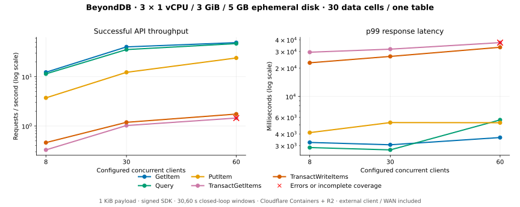

# BeyondDB on Cloudflare Containers and R2

**Measured October 19, 2026:** three database nodes, one table across **30 ordered
data Cells**, ten per node. All 15 measured windows completed with **8,831
successful API calls, zero measured errors and full range coverage**. A separate
60-client transaction-read warmup returned **two `ServiceUnavailable` errors**;
the pressure sweep therefore exited unsuccessfully. Transaction latency is high
and this run does not qualify production capacity or a latency SLO.

| Deployment | Recorded setting |
| --- | --- |
| Each database node | **1 vCPU / 3072 MiB memory / 5000 MB ephemeral disk**, confirmed through Cloudflare's instance API |
| Locations during measurement | Node 1: `sea01`; node 2: `sjc08`; node 3: `lax09`; western North America, across metros |
| Table placement | 30 ordered ranges; balancing paused; authoritative ownership verified before and after both sweeps |
| Other Cells | Account, credentials, directory, inventory and transaction coordinators share the same budgets; end of measurement: **852 total owned Cells** |
| Durability | Dedicated R2 bucket; direct S3 API; acknowledgement waits for bucket publication; follower durability disabled |
| Executable | Unchanged release source `57bec2e`; Cellar `=0.1.0`; committed ExtendDB revision and lockfile |
| Runtime transport | Public HTTPS Worker → Container → loopback ExtendDB; authenticated WSS bridge carries native Cellar peer bytes |
| Client | External workstation; WAN, signing, authorization, Worker ingress, routing and durability included |

Cloudflare's custom instances require at least **3 GiB per vCPU**. The memory
allocation above is 3 GiB, rather than 3 decimal GB. Guest CPU count and
`MemTotal` include platform details and are not the allocation proof. See the
[platform limits](https://developers.cloudflare.com/containers/platform/limits/).

## Throughput and response latency

Each API runs in its own closed-loop window. The reference sweep uses eight
clients and 60 seconds per window; the pressure sweep uses 30 then 60 clients
and 30 seconds per window. Each has five seconds of separate warmup. Actual
elapsed time includes in-flight completion drain.

| Workload | Request contents |
| --- | --- |
| `GetItem` | One existing item, strongly consistent |
| `Query` | One PK with numeric SK `BETWEEN 1 AND 2`, two returned items, strongly consistent |
| `PutItem` | One new item |
| `TransactGetItems` | Two existing items in different data Cells and nodes |
| `TransactWriteItems` | Two new items in different data Cells and nodes; fresh client token |

Payloads contain a uniform 1-KiB value. Traffic rotates across every range and all
three ingress nodes. SDK retries and authorization caching are disabled. There
are no intentional key conflicts, hot keys, secondary indexes, TTL or Streams.



| API | 8 clients: req/s | 30 clients: req/s | 60 clients: req/s |
| --- | ---: | ---: | ---: |
| GetItem | 12.279 | 40.142 | 48.973 |
| Query | 11.402 | 35.395 | 46.810 |
| PutItem | 3.720 | 12.246 | 23.937 |
| TransactGetItems | 0.328 | 1.023 | 1.450 |
| TransactWriteItems | 0.461 | 1.188 | 1.746 |

At **60 clients**, the successful-call latency distribution was:

| API | p50 ms | p95 ms | p99 ms | Successful samples | Measured errors | Separate warmup errors |
| --- | ---: | ---: | ---: | ---: | ---: | ---: |
| GetItem | 1032.634 | 3094.719 | 3664.695 | 1,515 | 0 | 0 |
| Query | 725.847 | 3969.660 | 5638.317 | 1,486 | 0 | 0 |
| PutItem | 2269.819 | 3923.116 | 5264.701 | 779 | 0 | 0 |
| TransactGetItems | 29141.885 | 35150.918 | 37312.382 | 90 | 0 | 2 |
| TransactWriteItems | 26464.494 | 32634.609 | 33301.932 | 102 | 0 | 0 |

Requests/s counts API calls. Two-item Query and transaction item rates are twice
their request rates. Percentiles use nearest rank over successful calls only.
Every transaction window, every PutItem window and all eight-client windows
have fewer than 1,000 successful samples: their p99 estimates are weak. The
[reviewed CSV](data/cloudflare-benchmark.csv) retains every window's counts,
elapsed time, errors, coverage and percentiles.

These results show that adding clients increases throughput while response
latency remains substantial. They do not isolate the cause. The deployment
includes cross-metro peers, the WSS adapter, R2 and shared metadata paths; phase
tracing and controlled comparisons are needed to attribute their costs. The
earlier [local benchmark](local-benchmark.md) uses different infrastructure and
does not provide an equivalent baseline.

## Resource and durability observations

| Node | Owned Cells at end of measurement | Peak sampled server RSS MiB | Maximum sampled disk use GB | Peak sampled open FDs |
| --- | ---: | ---: | ---: | ---: |
| 1 | 372 | 468.4 | 0.524 | 3,492 |
| 2 | 237 | 717.9 | 0.548 | 2,275 |
| 3 | 243 | 581.0 | 0.490 | 2,325 |

Samples were collected approximately every five seconds. These are observed
values rather than hard peaks; server RSS excludes Python, the guest and other
platform memory. Disk observations include the image/runtime and retained setup
history. All nodes used a verified `nofile=65536:65536`. Guest cgroup CPU/I/O
counters were retained; root CPU/memory limit files were unavailable.

R2 preflight verified conditional creation, conditional replacement, rejection
of stale conditions and read-back. After the six write windows, **180 acknowledged
values** were read back consistently: one per data range per write window.
This samples successful writes rather than proving every written item or every
transaction recovery boundary.

### Operator-assisted cold recovery

All three Containers were observed stopped before any restart. Startup omitted
bootstrap and reused the same binary, image, keys and R2 roots. Cloudflare starts
stopped Containers from a [fresh ephemeral disk](https://developers.cloudflare.com/containers/concepts/architecture/#use-snapshots);
no filesystem snapshot or retained local data volume was restored.

| Observation | Result |
| --- | --- |
| All Containers stopped | `17:31:02 UTC` |
| Initial signed-readiness guard | Node 1 exceeded **300 seconds**; peers were started during this initial wait |
| Recovery discovery | **531 registered coordinator shards**; startup's recovery pass precedes public serving |
| Operator assistance | Six concurrent native **read-only pending-boundary queries** prefetched all 531 existing coordinator Cells; all final queries succeeded; 19 intermediate stale-route responses were retained while selecting the serving owner |
| All three signed endpoints ready | `17:45:40 UTC` |
| Consistent original-value checks | **210/210 passed**: 180 acknowledged write witnesses plus 30 seed values |
| Post-recovery table ownership | **30 unique resident data Cells**, ten per node; same three locations and verified resource allocation |

The prefetch ran from `17:41:50` to `17:45:32 UTC`. It did not skip the startup
recovery pass, alter authority records or resubmit mutations. The failed initial
probe, routing responses, initial timeout, prefetch script and read-back results
remain in the private artifacts. These timings include staggered starts and
operator assistance; **unattended recovery time remains unqualified**. The result
establishes sampled recovery of user values from R2 for this experiment, rather
than every crash, owner-loss or transaction-atomicity boundary.

## Retained setup failures

The initial setup was not clean. All failed attempts and the exact measured
harness remain in the private local run directory.

| Observation | Handling and evidence boundary |
| --- | --- |
| HTTPS forwarded to a plaintext internal port; WebSocket binary messages arrived as `Blob` | Fixed the deployment adapter's scheme and binary conversion before measurement; native protocol bytes remain unchanged |
| Restart attempted bootstrap over an existing credential | Bootstrap became explicit and first-start-only; existing identity was retained |
| Native process exhausted file descriptors | Raised and verified soft/hard limits to 65,536; retained the original failure logs; the old hard limit was not directly observed |
| Node 2 self-fenced during setup after ambiguous/unconfirmed R2 node-lease renewals | Retained its log and restarted normally; the underlying cause is unisolated; lease deadlines and fencing were unchanged |
| `CreateTable` exceeded the client's 45-second timeout | Observed the original generation becoming `ACTIVE`; no duplicate creation submission; verified empty ranges before seeding 240 acknowledged items |
| Earlier restored ownership was 19/1/10 | Verified the earlier task-created table was empty and retired it with normal `DeleteTable`; created the measured generation with controlled 10/10/10 placement; retained earlier roots/history |
| Two transaction-read warmup 503s at 60 clients | Kept both errors; no retry or durability/admission change; the pressure sweep exits nonzero |
| Cold signed readiness exceeded the five-minute observation guard | Retained the timeout; all peers eventually became ready with read-only operator prefetch; recovery checks passed without weakening runtime gates |

No runtime authority, lease or SQLite records were edited. A timeout after
submission does not establish that a mutation failed to execute. Recovery and
diagnostics must retain that distinction.

## Reproduce and inspect

Use the [deployment runbook](../deploy/cloudflare/README.md) for protected
credentials, image deployment, readiness, controlled placement, measurement,
reporting and shutdown. This fixture creates billable resources. Keep its keys
and retained data together; do not rerun provisioning over an existing directory.

The measured sweeps used:

```sh
"$CF_PERF_PY" scripts/perf/cloudflare.py measure \
  --run-dir "$CF_PERF_RUN" --label reference \
  --clients 8 --seconds 60 --warmup 5 \
  --operations get query put transact_get transact_write

"$CF_PERF_PY" scripts/perf/cloudflare.py measure \
  --run-dir "$CF_PERF_RUN" --label pressure \
  --clients 30 60 --seconds 30 --warmup 5 \
  --operations get query put transact_get transact_write
```

| Reproducibility field | Recorded value |
| --- | --- |
| Full source revision | `57bec2e52fb02697ad7c3744afdd82cb77c450f0` |
| Binary SHA-256 | `cb7cb9817b85e386baa33bb8fe056c1dc7f0f79646134047b0f94640be44220c` |
| Cargo.lock SHA-256 | `acb3beb63e18043d10855a2ff6835a910c40978a3ba4f952d420be9b989a9f98` |
| Measured image digest | `sha256:3f839c02ce2c9e794e3cd2f5206d72046ce7e38ee8212c43deb8adcc0fc2d2a1` |
| Build | Rust 1.98.1; cargo-zigbuild 0.23.4; Zig 0.14.1; LLVM ar/ranlib; `x86_64-unknown-linux-gnu.2.36` |
| Client read timeout | 45 seconds; SDK retry count zero |
| Local retained evidence | `benchmarks/2026-10-19-cloudflare-benchmark/` |

Raw artifacts include all successful latency samples, failures, warmup files,
before/after authoritative inventories, resource samples, logs, deployment
fingerprints and the exact measured harness. They remain ignored and private.
Failed/incomplete windows must remain in reports. A closed-loop test has no
coordinated-omission correction and does not establish an arrival-rate SLO,
automatic-balancing performance or unattended recovery qualification.
