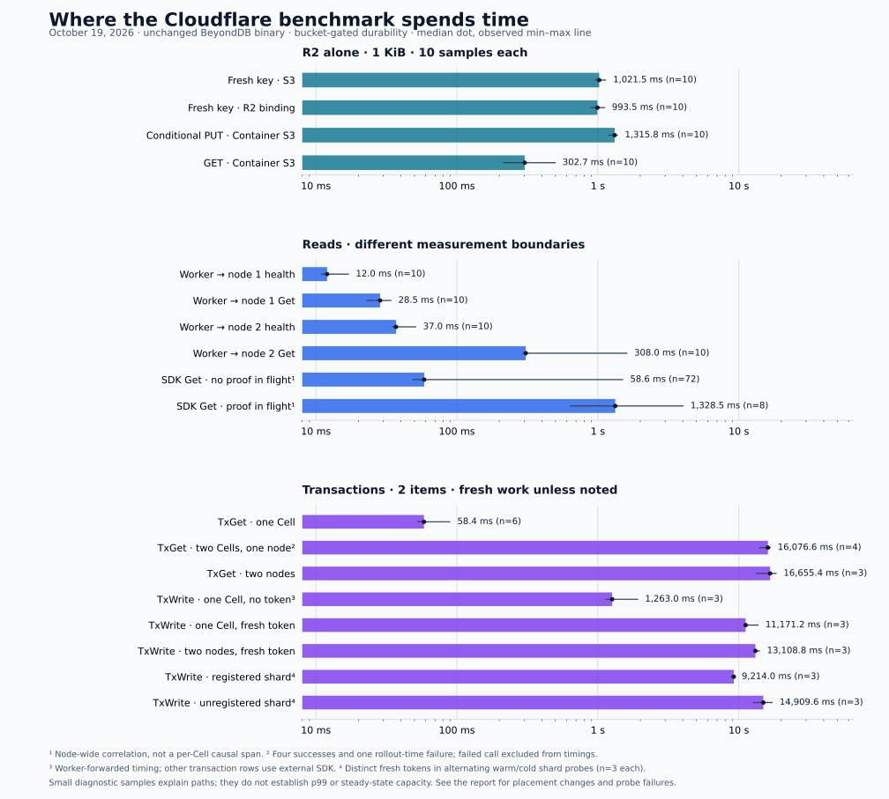

# Cloudflare API bottleneck investigation

**October 19, 2026:** the live three-node deployment spends most write and
transaction time waiting for durable storage. Ordinary reads also pay for
uncached metadata calls, remote account access and intermittent background-write
contention. CPU allocation and the number of data Cells do not explain these
latencies by themselves.

This follows the [original Cloudflare benchmark](cloudflare-benchmark.md).
The database executable, Cellar `=0.1.0`, ExtendDB revision, authentication and
bucket-gated acknowledgement settings stayed unchanged. Temporary private probes
were removed after measurement. These are diagnostic samples, not a new capacity
qualification.

## Findings by API

| API | Measured evidence | Bottleneck and confidence |
| --- | --- | --- |
| `GetItem` | Worker-forwarded median **28.5 ms** through node 1; **308 ms** through node 2, ten samples each | Several uncached credential, policy, catalog and directory calls; remote shared metadata adds serial peer round trips. Source-confirmed path; no per-stage timing yet |
| `Query` | Same boundary: **33.5 / 300 / 349.5 ms** through nodes 1 / 2 / 3 | Same metadata path as Get; result contains only two items. Node 3's original target range had moved after restart |
| `PutItem` | Sequential SDK medians **1.66–1.86 s**, five samples per ingress/owner combination | LTX upload must reach R2, then ownership must be verified before acknowledgement. Direct fresh-object R2 PUT alone takes about **1 s** |
| `TransactGetItems` | Two items in one Cell: **58 ms**; two Cells on one node: **16.08 s**; two nodes: **16.66 s** | Multi-Cell reads use durable coordination, saved snapshots and durable release bookkeeping. The single-Cell path is a query |
| `TransactWriteItems` | Fresh token: **11.17 s** in one Cell; **12.77 s** in two Cells on one node; **13.11 s** across nodes | Token-bearing writes use global coordination even with one participant. Serial durable phases multiply storage latency |

Transaction groups have three successes each, except single-Cell reads (six) and
two-Cell, same-node reads (four successes, **one failed call during diagnostic
rollouts**). Failed calls are excluded from latency summaries and retained in
[the aggregate CSV](data/cloudflare-diagnostics.csv). Do not infer p99 from these
small samples or compare different timing boundaries as a controlled speedup.



## R2 is on the acknowledgement path

The storage probes bypassed BeyondDB entirely. Each group contains ten successful
1-KiB operations, with no observed object-operation errors.

| Origin and access path | Operation | Median ms | Observed min–max ms |
| --- | --- | ---: | ---: |
| Worker, YVR; signed S3 | PUT to a fresh unique object | 1021.5 | 962–1135 |
| Worker, YVR; native R2 binding | PUT to a fresh unique object | 993.5 | 890–1114 |
| Container, LAX; signed S3, persistent connection | Conditional PUT, same object | 1315.8 | 1198.8–1375.8 |
| Container, LAX; signed S3, persistent connection | GET | 302.7 | 215.6–497.1 |
| Worker, YVR; signed S3 | Unconditional / conditional PUT, same object | 1410.5 / 1405.0 | 1113–1492 / 1329–1761 |
| Worker, YVR; native R2 binding | Unconditional / conditional PUT, same object | 1245.0 / 1251.0 | 1019–1509 / 1161–1563 |

A native binding still showed the approximately one-second fresh-object PUT
latency. Replacing the S3 adapter alone therefore has no demonstrated way to
remove that cost. Bucket metadata reports **WNAM**, Standard storage and default
jurisdiction. The underlying provider/network reason for these timings remains
unisolated; this is evidence about this bucket and deployment, not an R2-wide
latency claim.

Cloudflare documents a same-key concurrent-write limit of one per second and
HTTP 429 when exceeded. Fresh unique keys avoid repeated-key contention, and no
429 appeared in these probes. See the [R2 limits](https://developers.cloudflare.com/r2/platform/limits/)
and [binding API](https://developers.cloudflare.com/r2/api/workers/workers-api-reference/).

The source-confirmed foreground path is:

```text
Cell SQLite commit
  → capture WAL as LTX
  → upload LTX object to R2
  → satisfy bucket durability proof
  → read ownership record and verify node / lineage / epoch
  → acknowledge command
```

The ownership GET prevents acknowledging writes in an orphaned epoch. Removing
it or acknowledging before upload would change the failure contract.
Independent probe medians cannot be added to reconstruct an exact request span.

Native `/state` snapshots independently support the storage finding:

| Node | Completed bucket proofs | Fleet proofs | Proof errors | Mean proof ms | Maximum proof ms |
| --- | ---: | ---: | ---: | ---: | ---: |
| 1 | 860 | 0 | 0 | 1157.0 | 7038.1 |
| 2 | 53 | 0 | 0 | 1131.0 | 2902.9 |

These are node-lifetime adapter counters, including background work, not
per-request spans. They measure the durability wait before the separate
ownership verification. Node 3's counters reset on restart and had no completed
proofs in that snapshot; zero is not a latency measurement.

**The default two-second flush interval is not the cause in this configuration.**
Cellar paces uploads only with an active follower shipper. With follower durability
disabled here, the shipper is not registered and uploads run immediately. Changing
`CELLAR_LOG_FLUSH_MS` is not a supported fix for this embedded path.

Dependency source: Cellar 0.1.0's [output gate and ownership verification](https://docs.rs/crate/cellar-main/0.1.0/source/actor/mod.rs),
[upload scheduling](https://docs.rs/crate/cellar-main/0.1.0/source/durability/replication/backend.rs)
and [LTX object writes](https://docs.rs/crate/cellar-ltx/0.1.0/source/src/client/object_store.rs).

## Reads repeat metadata work and sometimes wait behind writes

Health checks establish that forwarding alone is much cheaper than the slow
read path:

| Measurement boundary | Health median ms | Get median ms | Successful samples per operation |
| --- | ---: | ---: | ---: |
| Worker YVR → node 1 | 12 | 28.5 | 10 |
| Worker YVR → node 2 | 37 | 308 | 10 |
| Inside node 3 → native loopback | 0.242 | 324.2 | 10 |

The loopback read still traverses remote metadata and, after the diagnostic
restart, a remote data owner. It excludes public ingress and the external client.
The node-2 test targets its local data range; local data placement does not remove
remote credential/account/directory work.

| Read-path work | Source |
| --- | --- |
| Inventory membership and credential query on every lookup | [Credential reader](../src/credentials.rs) |
| Policy and permission-boundary reads in the account Cell | [Authorization](../src/authorization.rs) |
| Table description and active route lookup | [Storage adapter](../src/backend.rs) |
| Directory anchor and leaf reads; further route lookup for data access | [Routing](../src/routing.rs), [routed data path](../src/backend/data/routed.rs) |
| Pass-through metadata providers and disabled route cache in this deployment | [Server wiring](../src/cellar/server.rs) |

Some directory work repeats within a request. Exact RPC counts and stage timings
were not instrumented, so there is no claimed numerical budget for each row.

An 80-call sequential node-1 Get probe, with no user write load, also found:

| Native proof pending before Get? | Successful reads | Median ms | Maximum ms |
| --- | ---: | ---: | ---: |
| No | 72 | 58.6 | 1499.4 |
| Yes | 8 | 1328.5 | 4016.6 |

All nine reads over 500 ms overlapped a completed bucket proof. These node-wide
counters show correlation, not the exact Cell or task causing each stall.
Background writes are a strong candidate: every node starts a 250-ms statistics
sampling loop over the same account; a completed sweep durably publishes to the
shared account Cell. Recovery and other maintenance also run. A sampling tick is
**not** one publication every 250 ms. See [statistics](../src/backend/statistics.rs)
and [maintenance wiring](../src/cellar/server.rs).

Admission can amplify stalls under load: the frontend gateway admits eight
in-flight Cell calls per target, and the native runtime limit is sixteen per
Cell. Pure queries have bounded backpressure retries. Their contribution to the
observed tail has not been separated from durability or metadata latency.

## Transactions multiply durable waits

Single-Cell reads use an atomic Cell query. Multi-Cell reads enter the coordinator
protocol and must retain saved images through result delivery and release.
Token-bearing transaction writes also use that coordinator, including when all
items belong to one Cell.

| Phase | Why it exists |
| --- | --- |
| Register/activate coordinator when needed; durable BEGIN | Establish discoverable transaction identity and participants |
| Prepare participants, concurrently where supported | Reserve state and establish the snapshot/write set |
| Persist coordinator decision | Recover one decision after driver/owner failure |
| Resolve participants and record receipts | Apply/release idempotently and preserve recovery progress |
| Transaction reads: retrieve saved images and durably record their release | Return the committed snapshot and safely reclaim it |

This is a protocol outline, not one R2 PUT per row. Commands may coalesce and
participants run concurrently, but sequential phase boundaries still wait on
bucket proofs. See [admission](../src/backend/admission.rs),
[transaction driver](../src/backend/transaction.rs),
[read completion](../src/backend/transaction_read.rs) and
[local paths](../src/backend/data.rs).

Two additional probes explain important benchmark behavior:

| Probe | Median | Samples | Interpretation |
| --- | ---: | ---: | --- |
| One-Cell TxWrite without a client token | 1.263 s | 3 successes | Uses local fast path; Worker-forwarded boundary |
| One-Cell TxWrite with a fresh client token | 11.171 s | 3 successes | Uses global coordinator; external SDK boundary |
| Two-node TxWrite, fresh distinct tokens mapped to an already registered coordinator shard | 9.214 s | 3 successes | Warm coordinator; new items and new logical transactions |
| Two-node TxWrite, fresh distinct tokens mapped to unregistered shards | 14.910 s | 3 successes | First-touch registration/activation and placement included |
| Exact same-token/payload TxWrite replays | 60–66 ms, group medians | 3 successes per placement group | Returns the saved outcome; not new-write throughput |

The local write fast path explicitly requires `token.is_none()`. Removing tokens
would discard the benchmark's idempotency contract. The warm/cold comparison used
alternating cases with distinct tokens; it is not replay. Three pairs establish a
first-touch penalty in this sample, not an isolated stage cost. The namespace has
4096 coordinator shards; 531 were registered by the original run, so short fresh-token
runs repeatedly encounter new coordinator Cells.

## Throughput interpretation and next changes

The original 60-client medians were **1.03 s Get, 2.27 s Put, 29.14 s TxGet and
26.46 s TxWrite**. Lower-concurrency probes above remain slow for writes and
transactions, so client queueing alone is not the cause. Higher concurrency adds
admission, shared metadata and durability contention.

Average guest CPU usage during the original 60-client windows was:

| Workload | Node 1 cores | Node 2 cores | Node 3 cores |
| --- | ---: | ---: | ---: |
| Get | 0.732 | 0.561 | 0.538 |
| Put | 0.478 | 0.362 | 0.361 |
| TxGet | 0.331 | 0.353 | 0.331 |
| TxWrite | 0.366 | 0.382 | 0.355 |

These are `cpu.stat` usage deltas divided by actual snapshot elapsed time.
Averages do not rule out bursts, locks or individual task saturation, but extra
CPU alone cannot remove the measured storage waits. More data Cells also do not
remove shared metadata calls or transaction phase barriers. Group commit can
amortize object writes across operations and improve throughput; it does not
remove the bucket round trip from an individual acknowledgement.

The 30-second transaction windows drain outstanding requests before computing
throughput: the 60-client TxGet window actually elapsed **62.05 s** and TxWrite
**58.41 s**. Those rates are completed work over the whole window, not sustained
steady-state capacity. The drain affects the rate estimate; it does not explain
away individual 26–29-second transaction medians.

| Priority | Proposed work | Evidence required before accepting it |
| --- | --- | --- |
| 1 | Add stage spans for metadata RPCs, queue admission, coordinator activation, durability wait and ownership GET; investigate the bucket/network path | Explain per-request latency without logging items, tokens or secrets; retain provider request IDs privately |
| 2 | Reuse validated routing metadata within a request; design cache invalidation and revocation behavior; coalesce statistics and elect one publisher per account | Signed behavior unchanged; generation/epoch validation, revocation and stale-route tests; read-tail comparison under background work |
| 3 | Reduce serial transaction commands/receipt writes where the protocol permits; batch durable work | Lost reply, duplicate prepare, owner-loss and saved-image cleanup gates still pass; no acknowledgement before the required proof |
| 4 | Rebenchmark warm and first-touch coordinators separately, using distinct tokens, longer steady windows and balanced placement | At least 1000 successful transaction samples for useful tail estimates; errors, drain time and per-range coverage reported |

Follower-based acknowledgement would be a separate durability experiment. It
changes what survives simultaneous loss of the ephemeral nodes before bucket
publication; it cannot be presented as an equivalent optimization without an
explicit failure contract and fault qualification. The current native peer
transport reuses pooled connections; it does not create a new tunnel for every
Cell call.

## Experimental limits and final deployment state

- Microprobes use sequential calls and 1-KiB values; groups have 3, 5 or 10
  samples unless stated otherwise. SDK retries were disabled. Min/max are
  observations, not statistical confidence bounds.
- Temporary Worker probe rollouts initially hit unsupported-RPC/404 errors.
  Seven probe-control/health invocations failed without a usable timing sample;
  those failures remain in the CSV. Two CLI SSH attempts failed their handshake.
- Node 3 was restarted normally with the same image and retained R2 state to
  activate the diagnostic code. Startup needed read-only prefetch assistance:
  529 of 531 coordinator queries succeeded, with two failures retained. An earlier
  prefetch attempt ran before the local tunnel was ready and failed to connect.
- One two-Cell transaction read returned Worker 1101 / closed Container port
  during the diagnostic rollouts. The native processes remained alive. Its
  cause is not isolated or attributed to the original steady-state run; its
  request/outcome was retained, not resubmitted under a new identity. The next
  27 transaction probes completed successfully.
- The original benchmark had ten data Cells on each node, verified around both
  sweeps. The diagnostic restart moved three ranges: final authoritative
  placement is **11 / 12 / 7**, all **30 uniquely owned and resident**. Node 3's
  later Get/Query probes target a range now on node 2. No post-restart capacity
  claim assumes the original balanced placement.
- Cleanup restored the repository Worker, removed the temporary R2 binding and
  diagnostic route, and retained the original pinned Container image. All three
  signed endpoints and allocations were checked. **210/210 original values**
  (180 acknowledged-write witnesses plus 30 seeds) and **51/51 additional diagnostic
  write values** were read back successfully. This does not replace
  unattended recovery qualification.

Raw signed-request plans, timings, node snapshots, failed observations and
harness hashes remain in the ignored, private
`benchmarks/2026-10-19-cloudflare-benchmark/diagnosis/` directory. Only reviewed
aggregates and the SVG are committed. The executable remains source revision
`57bec2e52fb02697ad7c3744afdd82cb77c450f0`, binary SHA-256
`cb7cb9817b85e386baa33bb8fe056c1dc7f0f79646134047b0f94640be44220c`.
Reproduce the original workload using the [deployment and benchmark instructions](cloudflare-benchmark.md#reproduce-and-inspect);
repeat diagnostic boundary tests separately rather than combining their medians
into a capacity estimate.
