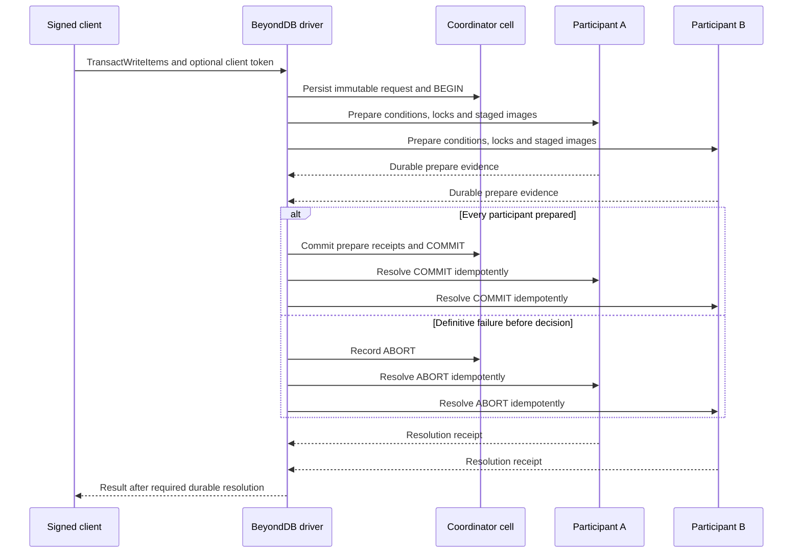

# Cross-cell transactions

BeyondDB groups request keys by participant cell and coordinates them through
durable prepare, decision and resolution records. Conditions are evaluated during
prepare against locked state; a preflight read is not a substitute.

## Write state machine

| State | Durable meaning | Recovery action |
| --- | --- | --- |
| BEGIN | Immutable participants/input admitted; no terminal decision yet | Resume or reject through the coordinator protocol |
| PREPARED participant | Locks, staged images/read images and reservations retained | Consult the durable decision; never invent an outcome from a timeout |
| COMMIT | Immutable logical write decision | Apply participant changes idempotently and retain required receipts |
| ABORT | Immutable rejection/cancellation decision | Discard staged work and release participant resources idempotently |

The normal commit command publishes prepare evidence and the decision together.
Success requires the driver's durable resolution contract; an incomplete receipt
set cannot authorize COMMIT. Small operations proven to have one participant can
use local fast paths. Tokens and larger/saved-image requests may still require
coordination even when the data happens to be local.

## Visibility and transactional reads

Ordinary item reads check prepared intents in the owning cell. If COMMIT is
durable but a participant has not applied, its old image must not be returned as
an unaffected value: resolve/re-read or report a retryable failure.

Cross-cell `TransactGetItems` captures shared locks and saved images. Assemble the
response from those images, not from live rows after releasing locks. A proven
single-participant read can use an atomic local query; oversized replies use the
saved-image path.

Separate GetItem calls can straddle commits. Query, Scan and batch APIs do not
promise a whole-response multi-cell snapshot. GSI projection remains asynchronous
after base transaction resolution.

## Retry and capacity rules

| Observation | What it proves |
| --- | --- |
| Explicit caller-side refusal before SDK submission | That attempt was not started |
| Durable rejected receipt | The recorded rejection for that mutation |
| Complete committed receipt | Result covered by the configured durability gate |
| HTTP error, timeout, lost body or driver cancellation | Outcome may be ambiguous after submission |

Retain the original mutation/client-token identity and request content when
resolving uncertainty. Do not turn a submitted error into a fresh mutation or
assume it rolled back. Token mismatch must reject changed content; retries may
not reroute an existing decision to a different participant set.

Prepare budgets include staged data, index/stream intent and physical apply
reservations. Encoded request size alone does not bound publication or memory
cost. Multipart uploads and replies are bounded separately. Coalescing must
preserve each caller's identity, admission and result; current batching limits
are in [prepare_batch.rs](../src/backend/prepare_batch.rs).

## Owner loss and maintenance

The driver or account maintenance discovers coordinator records and resumes the
original decision. Owner loss does not expire a native lease immediately. A
missing reply or unavailable participant must not prevent healthy decided work
from progressing, nor authorize aborting an existing COMMIT.

Splits and reclamation must retain participant/decision evidence until the
protocol proves it is safe to retire. Do not delete stuck transaction records
or edit locks/reservations as an operational repair.

## Source and evidence

| Boundary | Source / current target |
| --- | --- |
| Driver | [transaction](../src/backend/transaction.rs), [read driver](../src/backend/transaction_read.rs) |
| Durable decision and tokens | [coordinator](../src/transaction_coordinator.rs), [token](../src/transaction_token.rs) |
| Prepare and resolution | [participant](../src/participant.rs), [partition transactions](../src/partition/transaction.rs) |
| Bounded transfer | [transaction transport](../src/transaction_transport.rs) |
| Recovery, replay and capacity cases | [cellar_transactions](../tests/cellar_transactions.rs) |
| Coalescing and lost replies | [cellar_coalescing](../tests/cellar_coalescing.rs) |

Run large fixture targets with `--test-threads=1` on constrained hosts, preserving
their internal concurrency. Focused cases do not establish a general
serializable-history proof or full DynamoDB capacity/error compatibility.
The local benchmark has transaction errors at higher concurrency; see
[performance](performance.md) rather than assuming transaction fleet capacity.
