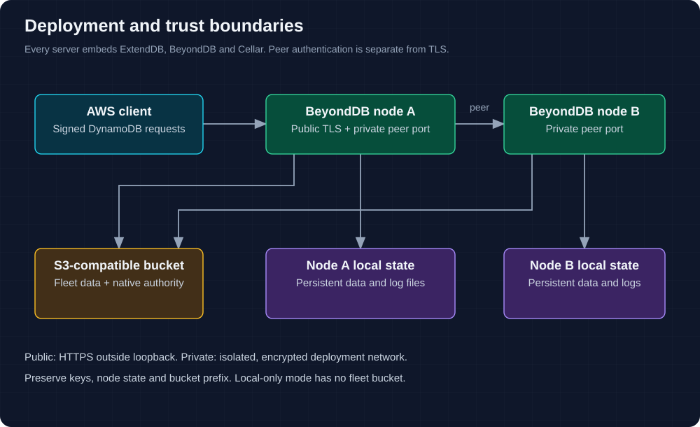

# Deploy BeyondDB

Start with a disposable deployment and qualify your workload against
[API coverage](api.md) and the [operational limits](operations.md). The executable
supports local persistence or an S3-compatible fleet; it does not provide a
qualified backup, upgrade or production availability contract.



## Prepare the deployment

| Resource | Requirement |
| --- | --- |
| Binary | Build the reviewed checkout with Rust 1.97+ and the committed lockfile |
| Node identity | Unique `node_name`, peer address and persistent `data_dir` per running node |
| Public listener | Loopback HTTP, or a certificate/private-key pair and HTTPS for external serving |
| Private network | Isolate the authenticated peer listener; the executable does not configure peer TLS |
| Keys | Two separate 32-byte raw files: shared fleet peer key and stable credential-encryption key |
| Fleet storage | S3-compatible bucket with conditional create/update semantics; a dedicated nonempty prefix |
| Credentials | Server-side object-store credentials are separate from client DynamoDB credentials |

Protect peer traffic with the deployment's private encrypted network. Shared-key
peer authentication is not transport encryption. Do not expose the peer listener
to public clients or forward the internal command gateway through the public API.

## Build and provision

Run from the repository root. On workstations with a mounted Workspace volume,
first choose a checkout-specific `CARGO_TARGET_DIR` as described in
[AGENTS.md](../AGENTS.md).

```sh
cargo build --release --locked --bin beyonddb

umask 077
install -d -m 700 /etc/beyonddb /var/lib/beyonddb
openssl rand -out /etc/beyonddb/peer.key 32
openssl rand -out /etc/beyonddb/encryption.key 32
cp config/cellar.example.json /etc/beyonddb/config.json
```

These paths require a provisioning account with write access. Give the service
account read access to its keys/configuration and ownership of its data directory.
For a local exercise, use paths owned by your current account instead.

Save an operator policy at `/etc/beyonddb/operator-policy.json`. This example
allows table operations only in the example account and region; tailor it to the
actual client workload before exposing the endpoint.

```json
{
  "Version": "2012-10-17",
  "Statement": [
    {
      "Effect": "Allow",
      "Action": "dynamodb:*",
      "Resource": "arn:aws:dynamodb:us-east-1:123456789012:table/*"
    },
    {
      "Effect": "Allow",
      "Action": "dynamodb:ListTables",
      "Resource": "*"
    }
  ]
}
```

Set a real `bootstrap.access_key_id`, confirm `bootstrap.account_id` is in
`accounts`, and check all paths in the copied configuration. Leave `fleet` absent
for local persistence. For a fleet, merge this object into the configuration:

```json
{
  "fleet": {
    "bucket": "my-beyonddb-bucket",
    "prefix": "beyonddb/ordered-v1",
    "follower_durability": false
  }
}
```

Create the bucket first and provide its authorized credentials through the server
process environment. `fleet.endpoint` optionally selects an S3-compatible
endpoint; HTTP endpoints are for isolated local fixtures. Preserve the prefix,
keys and retained node data. Do not reuse a prefix from another deployment or an
incompatible runtime format. See [server reference](cellar-server.md#configuration).

| Server environment variable | Use |
| --- | --- |
| `AWS_ACCESS_KEY_ID`, `AWS_SECRET_ACCESS_KEY` | Object-store access identity, when using static environment credentials |
| `AWS_SESSION_TOKEN` | Token when the object-store credentials require one |

Keep these in the service's secret environment. Client shells use the separately
bootstrapped DynamoDB key; changing client credentials must not change the
server's object-store identity.

## Local object-store fixture

Use a disposable local store to exercise fleet mode before configuring a remote
provider. This fixture is not a production storage or backup recommendation.
Its port avoids the default private peer listener on 9000.

```sh
docker run --detach --name beyonddb-docs-store \
  --publish 127.0.0.1:19100:9000 \
  --env RUSTFS_ACCESS_KEY=localdocs \
  --env RUSTFS_SECRET_KEY=local-docs-store-secret \
  --env RUSTFS_CONSOLE_ENABLE=false \
  --volume beyonddb-docs-objects:/data \
  ghcr.io/rustfs/rustfs:1.0.0-glibc@sha256:bffcab0c9d647aab0055d1c69d340b202d0909966b385932d4ead1aeb7602858

export AWS_ACCESS_KEY_ID=localdocs
export AWS_SECRET_ACCESS_KEY=local-docs-store-secret
export AWS_DEFAULT_REGION=us-east-1
aws --endpoint-url http://127.0.0.1:19100 s3api create-bucket \
  --bucket beyonddb-docs
```

Wait for the store to accept S3 requests before creating the bucket. Use these
credentials in the **server** environment; keep the DynamoDB client shell
separate. Configure `fleet.bucket` as `beyonddb-docs`, `fleet.endpoint` as
`http://127.0.0.1:19100`, and a fresh dedicated prefix. The named volume preserves
objects across container restart. Do not delete it while retained experiments
or acknowledged state depend on it. A new test deployment needs its own namespace.

Record storage type and mounts with measurements: a VM-native volume and a
host-shared filesystem can have different publication latency. That local
observation is not evidence of production capacity or storage correctness.

## Bootstrap and start

In Bash, read the first DynamoDB secret without adding it to shell history:

```bash
read -r -s -p 'Bootstrap secret: ' BOOTSTRAP_SECRET
printf '\n'
printf '%s' "$BOOTSTRAP_SECRET" | \
  "${CARGO_TARGET_DIR:-target}/release/beyonddb" /etc/beyonddb/config.json --bootstrap
unset BOOTSTRAP_SECRET
```

Bootstrap persists the encrypted credential and inline policy, then serves in the
foreground. It is initial provisioning, not a credential rotation workflow.
Subsequent starts omit `--bootstrap`:

```sh
"${CARGO_TARGET_DIR:-target}/release/beyonddb" /etc/beyonddb/config.json
curl --fail http://127.0.0.1:8000/health
```

The health example assumes the default loopback HTTP configuration and runs from
another terminal. Follow it with a signed `ListTables` and a write/read check;
a healthy listener does not establish table durability or fleet capacity.

## Expose HTTPS and add nodes

Set both `public_certificate` and `public_private_key` to PEM files, change
`public_bind` to the intended address and set `public_endpoint` to the matching
`https://` URL. Use a certificate trusted by clients. The server rejects external
plaintext HTTP and a TLS/endpoint scheme mismatch.

Merge these fields into the node configuration after provisioning the certificate:

```json
{
  "public_bind": "0.0.0.0:8000",
  "public_endpoint": "https://ddb.example.com:8000",
  "public_certificate": "/etc/beyonddb/public.crt",
  "public_private_key": "/etc/beyonddb/public.key"
}
```

For each peer, use the same bucket, deployment prefix, region, peer key and
credential-encryption key. Assign a unique node name, persistent local directory,
and reachable `peer_advertise` address (`HOST:PORT`). Configure maintained accounts
on the serving nodes. Do not independently re-bootstrap a shared credential on
every node. Cellar owns discovery and physical balancing; adding a process does
not guarantee immediate movement or an even workload.

Use a supervisor that sends SIGTERM and waits for process exit. `preserve` drains
and retains same-node reload state; `handoff` requires a fleet with an eligible
live peer. Do not delete the data directory as a shutdown step. Check exit status
and logs before restarting; see [operations](operations.md#shutdown-and-replacement).

## Before relying on a deployment

Qualify the exact binary, storage service, filesystem, failure domains and client
workload. Exercise owner loss, ambiguous mutations, capacity limits and restore
from retained state. Backups/PITR, supported in-place upgrades and bounded fleet
recovery are still open gates; a copied live data directory is not a table backup.
Use [implementation status](implementation-status.md) to select current tests.

## State and credential retention

| State | Who uses it | Retain or replace deliberately |
| --- | --- | --- |
| Object-store credentials | Server S3 clients | Equivalent authorized credentials may replace them; keep the prefix accessible |
| Encryption key | Credential cells | Required to decrypt existing access secrets; not a database-wide SSE setting |
| Shared peer key | Native authenticated transport | Every participating node must agree; key rotation requires a qualified transition |
| DynamoDB access key/secret | Signed client | Retain until credential rotation or revocation is implemented and exercised |
| Node directory | Cellar local state and logs | Preserve across same-node reload and while native recovery needs retained logs |
| Bucket prefix | Fleet authority and published recovery state | Dedicated to one compatible deployment; arbitrary lifecycle deletion is unsafe |

## Verify startup and recovery

A healthy listener is only one part of the original acceptance path. Check the
signed endpoint, correct generation and durable result, then exercise restart:

1. Create a disposable multi-range table and wait for ACTIVE.
2. Write a unique value using a condition; read it consistently.
3. Stop with SIGTERM, wait for a successful drain, restart without bootstrap and
   read that value and metadata again.
4. For fleet qualification, use the registered process fixtures to remove a failed
   owner's local state and recover under a native lease fence. Do not improvise
   authority edits or delete a live node directory.
5. Repeat the relevant transaction/index/Streams cases and record failures and
   the exact binary/storage/configuration. A local restart is not machine-loss proof.

[Implementation status](implementation-status.md) retains detailed fault evidence,
current target commands and the distinction between historical and current runs.
