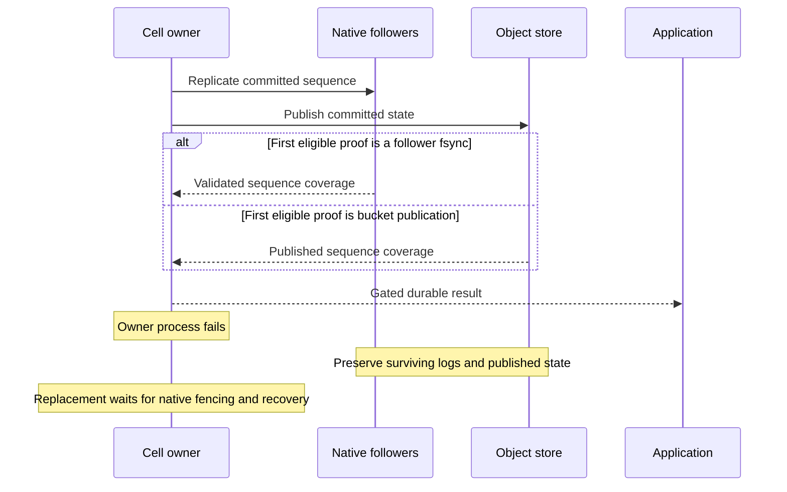

# Native follower durability

Fleet mode waits for bucket-publication proof by default. Enable this option only
with qualified peer/storage failure handling:

```json
{
  "fleet": {
    "bucket": "my-beyonddb-bucket",
    "prefix": "beyonddb/ordered-v1",
    "follower_durability": true
  }
}
```

With the option enabled, native follower fsync proof may race bucket publication.
The SDK chooses and maintains its ensemble; the flag is not an operator-selected
quorum or a guarantee of independent failure domains. Bucket fallback remains
available when follower proof cannot be established.

## Acknowledgement and recovery



Retain each node's data directory and surviving follower logs. An owner process
kill does not immediately expire its authority. When a generation may have
acknowledged untiered writes, Cellar validates/seals its retained log before
certifying recovery. Do not delete follower state to speed takeover.

## Verified process boundary

The registered case
[acknowledged_untiered_item_survives_owner_process_kill](../tests/server_binary/follower_durability.rs)
uses three real executables and a publication-blocking S3 proxy. It tests
acknowledged mutation recovery on a fresh owner after the old owner's process
and local files are removed, with surviving followers and a native lease fence.
It checks item/deletion state, replay and stream effects.

```sh
cargo test --locked --test cellar_process acknowledged_untiered_item_survives_owner_process_kill -- --ignored --nocapture
```

Docker, OpenSSL and AWS CLI are required. This case does not qualify simultaneous
witness loss, independent-host partitions, slow-disk admission, sustained capacity
or all cross-cell fault histories. Run it for the exact deployment binary and
retain its result. See [operations](operations.md#shutdown-and-replacement).
