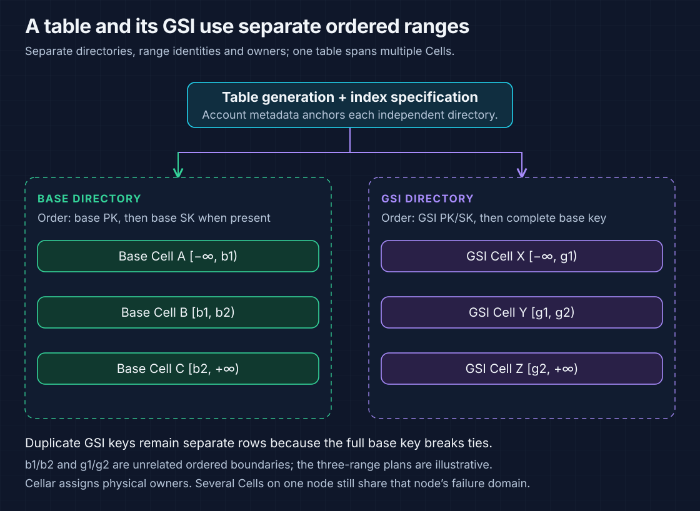
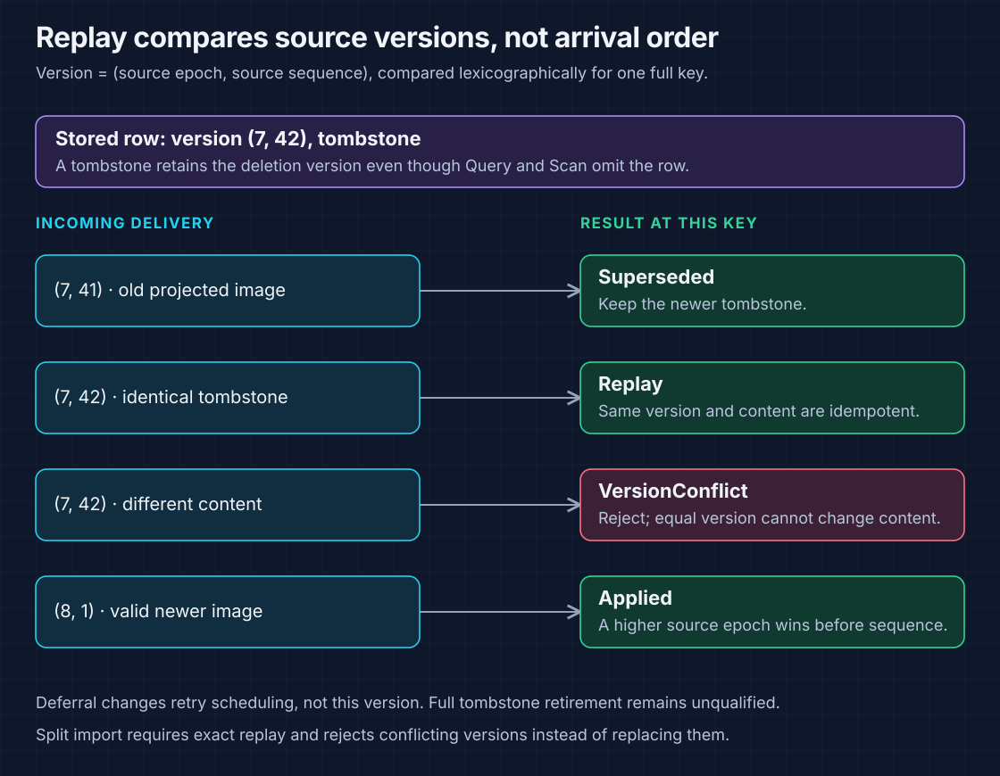
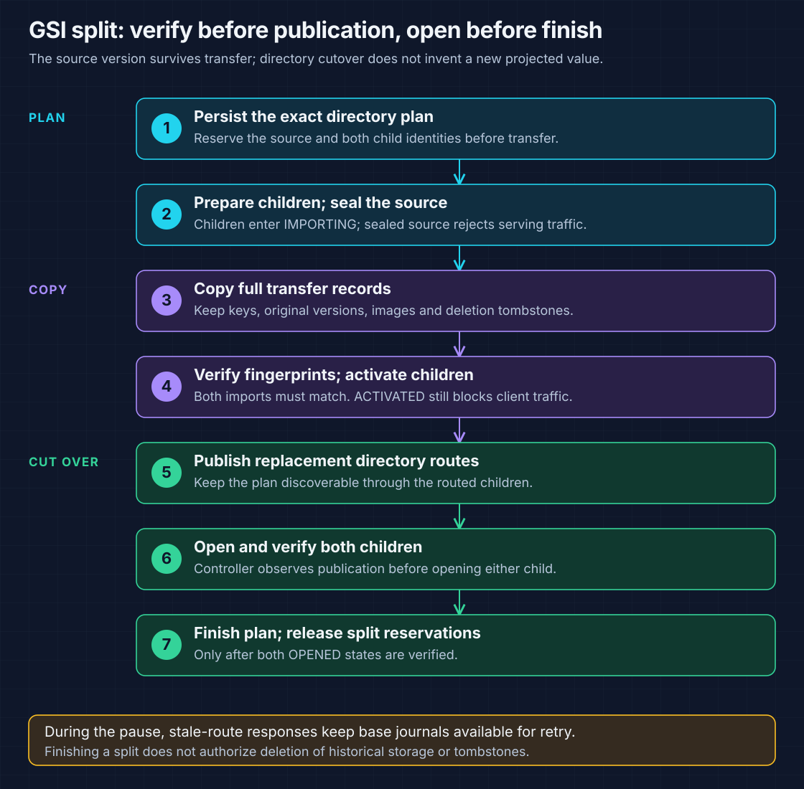

# Global secondary indexes

A GSI is a separately routed, asynchronously maintained view of a base table.
The base command durably records what to project; a worker delivers versioned
changes to the index Cells. A successful base write can precede its index view.

| I need to… | Start here |
| --- | --- |
| Choose a projection and understand placement | [Current Cellar reference](#current-cellar-reference) |
| Follow write acknowledgement and index delivery | [Projection delivery](#projection-delivery) |
| Understand duplicate delivery and deletion replay | [Versions and tombstones](#versions-and-tombstones) |
| Follow a split or owner replacement | [Split and recovery reference](#split-and-recovery-reference) |
| Create and query an indexed table | [Request examples](#request-examples) |
| Inspect original reasoning, faults and measurements | [Detailed design and recorded evidence](#detailed-design-and-recorded-evidence) |

## Current Cellar reference

Creation-time GSIs use independent **ordered ranges**, directories and Cell
identities. The full base primary key breaks ties between duplicate GSI keys.
The range count and physical owners can differ from the base table's plan.



| Feature | Current boundary |
| --- | --- |
| GSI specified in `CreateTable` | Install independent index ranges before publishing the base route |
| `ALL`, `KEYS_ONLY`, `INCLUDE` | Store the selected projection in the index Cell |
| Query and Scan | Read projected index rows; do not fetch unprojected base attributes |
| Query ordering | Index PK equality and optional SK predicates, forward/reverse pagination, with full base-key tie breakers |
| Continuation | Pass the returned `LastEvaluatedKey` unchanged; it contains the union of base and index keys |
| Missing GSI key attributes | Sparse item: no projected entry for that index |
| Strongly consistent GSI reads | Rejected by the pinned frontend |
| `ALL_ATTRIBUTES` on a partial projection | Rejected; choose projected attributes |
| Online GSI create/delete/update | Rejected by `UpdateTable`; internal backfill primitives do not establish a supported public lifecycle |
| Base transaction followed by index reads | Eventual projection; no atomic cross-index or base/index read view |

### What each projection contains

Assume a base key `order_id`, index keys `status`/`created_at`, and non-key
attributes `total` and `internal_note`.

| Projection | Stored attributes | Unavailable through that index |
| --- | --- | --- |
| `KEYS_ONLY` | Base key + index keys | `total`, `internal_note` |
| `INCLUDE` with `NonKeyAttributes: ["total"]` | Base key + index keys + `total` | `internal_note` |
| `ALL` | Complete projected item | No additional base fetch is needed |

The current GSI route key orders `(index PK, index SK, complete base key)`;
omit absent sort-key components. DynamoDB JSON names those logical key roles
`HASH` and `RANGE`; those API names do **not** select physical hash routing.
See [ordered keys](ordered-cell-partitioning.md#primary-key-bytes) and
[the encoding](../src/partition/key.rs).

## Projection delivery



| Base operation | Projection effect in the same base command |
| --- | --- |
| Put / Update / Delete | Record immutable old/new images when at least one projection changes |
| Transaction PREPARE | Reserve journal/apply capacity; emit no projection entry yet |
| Transaction COMMIT resolution | Emit projection entries while applying staged base images |
| Transaction ABORT | Discard staged images; emit no projection entry |
| Split-copy import | Copy existing state; do not create a new user change or projection intent |
| No projected value changes | No journal work |

A journal entry holds the table/index generation snapshot, old/new images and
immutable source version. The entry is shared across the table's indexes.
The source removes it only after every required mutation for the live index
generations has a durable `Applied`, `Replay` or `Superseded` result.

| Change to one index | Delivery order |
| --- | --- |
| New projected item | Write the new entry |
| Same index key, changed projected attributes | Replace the projected image |
| Index key changes | Tombstone the old entry, then write the new entry |
| Item deleted or becomes sparse | Tombstone the old entry |
| This index's projection is unchanged | Skip its mutation |

### When an index is unavailable

| Observation | Worker action | Source journal |
| --- | --- | --- |
| One index fails | Continue attempts to other healthy indexes | Retain until all required mutations succeed |
| A reply is lost | Replay from immutable work and version rules | Retain uncertain work |
| GSI returns a stale route during cutover | Retry through current routing | Retain |
| Entry fails delivery | Durably defer it behind work already queued on that source | Keep the original projection version |
| Another worker already acknowledged it | Duplicate deferral is a no-op | Do not recreate the removed entry |

Deferral changes scheduling order, not content or source version. Healthy indexes
can advance to later base writes while another index is unavailable. This does
not bound lag: sustained writes above projection capacity can fill the finite
base Cell budget. See [journal replay](../src/backend/global_index.rs) and
[enqueue/deferral](../src/global_index/outbox.rs).

## Versions and tombstones



| Field | Meaning |
| --- | --- |
| `source_epoch` | Base range epoch that produced the change |
| `sequence` | Source Cell command sequence; together with epoch forms the immutable lexicographic version |
| Content digest | Distinguishes exact replay from different content at the same version |
| Projected image / tombstone | Live row, or retained deletion evidence that suppresses stale resurrection |
| Destination route epoch | Separate GSI range-routing fence; not a replacement for source version or native ownership fencing |

| Incoming mutation | Result | Can count as delivered? |
| --- | --- | --- |
| Older than stored version | `Superseded`; keep stored content | Yes, after the durable result |
| Same version and same content | `Replay` | Yes, after the durable result |
| Same version and different content | `VersionConflict` | No |
| Newer valid version | `Applied` | Yes, after the durable result |
| Wrong route, generation or serving state | `StaleRoute` | No; retry routing |

Versions compare only entries for the **same complete index/base key**. Separate
base items with equal index PK/SK values do not overwrite each other. Split import
uses stricter exact-replay checks: a conflicting imported version is rejected
rather than replacing the copied row. Tombstone collection still needs a safe
retirement protocol; elapsed time alone does not make old delivery impossible.

## Split and recovery reference



| State / boundary | Serving behavior | Durable rule |
| --- | --- | --- |
| Source `Serving` | Reads and projection apply allowed | Exact source/child plan is recorded before transfer |
| Source `Sealed` | Query, Scan and projection apply reject stale routes | Export only the sealed source; retain original keys, versions and tombstones |
| Child `Importing` | No client traffic | Row and fingerprint commit together; duplicate import does not increment its count |
| Child `Activated` | Still no client traffic | Complete imported fingerprint must match expected contents |
| Directory publication | Replacement routes become authoritative | Retain plan/reservations through both child opens |
| Child `Opened` | Reads and projection apply allowed | Trusted controller observes publication before opening |
| Plan complete | Both opened states verified | Finish reservations; this does not authorize historical storage deletion |

Base splits have another gate: source sealing rejects unresolved transaction
locks **and pending projection entries**. A copied base image is already projected;
a later child mutation carries its newer source epoch.

### Serving-time owner recovery

| Discovery step | Current behavior |
| --- | --- |
| Account selection | Rotate the deployment's configured `accounts`; omitted accounts receive no such maintenance |
| Table discovery | Page live table generations; skip deleting generations in the projection sweep |
| Base ranges | Replay pending source journals |
| Index ranges | Visit every published range through native ingress, even with empty base journals |
| Idle or expired owner | Use Cellar's native routing, ownership fence and restoration |
| Live remote owner | Leave physical ownership with that node |
| Capacity refusal / transient range failure | Advance the cursor and revisit later; do not pin healthy work behind the failure |
| Worker restart | Rebuild transient sweep cursors; journal contents, versions and split plans remain durable |

There is no separate GSI placement or lease mechanism. Peer authentication is not
transport encryption; see [server boundaries](cellar-server.md#server-layout).
A configured-account sweep and a successful local fixture do not establish a
fleet-wide recovery-time bound.

### Resource bounds and open qualification

| Current source setting / mechanism | Interpretation |
| --- | --- |
| Journal payload reads: **128-KiB** chunks | Bound each read; old/new images and journal retention still consume capacity |
| One sweep page: up to **64 ranges**, **4 range attempts** in flight | Bounded work, not a projection-lag or recovery SLA |
| Index Cell: **512-MiB database / 64-MiB capture** limits | Finite budgets, including retained tombstones; not a sustained-capacity claim |
| Split pressure | Occupied SQLite pages, configured byte threshold and available native admission |
| Online lifecycle / backfill | Internal primitives exist; public orchestration and SDK qualification remain unsupported |
| History and recovery | Safe tombstone/sealed-storage collection, sustained projection throughput and fleet fault/RTO qualification remain open |

Use compatible retained roots or freshly provision incompatible formats. Earlier
unreleased index schemas are not a supported in-place migration path.

## Request examples

Use a client shell with bootstrapped DynamoDB credentials and a policy permitting
the table and its index. These examples assume the [local server](cellar-server.md#configuration).
They are explanatory JSON/CLI requests; selected executed cases are linked below.

### Create an INCLUDE index with the table

Save as `gsi-table.json`. `total` is an included non-key attribute, so it does not
appear in `AttributeDefinitions`.

```json
{
  "TableName": "GsiOrders",
  "BillingMode": "PAY_PER_REQUEST",
  "AttributeDefinitions": [
    {"AttributeName": "order_id", "AttributeType": "S"},
    {"AttributeName": "status", "AttributeType": "S"},
    {"AttributeName": "created_at", "AttributeType": "S"}
  ],
  "KeySchema": [{"AttributeName": "order_id", "KeyType": "HASH"}],
  "GlobalSecondaryIndexes": [
    {
      "IndexName": "ByStatusTime",
      "KeySchema": [
        {"AttributeName": "status", "KeyType": "HASH"},
        {"AttributeName": "created_at", "KeyType": "RANGE"}
      ],
      "Projection": {"ProjectionType": "INCLUDE", "NonKeyAttributes": ["total"]}
    }
  ]
}
```

```sh
aws --endpoint-url http://127.0.0.1:8000 --region us-east-1 \
  dynamodb create-table --cli-input-json file://gsi-table.json
aws --endpoint-url http://127.0.0.1:8000 --region us-east-1 \
  dynamodb wait table-exists --table-name GsiOrders
```

### Write a base item

Save as `gsi-put.json` and submit it after the table becomes ACTIVE.

```json
{
  "TableName": "GsiOrders",
  "Item": {
    "order_id": {"S": "O-001"},
    "status": {"S": "OPEN"},
    "created_at": {"S": "2026-10-19T10:00:00Z"},
    "total": {"N": "25"},
    "internal_note": {"S": "base-only attribute"}
  },
  "ConditionExpression": "attribute_not_exists(order_id)"
}
```

```sh
aws --endpoint-url http://127.0.0.1:8000 --region us-east-1 \
  dynamodb put-item --cli-input-json file://gsi-put.json
```

### Query projected rows

Save as `gsi-query.json`. `Limit: 1` makes the pagination boundary visible when
several rows match; an absent `LastEvaluatedKey` means no continuation is needed.

```json
{
  "TableName": "GsiOrders",
  "IndexName": "ByStatusTime",
  "KeyConditionExpression": "#s = :status AND begins_with(#t, :month)",
  "ExpressionAttributeNames": {"#s": "status", "#t": "created_at"},
  "ExpressionAttributeValues": {":status": {"S": "OPEN"}, ":month": {"S": "2026-10"}},
  "Select": "ALL_PROJECTED_ATTRIBUTES",
  "ConsistentRead": false,
  "ScanIndexForward": true,
  "Limit": 1
}
```

```sh
aws --endpoint-url http://127.0.0.1:8000 --region us-east-1 \
  dynamodb query --cli-input-json file://gsi-query.json --no-paginate
```

The first query can lag the base write. Re-query to observe eventual delivery;
there is no fixed propagation deadline. Once projected, the example row contains
`order_id`, `status`, `created_at` and `total`, not `internal_note`. Two orders with
the same `status` and `created_at` remain distinct because `order_id` breaks the tie.

| Follow-up | How to express it |
| --- | --- |
| Next service page | Put the exact returned `LastEvaluatedKey` into `ExclusiveStartKey` in the next query; keep `--no-paginate` to inspect service pages |
| Reverse order | Set `ScanIndexForward: false` |
| Sparse item | Omit an index key attribute; the item remains in the base table but has no entry in this index |
| Move an existing order to another status | Update the base `status`; the worker tombstones the old key and projects the new key asynchronously |
| Delete an order | Delete the base item; projection retains a versioned tombstone |
| Strong read request | Do not set `ConsistentRead: true`; the frontend rejects it for GSIs |

## Current source and verification

| Boundary | Entry point / test |
| --- | --- |
| Creation and rejected online updates | [table adapter](../src/backend.rs) |
| Projection selection and versioned storage | [index module](../src/global_index.rs), [schema](../src/global_index_schema.sql) |
| Immutable journal and deferral | [outbox](../src/global_index/outbox.rs), [journal schema](../src/global_index_outbox_schema.sql) |
| Delivery, pagination and owner visits | [worker](../src/backend/global_index.rs), [read path](../src/global_index/read.rs) |
| Ordered range transfer | [controller](../src/provision/global_indexes.rs), [lifecycle commands](../src/global_index/transfer.rs) |
| Current registered native cases | [Cellar index target](../tests/cellar_indexes.rs) |
| Signed process scenario | [GSI process fixture](../tests/server_binary/global_indexes.rs); see [current targets](implementation-status.md#current-verified-slice) |

```sh
cargo test --locked --test cellar_indexes -- --test-threads=1
```

Process fixtures require the environment described in the
[server qualification guide](cellar-server.md#qualification-still-required).
The historical records below include an unresolved intermittent owner-observation
result. Those runs do not establish an all-green current GSI suite. Consult [the retirement inventory](retired-tests.md) for retired gates.

## Detailed design and recorded evidence

> **Revision scope:** The complete original journal/version protocol, reservation
> analysis, split investigations and regression records remain below. Older hash
> layouts, mTLS fixtures, runtime APIs, timing/pass counts and unfinished items
> describe their recorded revisions. They do not override the [current Cellar
> reference](#current-cellar-reference) or qualify present ordered routing.
> Snapshot: [original detailed document](https://github.com/crabbuild/beyonddb/blob/a1eb96a0e87d4473f1bec89c0f3b4f2b02a21afb/docs/global-indexes.md).

Original headings and detailed evidence are preserved. Expand a topic or follow its link.

| Topic | Detailed material retained |
| --- | --- |
| [Recorded feature boundary](#at-a-glance) | Original feature matrix, creation layout, projection semantics and scope. |
| [Journal, version and reservation protocol](#durable-asynchronous-maintenance) | Atomic enqueue, transaction effects, payload sizes, replay and fair deferral. |
| [Split protocol and owner recovery](#splits-and-recovery) | Transfer lifecycle, fingerprints, directory publication, discovery and capacity. |
| [Source map and serving-recovery investigations](#evidence-map) | Original source map, recorded suites/timings and empty-journal recovery regression. |
| [Transfer and capacity-pressure evidence](#transfer-evidence) | 70-entry transfer, interrupted publication, transient capacity and unresolved owner observation. |

<details>
<summary><strong>Recorded feature boundary</strong></summary>

## At a glance

| Question | Current contract |
| --- | --- |
| When does the base write commit? | The item change and immutable projection journal entry commit together in the base Cell. |
| When does an index change appear? | A worker applies the journal entry asynchronously, so GSI reads are eventually consistent. |
| What prevents stale replay? | Each projected row carries a source epoch and sequence; tombstones retain deletion versions. |
| What remains open? | Online index changes, bounded tombstone collection, projection throughput, and fleet recovery qualification. |

Follow [durable asynchronous maintenance](#durable-asynchronous-maintenance)
for the write path, [splits and recovery](#splits-and-recovery) for owner changes,
and the [evidence map](#evidence-map) for code and tests.

<a id="current-implementation"></a>

## Recorded implementation

CreateTable installs independent index range Cells before publishing the base
route. The table and each index have separate HASH distributions and range
identities. An index entry includes the base primary key, so duplicate index
keys do not overwrite one another. Missing index key attributes make an item
sparse. ALL, KEYS_ONLY, and INCLUDE projections are stored in the index Cell;
Query and Scan never fetch unprojected base attributes.

Index Query supports HASH-only indexes, ordered RANGE comparisons, forward and
reverse pagination, and continuation keys containing the union of base and
index keys. Scan uses the index directory and the index HASH distribution for
parallel segments. The pinned ExtendDB engine rejects strongly consistent GSI
reads and ALL_ATTRIBUTES on partial projections.

Indexes created with the table now support automatic HASH-range splits. Online
Create/Delete/Update index operations, index statistics, tombstone collection,
sealed-source storage collection, and fleet-scale recovery qualification remain
unfinished. Each index range has a 512-MiB database budget and a 64-MiB capture
budget. Adding initial ranges is not an unlimited scaling claim.

</details>

<details>
<summary><strong>Journal, version and reservation protocol</strong></summary>

## Durable asynchronous maintenance

```text
Base Cell command
    +--> base item + local indexes
    |
    +--> immutable projection journal
              |
              v
       bounded projection worker
              |
              v
       versioned index range mutation
              |
              v
       durable success or superseded version for every index
              |
              v
       acknowledge and delete source journal entry
```

A base Put, Update, or Delete inserts its journal entry in the same command as
the data change. Transaction PREPARE stores no projection entry. COMMIT creates
entries while applying staged base images; ABORT discards the staged images
without emitting projection work. Prepare reserves space for journal metadata
and the old/new images in addition to the existing base/local-index claim.

The account and routed participant paths use the same journal representation.
At 4-KiB pages, eight additional worst-case B-tree edits per changed item add
about 137.5 MiB of reservation for a 100-write participant, before image bytes.
This conservative claim consumes the finite Cell budget; it is an admission
cost, not measured physical growth or proof that every maximal request fits.

One entry contains the table/index generation snapshot, old and new base images,
and the source range epoch plus actor sequence. It is shared across the table's
indexes. Payload reads use 128-KiB chunks, so large old/new pairs do not have to
fit one SQL result or peer response. An unchanged projection creates no work.

For each index, the worker removes the old entry when the canonical key
changes, then writes the new projected entry. A same-key replacement writes
only the new image. The source acknowledges the journal entry only after every
required mutation has a durable successful result. A lost reply, failed index
owner, or interrupted worker leaves the entry available for retry.

A failed index does not suppress projection to later healthy indexes;
acknowledgement still waits for all indexes. Failed delivery durably moves the
entry behind work already queued on that source. Enqueue and deferral use the
same monotonically increasing source commit sequence for scheduling, so
retries and new changes cannot pin one another at the head. The immutable
projection version remains unchanged.

This lets later base writes reach healthy indexes while another index is
unavailable. Concurrent workers may process the same entry safely; deferral
after another worker acknowledges it is a no-op.

Each index row retains a lexicographically ordered `(source_epoch, sequence)`
version, a content digest, and either its projected image or a tombstone.
Older versions are ignored, equal versions with identical content replay, and
equal versions with different content are rejected.

A delayed old image cannot resurrect a removed entry. Index identities include
the base key, so versions
from different base items do not compete. This relies on the base routing
contract: a key has one owner and a split gives its successor a higher epoch.

GSI propagation is eventual. A successful base transaction does not imply that
all of its GSI changes are already visible, or that index readers observe them
atomically. This follows the [AWS propagation contract](https://docs.aws.amazon.com/amazondynamodb/latest/developerguide/transaction-apis.html).

</details>

<details>
<summary><strong>Split protocol and owner recovery</strong></summary>

## Splits and recovery

The index Cell now has a durable transfer lifecycle: serving → sealed for the
source, and importing → activated → opened for each replacement. Sealed sources
and unopened children reject Query, Scan, and projection application with a
stale-route result. Projection workers retain their source journal on that result.

`PrepareGlobalIndexSplit` binds the source and both children to one exact plan.
`ExportGlobalIndexEntries` reads only that sealed source, returning at most 64
entries per page with an image-byte bound. Export includes the full index/base
key, original source version, and image or tombstone. SQL image reads and writes
use the existing 256-KiB BLOB chunks. Imports share ordinary projection validation
and storage, but reject any conflicting version rather than replacing it.

The imported row and its fingerprint commit in the same runtime command.
The fingerprint covers canonical key bytes, source version, and the optional
image; duplicate imports do not increment its count. Activation requires the
complete expected fingerprint and still blocks serving traffic. Opening requires
a trusted controller to observe the replacement directory route first.

Each directory leaf records a per-source split plan and reserves its source and
both children before fencing any owner. Independent leaves may split concurrently;
publication compares exact source/child rows and advances that leaf's version. Administrative metadata changes do not invalidate an immutable
key contract. Participant reservations reject overlapping plans.

Publication retains the plan until both children are open. A sweep can discover
that plan through either routed child after a crash at cutover. The controller
replays the sealed export, verifies both fingerprints, publishes, opens both
children, then removes the plan and reservations.

Table deletion fences the account generation, retires its directory tree, and
acknowledges retirement
before removing the account anchor. Directory roots retain terminal fences.
See [metadata ownership](metadata-sharding.md) for cutover qualification.

The serving account capacity loop visits base ranges, then each index's ranges.
It uses occupied SQLite pages, including tombstones, and the existing configured
byte threshold. Its cursor advances before attempts; capacity refusals and
transient errors defer work without terminating healthy serving. When fleet
capacity becomes available, pending plans resume through signed placement and
peer admission. Source/child identities remain fixed across retries.

At local admission pressure, completed sealed sources can release their SQL
slots after the current directory leaf confirms route removal and no pending
split reservation, or after the account confirms generation deletion. Their durable roots and tombstones remain for recovery; remote
rebalancing and storage collection remain unfinished.

Index reads and projection application can return transient failures between
source sealing and child opening. Base mutations continue to retain projection
journals for later delivery. HASH-range splitting does not divide one index HASH
group across Cells; sort-key subranges and measured fleet recovery remain open.
The unreleased account/index schemas changed in place; development roots require
reprovisioning. No released-data migration is claimed.

Base split sealing rejects pending projection entries as well as transaction
locks. Split imports therefore copy already-projected images and do not emit
new projection work. A later child mutation has a newer source epoch. The
seal check and state transition share one command, preventing a write from
slipping between the journal check and the source fence.

Startup discovers each index's published directory and restores Idle or expired
owners through the same fenced admission machinery as data ranges. The private
peer receiver accepts the index namespace. The supervised projection worker
then resumes the durable source journals.

The worker rotates configured accounts and pages table names. For each indexed
table it visits base route pages to replay journals, then each index's route
pages to restore read availability even without pending writes. Each iteration
visits at most one page (64 ranges), with four range attempts in flight. It
advances before admission so a failed range is revisited on a later sweep.

Sweep cursors are transient; projection versions and journal contents are durable.
The projection and statistics sweeps list only live table generations. Public
listing and deletion recovery include generations while deletion is pending,
but their records are unavailable to projection. Skipping them lets later live
tables receive journal replay even when retired directories take time to drain.

Serving discovery uses the existing provisioner's fenced owner recovery for
both sources and index ranges. Idle Cells restore from published roots. Live
remote owners remain in place; expired sessions require NodeDirectory takeover
proof and authority CAS. Local capacity, active node-log recovery, and competing
ownership still gate admission. The same-endpoint restart path may wait up to
30 seconds for its previous session to expire, as in existing recovery.

There is no independent index placement scheduler or measured fleet RTO. A
sustained write rate above projection capacity eventually consumes the finite
base Cell budget; steady-state throughput and journal admission need further
qualification.

</details>

<details>
<summary><strong>Source map and serving-recovery investigations</strong></summary>

## Evidence map

| Boundary | Source |
| --- | --- |
| API metadata and provisioning | `src/backend.rs`, `src/table.rs`, `src/cellar/provision.rs` |
| Base mutation and transaction apply | `src/items.rs`, `src/items/transaction.rs`, `src/partition.rs`, `src/partition/transaction.rs` |
| Durable source journal | `src/global_index/outbox.rs`, `src/global_index_outbox_schema.sql`, `src/item_storage.rs` |
| Routed replay and acknowledgement | `src/backend/global_index.rs` |
| Serving owner recovery | Cellar SDK routing, owner fencing and restoration; `src/cellar/provision.rs` orchestrates domain ranges |
| Versioned index storage and reads | `src/global_index.rs`, `src/global_index/read.rs`, `src/global_index_schema.sql` |
| Index directory | `src/global_index/routing.rs`, `src/directory.rs`, `src/directory/`, `src/directory/schema.sql`; fixed-size account anchors in `src/schema.sql` |
| Server worker and peer reachability | `src/bin/beyonddb.rs`, `src/cellar/server.rs`; SDK peer transport |
| Focused recovery fixture | `tests/elastic_cells/global_indexes.rs` |
| Retired Cellule peer-owner recovery | [Removed coverage and source revision](retired-tests.md); no current gate |
| Signed SDK process fixture | `tests/server_binary/global_indexes.rs` |

The focused fixture interrupts a key move after the old index entry is removed,
restores owners, and checks journal completion, duplicate apply, stale-image
suppression, split fencing, and chunked old/new images larger than 700 KiB.
The process fixture covers creation of all three projections, duplicate index
keys, sparse entries, Query/parallel Scan pagination, transaction key moves and
deletes, rejected strong reads, and replay after owner restart.

The signed SDK/RustFS process fixture passed in 330.55 seconds before the
runtime read-replica rebase. The expanded elastic suite passed all 28 tests in
86.28 seconds, including partial-projection restart and binary prefix bounds.
The account and peer-owner tests passed in 3.41 and 99.12 seconds. These are
selected-path results; fleet throughput and recovery remain unqualified.

After rebasing onto `396e0ab1b40` and fixing optional replica-query stack growth,
the account, elastic, and peer suites again passed all 30 tests (3.47, 92.80,
and 101.82 seconds). The runtime snapshot-read/fencing test, strict BeyondDB
Clippy, HTTP-server all-target check, and Cell/LTX layout checks also passed.

The final rebased signed SDK/RustFS server-process smoke passed in 339.11
seconds, including the added wrong-sort-operand validation check, GSI state
recovery, and transaction-token replay after hard restart.

The new index metadata, journal schemas, and Cell namespace change the unreleased
storage format. Development roots from earlier builds require reprovisioning.
No dependency pin, override, or lockfile changes are required.

## Serving recovery regression

The focused fixture releases the first index owner, checks that a healthy
second index advances while the source journal remains, then releases the
source too. The supervised serving worker must restore both and acknowledge
the completed projection. It releases the index again with empty journals to
prove index discovery restores reads independently of new writes. This fixture
passed in 1.70 seconds.

The signed peer fixture creates an indexed table on a live remote owner and
checks that the already-serving recovery node leaves it there. After the old
node stops renewing its lease, the worker must restore the base and index,
preserve the old projected image, and propagate a subsequent signed SDK write
without restarting the recovery node.

It passed in 92.47 seconds. The initial
attempt failed because the new fixture table was absent from its IAM policy;
the fixture now grants only that table and index alongside its existing tables.

Use the existing projection sweep to discover index
owners and the existing provisioner to recover them. The server supplies its
provisioner and NodeDirectory; transaction recovery and startup retain their
current authority boundary. This adds no second ownership or lease mechanism.

Before this change, serving projection visited only base routes and stopped at
the first failed index. Startup could restore indexes, but an empty journal
provided no serving-time discovery. `origin/main` has no BeyondDB subtree;
these comparisons are against the preceding draft PR revision.

The account and elastic suites passed all 30 tests (3.39 and 82.11 seconds,
two test threads), and strict all-target BeyondDB Clippy passed in 8.84 seconds.
The compiled-server signed SDK/RustFS smoke passed in 317.32 seconds, including
unclean restart, recovered index state, and transaction-token replay.
These results cover selected recovery schedules, not a fleet-scale bound.

</details>

<details>
<summary><strong>Transfer and capacity-pressure evidence</strong></summary>

## Transfer evidence

| Boundary | Evidence |
| --- | --- |
| Serving caller | `bin/beyonddb.rs` installs the account capacity loop; `provision/capacity.rs` visits base and index ranges; `provision/global_indexes.rs` owns routed transfer orchestration. |
| Directory leaf boundary | `directory/transfer.rs` owns per-source plans, source/child reservations, atomic route publication, and completion. The runtime command savepoint protects all leaf rows together. |
| Cell entry points | `global_index/transfer.rs` commands and queries registered by `GlobalIndexModule`; `global_index_schema.sql` persists lifecycle state. |
| Shared projection path | `ApplyGlobalIndexMutation` and `ImportGlobalIndexEntry` call the same key/image validator and versioned row writer; imports require exact replay. |
| Reader siblings | Both `GlobalIndexQuery` and `GlobalIndexScan` require serving/opened state. `ReadGlobalIndexPartition` remains available for owner recovery and retired-table residency checks. |
| Dependency contract | Runtime `cell/executor.rs` uses an application savepoint and rolls it back on command rejection. `StoredValue` chunks images. ExtendDB's `AttributeValue` deserializer normalizes numeric strings before canonical Cell encoding. |
| Prior behavior | Main had no index lifecycle/export/import. The preceding transfer increment added those primitives but had no account plan storage, publication controller, or GSI capacity sweep. |
| Transfer regression | `index_transfer_retains_versions_tombstones_and_fences_replay_after_restart`: 70 entries across both children, duplicate index keys, wide escaped keys, large binary images, tombstones, bounded export, exact replay, conflicting versions, wrong fingerprint, premature opening, restart during import and after activation, and delayed mutations after opening. |

The transfer regression uses real Cell actors, host ownership, object-store roots,
and restoration. It now publishes replacement routes, restarts after publication
while both children are still activated, and resumes through the production
controller; plans remain discoverable until both children open.

The signed SDK capacity regression fills an eight-slot serving node, forces an
index split, and verifies the durable plan survives capacity refusal. A supervised
sweep stays healthy under pressure and resumes both independent plans after a
second node joins. Children are placed remotely over mTLS.

SDK Query/Scan with retries disabled survive metadata/child owner restoration;
delayed projection
cannot resurrect a copied tombstone, and a later key move converges. The test
also covers participant reservation conflicts, metadata changes during a plan,
stale page epochs, and deletion of a table with a pending plan.

The transfer regression and existing journal replay regression passed. The existing
idle-owner discovery test failed twice with `target Cell is not locally owned`
and passed alone in 1.95 seconds. This repeats the intermittent result already
recorded in `scaling.md`: its final ownership observation can precede local
activation (`acquire_idle_restored` claims authority before restoring the actor).

The test assertions were not changed. This remains unresolved evidence, not an
all-green GSI suite claim. Strict all-target Clippy, standalone server build,
format, and Cell layout/policy checks pass.

The capacity-pressure regression failed before supervisor classification changed:
`LimitExceeded` stopped serving in 3.26s. It passes after the fix in 13.06s,
including remote placement and SDK recovery. This is a two-node qualification;
10,000 active Cells, multi-TB throughput, unclean fleet recovery, and a bounded
cutover pause remain unproven.

Latest focused proof: both base/index SDK capacity regressions pass (11.23s),
publication-window recovery passes (11.05s), and the base numeric Query/Scan
capacity regression passes (3.44s). Strict all-target Clippy passes (11.07s),
the standalone server builds (19.21s), and format/layout/policy checks pass.

The previously recorded intermittent idle-owner test has not been resolved by
this work. Automatic GSI growth is demonstrated in bounded fixtures, not a
full DynamoDB replacement or fleet-capacity guarantee.

</details>
