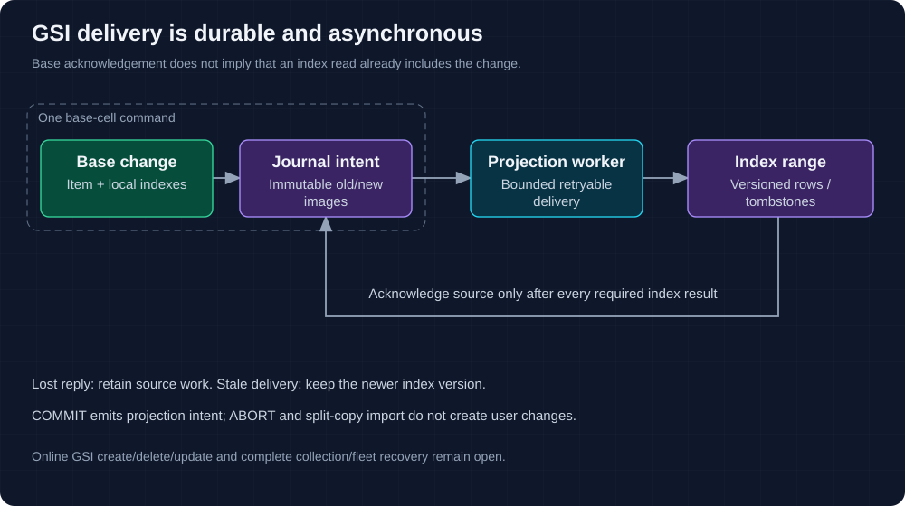

# Global secondary indexes

GSIs created with a table have independent ordered range cells and asynchronous
projection. A successful base write does not promise that a GSI read already
includes it. Online GSI creation/deletion/update remains unsupported.

## Query and projection contract

| Feature | Current behavior |
| --- | --- |
| `ALL`, `KEYS_ONLY`, `INCLUDE` | Creation-time projections stored in index cells |
| Sparse items | Missing index key attributes produce no index entry |
| Duplicate index keys | Full base key is a tie-breaker; entries do not overwrite each other |
| Query / Scan | Ordered range traversal and logical continuation using base/index key union |
| Strong reads | Rejected for GSIs by the frontend |
| Nonprojected attributes | No fetch from the base table; partial projections cannot supply them |
| Splits | Independent index range state and directory publication |

Base and GSI layouts are distinct. Moving a base owner does not make it the GSI
owner, and splitting a base range is not an atomic repartitioning of index rows.

## Durable asynchronous maintenance

1. A base command commits the item and immutable old/new projection journal
   together. Transaction COMMIT captures the intent while applying images; ABORT
   does not project staged writes.
2. Bounded workers remove changed old keys and apply new projected images to the
   relevant index cells. An unchanged projection needs no mutation.
3. Index rows/tombstones retain source epoch/sequence and content identity.
   Older versions cannot overwrite newer state; equal content can replay.
4. Acknowledge source work only after every required index mutation has durable
   success or a superseding version. Lost replies leave work recoverable.

A failed index does not suppress attempts for later healthy indexes, but source
acknowledgement still waits for every required index. Deferral changes scheduling
position without changing the immutable projection version.

Prepare capacity includes journal metadata and old/new image storage. A small
wire request can require substantial physical reservations. Index lag, tombstones
and retained source history must be included in resource measurements.

## Source and evidence

| Boundary | Source / test |
| --- | --- |
| Projection journal | [outbox](../src/global_index/outbox.rs) |
| Index state and versions | [global_index](../src/global_index.rs) |
| Worker and routing | [backend index work](../src/backend/global_index.rs), [index routing](../src/global_index/routing.rs) |
| Native cases | [cellar_indexes](../tests/cellar_indexes.rs) |
| Signed process loss | [process target](../tests/cellar_process.rs), [GSI assertions](../tests/server_binary/global_indexes.rs) |

Online lifecycle/backfill orchestration, broad query/projection compatibility,
tombstone/source collection and sustained fleet recovery remain unqualified.
Use [API coverage](api.md#indexes) and [operations](operations.md) when selecting
or diagnosing an index workload.
