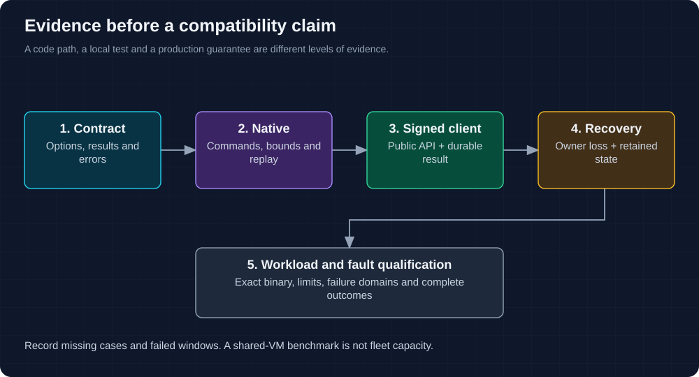

# Implementation status and qualification

The current server embeds Cellar `=0.1.0` from crates.io and a reviewed ExtendDB
Git revision. [Cargo.toml](../Cargo.toml) and [Cargo.lock](../Cargo.lock) are the
version record. This page maps contracts to current tests; it does not assert
that the latest local or CI run passed.

## Current verified slice

Registered targets exercise the following boundaries. Read the individual cases
and run results before extending any claim beyond their workload/fault model.

| Contract | Current target / source |
| --- | --- |
| Domain commands, table/item semantics | [cellar_domain](../tests/cellar_domain.rs), [account_cell](../tests/account_cell.rs) |
| Typed SDK/SQL adapter | [cellar_sdk](../tests/cellar_sdk.rs), [runtime crate](../crates/cellar-runtime/src/lib.rs) |
| Ordered serving, directories and splits | [cellar_serving](../tests/cellar_serving.rs), [cellar_directories](../tests/cellar_directories.rs), [keyspace](../crates/keyspace/src/lib.rs) |
| Transactions, lost replies and batching | [cellar_transactions](../tests/cellar_transactions.rs), [cellar_coalescing](../tests/cellar_coalescing.rs) |
| Native peer and owner fencing | [cellar_peer](../tests/cellar_peer.rs), [node_log_authority](../tests/node_log_authority.rs) |
| Lifecycle, admission and reclamation | [creation](../tests/cellar_creation.rs), [deletion](../tests/cellar_deletion.rs), [admission](../tests/cellar_admission.rs), [reclamation](../tests/cellar_reclamation.rs) |
| Indexes, images and metadata | [indexes](../tests/cellar_indexes.rs), [images](../tests/cellar_images.rs), [metadata](../tests/cellar_metadata.rs) |
| Actual executable, signed requests and hard restart | [cellar_process](../tests/cellar_process.rs), [server_binary](../tests/server_binary.rs), [process helper](../tests/support/process_fixture.rs) |
| Follower-acknowledged owner loss | [follower process case](../tests/server_binary/follower_durability.rs) |

The exact CI matrix is in [Rust CI](../.github/workflows/rust.yml) and
[signed SDK qualification](../.github/workflows/qualification.yml). An ignored
process test has not run just because an ordinary `cargo test` succeeded.

## Run the gates

Use the toolchain and target-directory rules in [AGENTS.md](../AGENTS.md).

```sh
cargo fmt --all --check
cargo check --workspace --all-targets --locked
cargo clippy --workspace --all-targets --locked -- -D warnings
cargo build --locked --bin beyonddb
cargo test --workspace --lib --locked
cargo test --locked --test cellar_coalescing --test cellar_transactions -- --test-threads=1
```

Large transaction fixtures run separately on constrained hosts while retaining
internal concurrency. Process fixtures require Docker, OpenSSL and AWS CLI:

```sh
cargo test --locked --test cellar_process -- --ignored --test-threads=1
cargo test --locked --test server_binary -- --include-ignored --test-threads=1
```

## Acceptance proof for a server claim



1. Define the operation/options and compare results and errors with the pinned
   ExtendDB SQLite backend and applicable protocol tests.
2. Exercise the signed public endpoint and check durable state/results.
3. Restore the relevant owner or process and verify replay, metadata and errors.
4. Inject failures around durable decisions for cross-cell or asynchronous work.
5. Record the exact source, dependencies, configuration, commands and outcomes.
   List missing cases and failures; distinguish local, CI and scale evidence.

## Independent client qualification

Run unchanged upstream client tests against an isolated, current server and retain
the upstream revision and complete result set. Broad protocol compatibility is
still an open gate.

The existing [convenience runner](../scripts/qualify-upstream.py) emits legacy
configuration (`storage_url` and certificate-based peer fields). It needs a port
before it can qualify the current executable. Do not use that runner's historical
results as Cellar evidence. Current signed process fixtures use the native config.

## Streams dependency contract

The reviewed ExtendDB pin exposes explicit open-versus-exhausted shard continuation.
BeyondDB maps its journal and split seal through that contract. This enables the
implemented read path; it does not complete policy changes or full iterator,
lineage and retention qualification. See [Streams](streams-contract.md).

## Open qualification gates

| Area | Work still required |
| --- | --- |
| Compatibility | Complete independent protocol/error matrix, including unsupported options |
| Recovery | Partitions, simultaneous failures, idle-cell scheduling and a bounded recovery objective |
| Resources | Sustained admission/fairness, memory/disk pressure and large payload histories |
| Operations | Coordinated backup/PITR, supported format upgrades and storage-history collection |
| Scale | Independent-machine throughput/latency and failure-domain evidence |

Current local measurements and their failures are in
[the benchmark report](local-benchmark.md). They are not a fleet capacity target.

## Historical evidence

Earlier runtime design discussions and benchmark development logs are preserved
[in Git history](https://github.com/crabbuild/beyonddb/tree/a1eb96a0e87d4473f1bec89c0f3b4f2b02a21afb/docs).
They are not current deployment instructions. The [retired coverage inventory](retired-tests.md)
records removed test targets so their absence is not mistaken for passing coverage.
