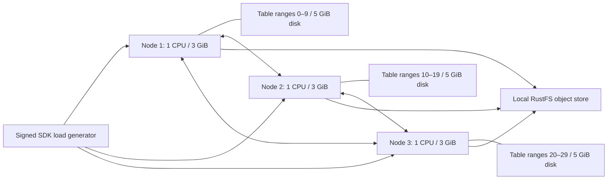

# Configurable local benchmark: nodes and table cells

`scripts/perf30` supports `--nodes N --cells-per-node C` on `setup.py init`.
The total table range count is `N * C`, between **2 and 256**, matching the
server's bootstrap limit. Both values must be positive. The defaults remain
three nodes and ten data cells per node; the directory, container and table
names retain `perf30` for compatibility with the original fixture.

```sh
python3 scripts/perf30/setup.py init --run-dir /path/to/fresh-run \
  --nodes 4 --cells-per-node 8
```

This example creates four node configurations and a 32-range table plan.
`fixture.json` in the private run directory persists the topology. Later setup,
prepare, measure and verify actions load it automatically. Node configurations
and saved table manifests must agree; passing topology flags to later setup
actions is rejected. Existing fixtures without `fixture.json` retain the original
three-node, 30-cell interpretation. Initialize into an empty directory; retained
keys and data must not be reinitialized or reused with a different topology.

Placement assigns a contiguous block of `C` ranges to each node. Load rotates
over every range and ingress node. Two-item transactions target different nodes
when `N > 1`; a single-node fixture targets distinct cells on that node.
Reports and plots derive counts, coverage, workload order and concurrency from
the saved results. Original 30-cell result files remain readable. The October 18
measurements below describe the original topology; other configurations have
not been performance-qualified.

The original local fixture measured signed DynamoDB API throughput and response latency
using three Linux containers. Each database node has **1 vCPU, 3 GiB RAM, no
container swap allowance, and its own 5 GiB ext4 data disk**. Each node
also sets `nofile=65536:65536`; the VM Docker default of 1,024 is insufficient
for the additional metadata cells and peer connections. Ten ordered data
ranges from one table belong to each node. Account, credential, inventory,
directory and transaction-coordinator cells are additional cells within the same
node resource limits. The fixture sets `max_active_cells=2048` to accommodate
metadata, including the 4,096-shard transaction-coordinator namespace as fresh
tokens spread across it; that limit is not a table-partition count. The server default of 128
caused transaction admission errors during the initial smoke test.

The object store (1 CPU, 4 GiB RAM) and client run outside the database node limits.
The first store ran at 1 GiB and was OOM-killed during the initial sustained run;
that interrupted matrix remains retained. All containers
share one local VM and its physical disk. These are local measurements, not
independent machine or fleet capacity qualification.



## Measured result — October 18, 2026

Source `674e377`, unchanged release server and dependency pins. The final sweep
completed 20 windows at 1, 8, 30 and 60 clients, using 30 seconds per window
after five seconds of warmup. Every window exercised all 30 ranges; final
authoritative inventories retained exactly ten data cells per node.

**Higher-concurrency transaction qualification failed:** 65,276 successful
requests, 101 measured request errors and 16 warmup errors. Both transaction
APIs returned 503s at 30 and 60 clients. All five eight-client windows passed:

| Operation | Requests/s | p50 ms | p99 ms | Successful samples |
| --- | ---: | ---: | ---: | ---: |
| GetItem | 293.8 | 13.2 | 70.9 | 9,064 |
| Query | 150.2 | 22.8 | 335.7 | 4,586 |
| PutItem | 204.0 | 25.8 | 214.0 | 6,125 |
| TransactGetItems | 16.5 | 442.0 | 1193.0 | 500 |
| TransactWriteItems | 23.7 | 305.7 | 1002.0 | 715 |

Transactions contain two items on different nodes. Their p99 estimates at
eight clients have fewer than 1,000 successful samples and need longer runs.


The shared account cell logged 3,723 native admission refusals at its configured
16-request limit. Internal refusal counts include paced reads and are distinct
from the public API error count. Data placement alone does not remove this shared
metadata path. The final inventory contained 2,900 coordinator cells, 257 inventory
cells, one account, one credential and one directory cell, alongside the 30 data
cells. All 3,190 were resident at the final observation.

Maximum sampled database-container memory was 1.32 / 1.23 / 1.25 GiB. Maximum
observed disk use was 1.93 / 1.90 / 1.78 GiB, including retained earlier trials.
The separate object store peaked at 2.78 GiB in sampled Docker stats. No process
was OOM-killed during the final sweep; all four processes then stopped cleanly
with exit status zero. Each write window verified one acknowledged value per
range, for 240 consistent read-backs. Failed mutations retain uncertain outcomes.

Raw results, all successful latency samples, failures, ownership snapshots,
resource counters, logs and the exact measured harness are retained locally in
`benchmarks/2026-10-18-three-node-30-cell/attempt4/`. Earlier attempts are retained
beside it: the original file-descriptor failure, the 128-resident-cell failure,
and the 60-second matrix interrupted by object-store OOM. The local report
includes every measured window and a CSV export.

This is a local characterization on a shared VM, with substantial pre-existing
host swap use. It does not establish independent-machine capacity or a production
latency SLO. Workloads share evolving table/coordinator state, and failed workers
stop after three errors. Failed windows are not healthy capacity measurements.

## Placement and correctness

`scripts/perf30/control.py` is a fixture client for the pinned **Cellar 0.1.0**
private query and management protocols. It authenticates every connection with
the fixture's private peer key. It never edits authority records or SQLite
files. All measured operations use ordinary signed boto3 requests.

Before `CreateTable`, the fixture reads the current account command sequence
and derives the next table identity using the application's existing identity
algorithm. Only this fixture may write to the account during preparation. It
warms each future data cell on its designated node with `ReadPartitionState`,
then calls normal DynamoDB `CreateTable`. The installed table identity, range
specifications and authoritative node inventories must match the plan. A
mismatch fails setup. This controls first placement without changing the server
or dependency code.

Native balancing is paused for the controlled placement experiment. Ownership
is checked before and after the run; a changed owner or missing/nonresident
range fails verification. This experiment does not measure automatic balancing.
The benchmark retains all default server admission and durability deadlines.
Follower durability is disabled, so writes wait for bucket publication.

The table has a string partition key `pk` and numeric sort key `sk`. Seed keys
are selected inside each schema-aware bootstrap interval, including non-ASCII
and control-character prefixes encoded normally as JSON. Every case records
attempted and successful traffic by range and ingress node. A case with no
successful touch in any of the 30 ranges is marked incomplete.

| Workload | Request | Items per request |
| --- | --- | ---: |
| Point read | Strongly consistent `GetItem` | 1 |
| Range read | Strongly consistent `Query`, `sk BETWEEN 1 AND 2` | 2 |
| Write | `PutItem` with a fresh key | 1 |
| Transaction read | `TransactGetItems` | 2, on different nodes |
| Transaction write | `TransactWriteItems` with a fresh token and keys | 2, on different nodes |

Reads check returned payloads. Each write case retains one acknowledged key per
range and reads it back consistently outside the measurement window. Fresh
write keys avoid intentional lock conflicts. This is uniform distribution,
not a hot-key workload.

## Reproduce

Use a dedicated Colima profile; never resize or stop another experiment's VM.
The checked-in setup script deliberately owns only resources named
`beyonddb-perf30-*` in the `colima-bdbperf30` context. Its configuration and data
paths are fixed to that fixture. Public and peer listeners bind loopback.
Only one topology can occupy this named fixture at a time. A different topology
requires a fresh dedicated VM/data deployment after preserving any retained
experiment. Scale VM CPU, memory and disk for the selected node count plus the
separate object store; each database container retains its 1 CPU / 3 GiB / 5 GiB
limits. The following defaults reproduce the measured topology:

```sh
PERF_NODES=3
PERF_CELLS_PER_NODE=10

colima start --profile bdbperf30 --cpu 6 --memory 12 --disk 30 \
  --vm-type vz --mount-type virtiofs --mount /Volumes/Workspace:w \
  --activate=false
```

Build the unchanged server in release mode with the committed lockfile. Use a
checkout-specific target directory under `$HOME/Workspace/crabbuild-target`.
For a Linux build on macOS, stage the tracked source under the shared Workspace
volume, mount it read-only into the pinned Rust 1.98.1 Bookworm container, and
run `cargo build --release --locked --bin beyonddb`. Keep the build process
stopped throughout measurement. The runtime and RustFS image digests are pinned
in `scripts/perf30/setup.py`.

Create three separate filesystems in the dedicated VM. Each image is
5,368,709,120 bytes; ext4 metadata reduces usable application space. Sparse
images enforce capacity but share the host's underlying storage performance.
Run this once in a fresh fixture:

```sh
colima ssh --profile bdbperf30 -- bash -s -- "$PERF_NODES" <<'SH'
set -eu
root=/mnt/lima-colima-bdbperf30/beyonddb-perf30
sudo mkdir -p "$root/disks"
for ((i=1; i<=$1; i++)); do
  disk="$root/disks/node$i.img"
  test ! -e "$disk"
  sudo mkdir -p "$root/node$i"
  sudo truncate -s 5368709120 "$disk"
  sudo mkfs.ext4 -q -m 0 "$disk"
  sudo mount -o loop,nodev,nosuid "$disk" "$root/node$i"
done
SH
```

Install the benchmark's client dependencies in an isolated environment. The
measurement run used boto3 1.43.114, botocore 1.43.114 and blake3 1.0.8.

```sh
python3 -m venv benchmarks/perf30-venv
benchmarks/perf30-venv/bin/pip install -r scripts/perf30/requirements.txt

PERF_PY="$PWD/benchmarks/perf30-venv/bin/python"
PERF_RUN=/Volumes/Workspace/crabbuild-target/beyonddb-perf30-run
PERF_BIN=/Volumes/Workspace/crabbuild-target/beyonddb-perf30-linux/release/beyonddb
PERF_OUT="$PWD/benchmarks/2026-10-18-three-node-30-cell"

"$PERF_PY" scripts/perf30/setup.py init --run-dir "$PERF_RUN" \
  --nodes "$PERF_NODES" --cells-per-node "$PERF_CELLS_PER_NODE"
"$PERF_PY" scripts/perf30/setup.py store --run-dir "$PERF_RUN"
```

The store action creates bucket `beyonddb-perf30` using the generated credentials.
Each node action waits for `/health`. Start node 1 with `--bootstrap`, then the
remaining nodes. Public endpoints start at `18001`; peer ports start at `19001`
and skip `19100`, which belongs to the local object store.

```sh
"$PERF_PY" scripts/perf30/setup.py node --node 1 --bootstrap \
  --run-dir "$PERF_RUN" --binary "$PERF_BIN"
for ((i=2; i<=PERF_NODES; i++)); do
  "$PERF_PY" scripts/perf30/setup.py node --node "$i" \
    --run-dir "$PERF_RUN" --binary "$PERF_BIN"
done

"$PERF_PY" scripts/perf30/bench.py prepare --run-dir "$PERF_RUN" --output "$PERF_OUT"
"$PERF_PY" scripts/perf30/bench.py measure --run-dir "$PERF_RUN" --output "$PERF_OUT" \
  --operations transact_write transact_get put get query \
  --clients 1 8 30 60 --seconds 30 --warmup 5 --label main
```

Capture Docker stats throughout the run, along with image IDs, the server binary
hash, source revision and lockfile hash. Each measured case also captures
cgroup CPU, memory/OOM, I/O and disk counters before and after its window.
The script retains all latency samples, failure messages and per-cell coverage.
SDK retries are disabled; an uncertain mutation is recorded as an error and is
never resubmitted. The client response timeout is 45 seconds.

Stop the owned nodes before stopping their object store. Preserve the data and
raw reports for inspection:

```sh
"$PERF_PY" scripts/perf30/setup.py stop --run-dir "$PERF_RUN"
```

## Interpret the report

Throughput is successful API calls divided by actual elapsed time, including
in-flight completion drain. Item throughput is reported separately. Latency
percentiles use nearest rank over successful requests; errors retain their own
latencies. Low-count cases flag that the tail estimate is weak. Warmup is saved
separately and excluded from the measured numbers.

This is a closed-loop client-concurrency sweep. It includes SDK, signing,
network, authentication, routing and durability time. It does not correct for
coordinated omission or establish an arrival-rate SLO. Do not interpret failed
or incomplete cases as healthy capacity. CPU throttling, metadata concentration,
object-store contention and common-host activity must accompany any conclusion.

## Generate the report and charts

The report keeps failed cases and labels short-sample tail estimates. Plotting
is optional and runs after measurement:

```sh
python3 scripts/perf30/report.py \
  --input "$PERF_OUT/results-main.json" --output "$PERF_OUT" --summary-clients 8
"$PERF_PY" -m pip install -r scripts/perf30/requirements-plot.txt
"$PERF_PY" scripts/perf30/plot.py \
  --input "$PERF_OUT/results-main.json" --output "$PERF_OUT"
```

The final local fixture is stopped, with its Docker containers, named store
volume, ext4 images and private configuration retained. The dedicated VM can
be started again with `colima start --profile bdbperf30 --activate=false`.
Remount the existing images at their original node paths before starting the
retained store and database containers. Wait for S3 readiness before starting
the database nodes. Use `measure` to reuse the existing table; `prepare`
intentionally rejects an existing table. Never rerun `init` over retained keys.

## Check the tooling

Python 3.12 or later is required. Run the focused offline tests in the client
environment; they validate topology limits, bootstrap key boundaries, placement,
cross-node transactions, coverage and report compatibility without starting a VM:

```sh
"$PERF_PY" -m unittest discover -s scripts/perf30 -p 'test_*.py'
```
