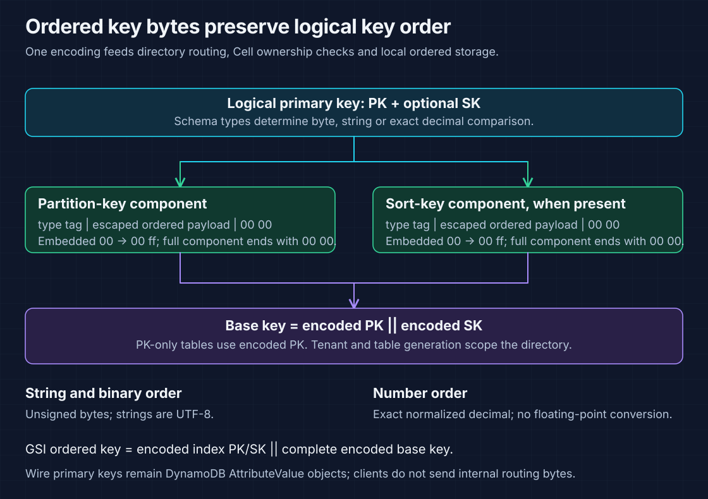
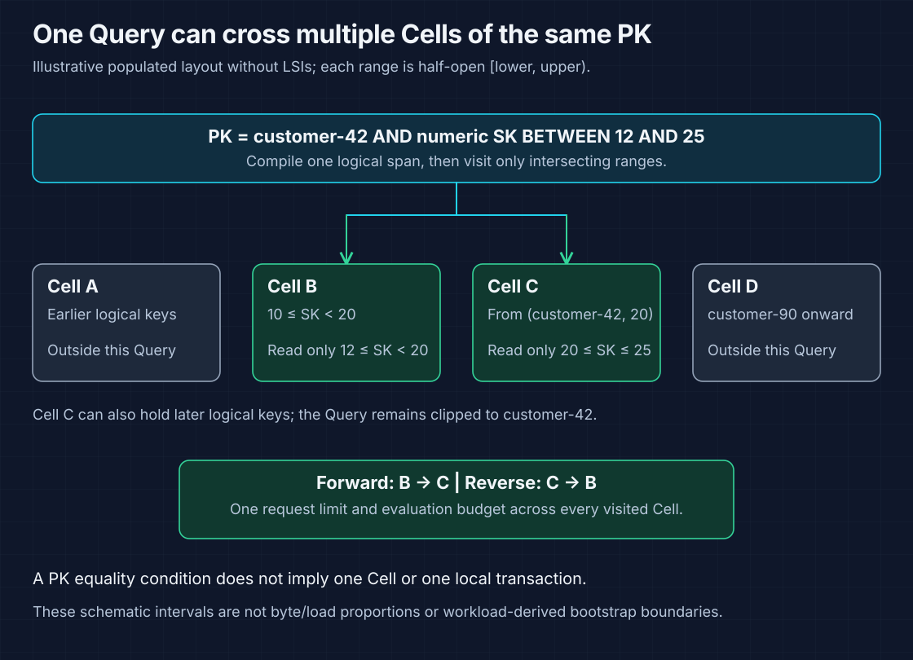
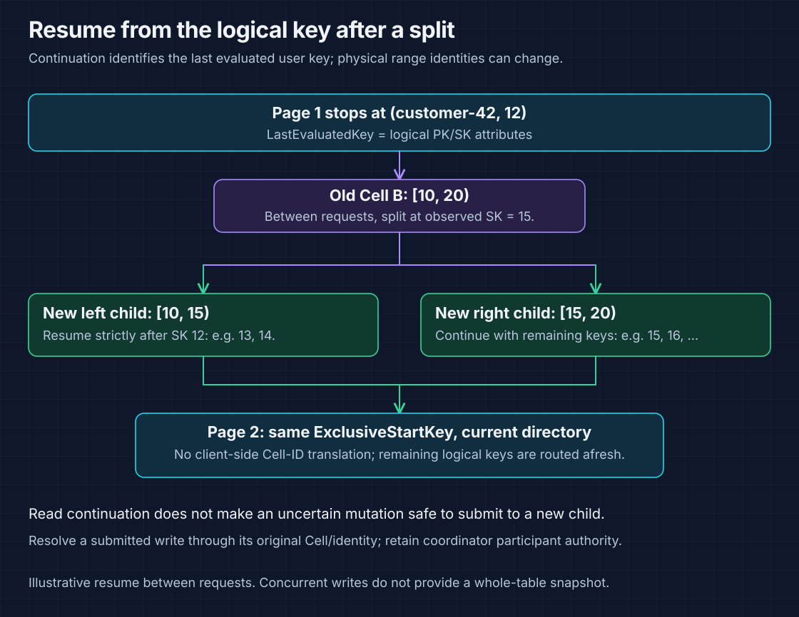

# Ordered table ranges on Cellar

A table is a directory of independently owned range Cells. Each range covers a
contiguous interval of the complete primary key `(PK, SK)`. A point request has
one range owner; a Query can visit several Cells for the same partition key.

| I need to… | Start here |
| --- | --- |
| Understand logical ranges and physical owners | [Current Cellar reference](#current-cellar-reference) |
| Understand key comparison and byte encoding | [Encoding reference](#encoding-reference) |
| Follow Query across ranges | [Query traversal and budgets](#query-traversal-and-budgets) |
| Resume after a range split | [Logical continuation](#logical-continuation) |
| Choose initial counts and understand split limits | [Creation and split policy](#creation-and-split-policy) |
| Try Query and inspect an evaluated-item limit | [Request example](#request-example) |
| Inspect the complete design and acceptance matrices | [Detailed design and recorded evidence](#detailed-design-and-recorded-evidence) |

## Current Cellar reference


| Boundary | Current contract |
| --- | --- |
| Public table creation | **2–256** initial data ranges; default **4**, recorded with the table generation |
| Ownership interval | Half-open **[lower, upper)**; adjacent ranges have no gaps or overlaps |
| Routing key | Complete ordered primary key; tenant and table generation scope the directory |
| Physical placement | Cellar chooses and fences the node owning each logical Cell |
| Node move | Retain Cell identity and interval; change physical owner |
| Range split | Create child identities/epochs and replace the source's directory interval |
| Metadata | Directory leaves hold routes; they do not hold the table's user items |
| Admission budget | `max_active_cells` counts metadata, credential, coordinator, base and GSI Cells together |

Multiple Cells on one node share that node's failure domain. Creating four ranges
does not guarantee four nodes, equal data occupancy or balanced request traffic.
See [server configuration](cellar-server.md#application-policy-and-capacity) and
[physical ownership](architecture.md#components-and-ownership).

## Encoding reference



| Key type | Comparison | Example |
| --- | --- | --- |
| String | Unsigned UTF-8 byte order | `"10"` sorts before `"2"` |
| Binary | Unsigned byte order | `61 00` sorts before `61 01` |
| Number | Exact normalized decimal order | `2` sorts before `10`; `1`, `1.00` and `1e0` identify the same numeric key |

| Encoding-v1 rule | Boundary |
| --- | --- |
| One component | Type tag, order-preserving escaped payload, then `00 00` |
| Embedded zero | Encode `00` as `00 ff` so component boundaries remain unambiguous |
| Binary example (hex) | Payload `61 00 62` becomes `30 61 00 ff 62 00 00`; `30` is the binary type tag |
| Base key | `encoded(PK)` followed by `encoded(SK)`; omit SK for a PK-only schema |
| GSI key | Encoded index PK/SK followed by the **complete encoded base key** |
| Numeric limits | Up to 38 significant digits; magnitude exponent −130 through 125; no `f64` conversion |
| Encoded key bounds | Base: **6,150 bytes**; index plus base suffix: **12,300 bytes** |
| Version fence | Directory and installed range must agree on encoding version **1** |

DynamoDB JSON still uses ordinary `S`, `N` and `B` attribute values. Clients do
not construct these routing bytes or submit Cellar invocation envelopes.
`HASH` and `RANGE` in a DynamoDB key schema name logical key roles; physical
ownership uses the ordered byte intervals. See [encoding](../crates/keyspace/src/encoding.rs)
and [range validation](../crates/keyspace/src/ranges.rs).

## Query traversal and budgets

DynamoDB Query requires **PK equality**. The optional SK predicate narrows the
logical span; it does not select one physical Cell. An arbitrary PK-range query
would require a separate API contract.



For the illustrative populated layout below, `K42(n)` means
`(customer-42, numeric SK n)`. `P90` is the boundary before all SKs of `customer-90`.
These intervals describe a possible layout without LSIs, not the initial
boundaries created by the CLI example.

| Cell | Owned interval | Query: PK customer-42, SK BETWEEN 12 and 25 |
| --- | --- | --- |
| A | `[−∞, K42(10))` | Skip |
| B | `[K42(10), K42(20))` | Read SK 12 through values below 20 |
| C | `[K42(20), P90)` | Read SK 20 through 25; exclude other keys in C |
| D | `[P90, +∞)` | Skip |

| Request | Traversal / result boundary |
| --- | --- |
| Point Get/Put/Update/Delete | Encode the full key; resolve its containing interval; validate generation, range and epoch at the destination |
| Forward Query | Visit intersecting ranges in ascending order and concatenate base-key results |
| Reverse Query | Visit intersecting ranges in descending order |
| SK equality / comparisons / BETWEEN | Compile the correct inclusive/exclusive logical endpoints into a half-open byte span |
| `begins_with` | String/binary prefix span; not a numeric SK operation |
| Scan | Traverse the ordered directory with bounded pages |
| Parallel Scan | Stable segment predicate on logical keys; its hash does not determine Cell ownership |

### One request budget across all visited Cells

| Boundary | Meaning |
| --- | --- |
| `Limit` | Evaluated items across the request; not returned items and not a fresh limit for each Cell |
| Public 1-MiB evaluation boundary | Account for logical item bytes before filtering and projection |
| Current 900,000-byte transport chunk target | Internal reply sizing; distinct from the frontend's public evaluation accumulator |
| Filtered empty response | Can still have `ScannedCount > 0` and `LastEvaluatedKey` |
| Projection expression | Does not reduce the bytes already evaluated for the public page budget |
| Exhausted local span | Continue to the next intersecting Cell when request budget remains |

An ordinary read must respect unresolved transaction intents, including prepared
creates or deletes absent from live rows. Authoritative per-Cell reads do not
provide one table-wide snapshot. See [read visibility](cross-cell-transactions.md#read-visibility-and-saved-images)
and [the Query aggregator](../src/backend/data/query.rs).

## Logical continuation



| Continuation field / event | Rule |
| --- | --- |
| `LastEvaluatedKey` | Logical primary-key attributes; no physical Cell or page identity |
| `ExclusiveStartKey` | Return the exact service key and keep the same Query conditions and direction |
| Forward resume | Start strictly after the evaluated key in the current directory |
| Reverse resume | Start strictly before the evaluated key |
| Range split between requests | Locate the remaining logical span using replacement ranges |
| Stale/sealed/not-ready range | May produce a retryable error; broad split-during-page behavior remains under qualification |
| New writes between requests | No whole-response or multi-page snapshot guarantee |
| Ambiguous submitted mutation | Resolve through the original Cell/identity before considering new-route submission |

Do not turn a read-resume rule into a write retry rule. A lost increment or
conditional-write reply may already have committed in the source Cell.
Admitted transactions keep their original coordinator and participant identities;
a split cannot retarget that durable decision.

## Creation and split policy

### Bootstrap and route publication

| Stage | Current requirement |
| --- | --- |
| Choose initial policy | Positive configured count from 2–256; counts need not be powers of two |
| Record creation | Persist the immutable generation and initial-count policy; retries finish that policy even after a node default changes |
| Install ranges | Match the generation, schema, encoding version, interval and range epoch |
| Publish GSI directories | Creation-time indexes must be installed and published before admitting base writes |
| Publish base directory / ACTIVE | Validate exact count, adjacency, full coverage and installation evidence |
| Failed provisioning | Keep creation recoverable; do not fall back to one account-local data store |

The current [bootstrap implementation](../src/cellar/provision.rs) uses deterministic
PK-type-aware fences. String/binary templates use prefix values; numeric templates
use numeric fences. They do not predict future workload balance. The public JSON
configuration selects the count; the explicit schema/workload templates in the
retained work packages are design/acceptance material, not additional JSON knobs.

`beyonddb:cell-model` accepts `auto` or `partitioned`; both use the configured
multi-range policy. `single` is rejected. Later tag changes do not change the
recorded creation policy or convert the table's placement.

### Split safety and what remains open


| Split boundary | Current behavior / qualification limit |
| --- | --- |
| Candidate selection | [Observed median key](../src/partition/split_point.rs); not an arithmetic midpoint of empty byte space |
| No LSI | May split a PK's SK siblings across Cells |
| PK-only table | Split only between distinct PKs; one item is indivisible |
| Table with LSIs | Choose only a PK-collection boundary; keep base and LSI state together |
| Source sealing | Reject unresolved participant work and pending GSI projection entries in the same command that seals |
| Copy / publication | Retain an exact plan, verify children, publish replacements, then open them |
| Old source | Retain evidence needed by replay, streams and recovery; full safe storage collection remains open |
| More advanced balancing | Byte/load-weighted sampling, hot-item handling and measured recovery headroom still need acceptance evidence |
| Merges / online delta catch-up | Later design work; not a supported operational shortcut |

| Related subsystem | Invariant |
| --- | --- |
| LSI | PK collection locality; the finite Cell budget does not establish DynamoDB's full 10-GiB collection capacity |
| GSI | Independent ordered ranges; full base-key tie breaker, original projection versions and tombstones survive transfer |
| Transaction | Same PK does not imply one participant; group by full-key ownership before persisting immutable targets |
| Native ownership | Application range epochs supplement Cellar's owner fence; they do not replace it |

See [GSI splits](global-indexes.md#split-and-recovery-reference),
[transaction recovery](cross-cell-transactions.md#recovery-and-stable-identities) and
[the split controller](../src/split.rs).

Encoding-v1 roots cannot reinterpret older hash layouts or another runtime's
storage. Use fresh compatible storage, or a separately designed export/repartition/
import migration with validation; do not reuse an incompatible prefix.

## Request example

Use a client shell with the bootstrapped DynamoDB credentials and the
[local server configuration](cellar-server.md#configuration). The following schema
uses a string PK and numeric SK. Save it as `ordered-table.json`:

```json
{
  "TableName": "OrderedOrders",
  "BillingMode": "PAY_PER_REQUEST",
  "AttributeDefinitions": [
    {"AttributeName": "customer_id", "AttributeType": "S"},
    {"AttributeName": "order_no", "AttributeType": "N"}
  ],
  "KeySchema": [
    {"AttributeName": "customer_id", "KeyType": "HASH"},
    {"AttributeName": "order_no", "KeyType": "RANGE"}
  ]
}
```

```sh
aws --endpoint-url http://127.0.0.1:8000 --region us-east-1 \
  dynamodb create-table --cli-input-json file://ordered-table.json
aws --endpoint-url http://127.0.0.1:8000 --region us-east-1 \
  dynamodb wait table-exists --table-name OrderedOrders
```

Save the following as `ordered-seed.json`. These four small items illustrate
logical ordering and filtering; they do not force a same-PK physical split.

```json
{
  "RequestItems": {
    "OrderedOrders": [
      {
        "PutRequest": {
          "Item": {
            "customer_id": {"S": "customer-42"},
            "order_no": {"N": "12"},
            "visible": {"BOOL": false}
          }
        }
      },
      {
        "PutRequest": {
          "Item": {
            "customer_id": {"S": "customer-42"},
            "order_no": {"N": "15"},
            "visible": {"BOOL": false}
          }
        }
      },
      {
        "PutRequest": {
          "Item": {
            "customer_id": {"S": "customer-42"},
            "order_no": {"N": "20"},
            "visible": {"BOOL": true}
          }
        }
      },
      {
        "PutRequest": {
          "Item": {
            "customer_id": {"S": "customer-42"},
            "order_no": {"N": "25"},
            "visible": {"BOOL": true}
          }
        }
      }
    ]
  }
}
```

```sh
aws --endpoint-url http://127.0.0.1:8000 --region us-east-1 \
  dynamodb batch-write-item --cli-input-json file://ordered-seed.json
```

Check `UnprocessedItems` and retry those entries before reading. Save the Query
as `ordered-query.json`; aliases avoid relying on attribute-name keyword status.

```json
{
  "TableName": "OrderedOrders",
  "KeyConditionExpression": "#pk = :customer AND #sk BETWEEN :lo AND :hi",
  "FilterExpression": "#v = :yes",
  "ProjectionExpression": "#pk, #sk",
  "ExpressionAttributeNames": {"#pk": "customer_id", "#sk": "order_no", "#v": "visible"},
  "ExpressionAttributeValues": {
    ":customer": {"S": "customer-42"},
    ":lo": {"N": "12"},
    ":hi": {"N": "25"},
    ":yes": {"BOOL": true}
  },
  "ConsistentRead": true,
  "ScanIndexForward": true,
  "Limit": 2
}
```

```sh
aws --endpoint-url http://127.0.0.1:8000 --region us-east-1 \
  dynamodb query --cli-input-json file://ordered-query.json --no-paginate
```

With all four seed writes completed and no concurrent changes:

| Service page | Evaluated keys | Returned items | Continuation |
| --- | --- | --- | --- |
| First, forward | SK 12 and 15 | Empty; both fail the filter | Use the returned key for SK 15 |
| Next, same Query + returned `ExclusiveStartKey` | SK 20 and 25 | Both keys | Stop when `LastEvaluatedKey` is absent |

`--no-paginate` exposes one service response. Copy the complete returned key into
`ExclusiveStartKey`; keep the other Query settings. For a **new** reverse traversal,
set `ScanIndexForward: false` and start without the forward cursor. Filtered empty
results do not mean the logical range is exhausted.

The JSON and CLI examples explain the public request shape. They are not executed
fixture results or proof of the illustrative multi-Cell placement above.

## Current source and qualification

| Area | Entry point / evidence |
| --- | --- |
| Key encoding and span math | [keyspace](../crates/keyspace/src/lib.rs), [range tests](../crates/keyspace/tests/ranges.rs) |
| Full-key ownership and publication | [routing](../src/routing.rs), [creation path](../src/backend/table_creation.rs) |
| Lazy Query and Scan traversal | [Query aggregator](../src/backend/data/query.rs), [routed reads](../src/backend/data/routed.rs) |
| Split fence and observed key | [partition handlers](../src/partition.rs), [selector](../src/partition/split_point.rs) |
| Embedded range fixture | [native range Cells](../crates/cellar-runtime/tests/embedded/range_cells.rs) |
| Signed serving and owner recovery | [Cellar serving target](../tests/cellar_serving.rs), [ordered route fixture](../tests/support/ordered_routes.rs) |
| Complete CI matrix | [Rust checks](../.github/workflows/rust.yml), [signed SDK qualification](../.github/workflows/qualification.yml) |

```sh
cargo test --locked -p keyspace
cargo test --locked --test cellar_serving -- --test-threads=1
```

Focused ordering, paging and restart evidence does not establish balanced traffic,
all index/predicate combinations, every split interruption schedule, sustained
fleet throughput or a bounded recovery time. Use the
[server qualification boundaries](cellar-server.md#qualification-still-required)
when evaluating deployment claims.

## Detailed design and recorded evidence

> **Revision scope:** The original ordering rationale, directory/LSI invariants,
> split/replay analysis, delivery sequence and acceptance work packages remain
> below. Recorded test counts and proposed steps describe their revisions.
> They do not turn workload-weighted splits, explicit bootstrap templates,
> merges or unqualified fault cases into current server features. Use the
> [current reference](#current-cellar-reference) above and the checked-in source.
> Snapshot: [original detailed document](https://github.com/crabbuild/beyonddb/blob/a1eb96a0e87d4473f1bec89c0f3b4f2b02a21afb/docs/ordered-cell-partitioning.md).

Original substantive lines, headings and acceptance matrices are preserved.
Expand a topic for the complete design and revision-scoped evidence.

| Topic | Material retained |
| --- | --- |
| [Ownership and encoding rationale](#ownership) | Complete key ordering, owner boundaries, encoding-v1 constraints and numeric rules. |
| [Bootstrap and directory invariants](#bootstrap-and-directory) | Immutable initial counts, publication proof, directory paging and route validation. |
| [Query, Scan and continuation contract](#point-requests-query-and-pagination) | Logical spans, request-wide budgets, filtering, transaction barriers and segment stability. |
| [Split, replay, index and transaction design](#splits-merges-and-replay) | Fenced copy sequence, ambiguous outcomes, LSI locality, GSI suffixes and immutable participants. |
| [Delivery packages and recorded acceptance evidence](#executable-delivery-sequence) | Original implementation slices, full acceptance matrices, measurements, fixture limits and references. |

<details>
<summary><strong>Ownership and encoding rationale</strong></summary>

Status: ordered routing is implemented in the Cellar-backed executable and
passes the local signed SDK/process-restart fixture. The root serving-router
fixture puts one PK in three actual cells, queries across them, splits the
middle cell at an observed SK, resumes in both directions and reopens the node.
The shared contracts are in `crates/keyspace`. Complete API/index and fleet
fault qualification remain unfinished. This document records the architecture
and delivery gates and supersedes the hash-based proposal in `scaling.md`.

## Ownership

A logical table is a catalog record and a directory of independently owned
data cells. It is never the data contents of an account cell or one table cell.
New tables must publish at least two data ranges before becoming ACTIVE; the
normal bootstrap policy provisions four. Each cell owns one contiguous interval
of the table generation's ordered primary-key space:

```text
table Orders, generation T
  catalog -> bounded directory tree -> [lower, upper) -> logical data cell

  cell A: [-infinity, (customer-42, 2026-04-01))
  cell B: [(customer-42, 2026-04-01), (customer-42, 2026-07-01))
  cell C: [(customer-42, 2026-07-01), (customer-90, MIN_SORT))
  cell D: [(customer-90, MIN_SORT), +infinity)

  Query customer-42, April through August -> B, then the relevant part of C
```

The example is a possible populated layout, not bootstrap boundaries inferred
from a future workload. A point mutation has one data-cell authority. A Query
may visit several cells even for one partition-key value. An individual item
cannot be split between independent writers.

Cellar assigns logical cells to nodes, fences owners, executes local SQL
transactions, and publishes durability evidence. BeyondDB owns table ranges,
split intent, directory publication, transaction decisions and index delivery.
Range epoch is an application fence; it does not replace Cellar ownership.
Moving a cell to another node keeps its range and cell identity. Splitting a
range creates new cell identities and changes directory ownership.

A table is a namespace over many cells, and a node hosts cells from many tables.
Cell counts grow with data and traffic; the number of tables does not determine
the number of data cells. Cellar replication protects each cell's state.
Placement must also respect the deployment's failure domains: many cells on the
same node still share that node's failure. A directory leaf is metadata, not the
table's data cell, and may legitimately contain one remaining entry.

## Primary-key bytes

Within a table generation, use:

```text
K = ordered_component(PK) || ordered_component(SK), when SK exists
K = ordered_component(PK), for a partition-key-only table
```

No hash, node identity, or cell ID precedes the key. Table generation and tenant
are directory/storage scope, not parts of the user-key comparison. Encodings
are versioned; an installation must reject a directory with another version.

`keyspace` implements encoding version 1:

* String: UTF-8 bytes in unsigned byte order.
* Binary: unsigned byte order.
* Number: exact normalized decimal, at most 38 significant digits, magnitude
  exponent -130 through 125. Zero has one canonical representation. Signed
  magnitude encoding reverses negative order and never uses `f64`.
* Components carry a type tag, escape embedded zero as `00 ff`, and end with
  `00 00`. A length prefix is unsuitable for ordered comparisons.
* Bounds are variable-length byte strings with explicit negative/positive
  infinity. They are never truncated to 16 bytes. The maximum encoded full key
  is 6,150 bytes, including worst-case escaping of the DynamoDB key limits.
  An index key with its full base-key suffix is bounded at 12,300 bytes.

Store this key in a SQLite BLOB index used by both ownership checks and export.
Keep ExtendDB's canonical item identity and expression semantics. This routing
encoding is a separate index; it does not redefine equality or the wire shape
of `LastEvaluatedKey`. Add differential cases for equivalent numeric spellings
before switching production writes.

</details>

<details>
<summary><strong>Bootstrap and directory invariants</strong></summary>

## Bootstrap and directory

Replace `TablePlacement::{Account, Single}` and one-cell `auto` on the Cellar
server with mandatory `RangePartitioned` placement. Existing explicit requests
for legacy placement fail validation; they must not silently override this
policy. Empty tables still have several installed data cells.

Persist explicit ordered split points, selected from an administrator's
schema-aware template or workload samples. A deterministic default template
can choose fences on string/binary prefixes and numeric values, but cannot
promise even occupancy for an unknown workload. Initial counts need not be
powers of two. Validate two through the configured admission limit, sorted
distinct fences, unique IDs, adjacency and full coverage. Adaptive splits must
correct skew; hash percentiles and arithmetic midpoints of hash space are not
valid ordered-key placement policies.

The catalog stores immutable table generation, key encoding/schema version,
directory-root identity, lifecycle and bootstrap-plan fingerprint. A durable
create intent makes retrying provisioning safe. Every initial cell must prove
its matching installation before directory publication and ACTIVE. No account
item-store fallback is allowed when provisioning is unavailable.

The publication command must independently check the cataloged initial count,
not just that the supplied ranges cover the full key space. A single full-space
range has contiguous coverage but still violates a four-cell creation policy.
Apply this check to both base-table and GSI publication. The creation policy is
immutable for that generation, so changing a node's configured default cannot
change the required count during a retried CreateTable.

Directory leaves store predecessor-searchable BLOB lower bounds and bounded
route pages. Branches store ordered child intervals. Preserve the existing
bounded directory-split protocol, replacing fixed-width hash comparisons and
fingerprints with length-framed encoded bounds. Do not return a complete table
route map on the serving path. Split metadata leaves independently of data
cells; one large table must not have one permanently growing directory writer.

Each route contains table generation, key-encoding version, interval, logical
data-cell ID, and range epoch. A cell persists that installation and validates
the full encoded key, table generation and epoch inside every command/query.
The route cache is bounded and keyed by table generation plus ordered interval.
A stale-route response causes a bounded directory refresh. No HTTP client may
choose a raw Cellar binding or submit internal invocation envelopes.

</details>

<details>
<summary><strong>Query, Scan and continuation contract</strong></summary>

## Point requests, Query and pagination

Get/Put/Update/Delete encode the complete primary key and resolve its owning
interval. Local item, LSI, transaction-intent and stream-journal changes retain
one atomic cell command. Resolve transaction intents before exposing affected
items, as the current domain implementation requires.

DynamoDB Query requires partition-key equality. Compile that value and the
optional sort-key predicate into a half-open encoded span. Equality, comparison,
BETWEEN and begins_with have distinct inclusive/exclusive endpoints. An exact
partition prefix covers every sort-key sibling, including siblings in different
cells. Arbitrary PK-range queries would be a separate BeyondDB API extension.

Use a lazy ordered directory cursor. Fetch intersecting cells in ascending or
descending range order, passing the clipped interval to each cell. Start with
sequential cell reads to make accounting unambiguous; bounded prefetch can be
added later. Base-table results concatenate in this order. Apply one request
budget across all visited cells: Limit counts evaluated items, and the 1-MiB
evaluation boundary precedes filter/projection. Never reset either budget for
each cell. A filtered empty page may still return a LastEvaluatedKey.

Return the last evaluated logical primary key, not a physical cell/page cursor.
Resume exclusively from that key against the current directory. A split between
pages therefore requires no client-token translation. Within a page, a sealed
or stale cell triggers refresh of only the unconsumed logical span. Do not emit
a row twice or advance the evaluated key past an unread interval. Ordinary
strong reads require authoritative per-cell committed reads; this does not
promise a table-wide snapshot. Transactions retain the durable coordinator
protocol where their participant set spans cells.

Scan traverses the same directory lazily. ParallelScan needs a separate stable
segment predicate on canonical logical keys (which may use a hash); segment
membership must survive physical splits and must never determine cell ownership.
Probe exclusive transaction intents in the same ordered `(PK, SK)` suffix as
the resumed Scan. Intents at or before its logical cursor must not block it;
an unvisited prepared create must still block even without a live item row.
The serving fixture verifies this with numeric-equivalent cursor spellings,
then splits one PK collection and exercises signed SDK transaction cancellation
and restart across the resulting cells.

</details>

<details>
<summary><strong>Split, replay, index and transaction design</strong></summary>

## Splits, merges and replay

Choose a split boundary from observed distinct keys using stored-byte and
request-load samples. Prefer the hottest separable ranges. Never repeatedly
divide empty lexical space using a numeric midpoint. Without LSIs, a boundary
may divide sort-key siblings of one PK. A PK-only table can divide only between
distinct PKs. An indivisible hot item needs backpressure and an explicit metric.

The first safe protocol uses a short serving fence and resumable copy:

1. Persist a split intent with source installation, source epoch, boundary,
   fresh child IDs, expected directory revision and operation ID.
2. Refuse to seal while admitted transaction participants are unresolved.
   Resolve them through their original durable coordinator/participants;
   never retarget an admitted transaction to new children.
3. Seal the source in one command, recording the terminal source sequence.
   New source mutations fail closed; retries can still inspect existing receipts.
4. Install both children as IMPORTING. Copy bounded ordered pages and required
   item/index versions, TTL state, stream lineage and retained delivery state.
   Copy/checkpoint commands are idempotent. Compare per-child counts and
   fingerprints with the sealed source's exact intervals.
5. Obtain durable child readiness receipts. The directory cell atomically
   compares the source interval/epoch and replaces it with adjacent children.
   A snapshot-wide directory revision may change for unrelated splits; refresh
   and revalidate the source instead of restarting the data copy unnecessarily.
6. Open children only under their matching publication evidence. Recovery can
   finish opening after directory publication; routers retry NotReady safely.
7. Retain the sealed parent for ambiguous mutation resolution, stream lineage,
   transaction recovery and retention windows. Reclaim it only after explicit
   durable acknowledgements and the relevant replay windows expire.

An ambiguous command must resolve its original cell/identity before rerouting.
Do not generate a fresh mutation identity and repeat an increment/condition on
a child. A source rejection that proves execution never occurred can permit
new-route submission; an unavailable source requires Cellar recovery first.
The copy protocol must not turn uncertain execution into an implicit retry.

This first protocol trades availability during copy for a small correctness
surface. Online snapshot plus delta catch-up is a later optimization with its
own terminal catch-up fence and crash matrix. Keep cell budgets small enough
to bound initial copy time. Trigger splits on bytes, write/read pressure, queue
latency and recovery cost, with headroom for indexes, journals and prepares.
Merges use the same fencing/publication discipline and never reduce a table
below two data cells; implement after split recovery is qualified.

## Secondary indexes and transactions

GSI cells have their own ordered space:
`(index PK, index SK, base PK, base SK)`. The base-key suffix provides a stable
tie-breaker when several items have identical index keys. GSI Query spans all
matching suffixes and merges in this order. Use independent directories and
the existing transactional projection outbox. Migrate destination versions and
tombstones so delayed projection cannot resurrect deleted entries. Durable
projection acknowledgement follows destination commit across a split. GSIs
remain eventually consistent unless a separate documented contract is added.

For the first LSI cutover, split only between partition-key collections. Base
items and their LSIs stay together, preserving current atomic maintenance and
strong index reads. A table can still span many cells. Enforce the current
explicit storage admission limit; the existing 512-MiB cell budget does not
meet DynamoDB's full 10-GiB LSI collection capacity. Supporting a PK split with
LSIs requires fanout to every base fragment and a merge by `(LSI SK, base key)`;
concatenating base-SK ranges would be incorrect. That is a separate gated phase.

Transaction admission resolves full keys, groups participants by current range,
and persists the actual participant identities/epochs before prepare. A shared
PK no longer implies a local transaction. Conditional writes and replay retain
their existing local atomicity and coordinator decision rules. Source sealing
must coordinate with admission so a transaction cannot prepare between the
"no unresolved work" check and the fence.

</details>

<details>
<summary><strong>Delivery packages and recorded acceptance evidence</strong></summary>

## Executable delivery sequence

| Slice | Files / implementation | Exit evidence |
| --- | --- | --- |
| Ordered contracts | `crates/keyspace`: canonical keys, query spans, validated multi-cell directories, split CAS and logical-key resume | Implemented: nine tests plus clippy. Exact decimal pairs, zero/ff escaping, same-PK ranges and resume through a split. |
| Real Cellar range fixture | `crates/cellar-runtime/tests/embedded/range_cells.rs` | Passed: three actual Cellar targets hold one PK split by SK; clipped ascending/descending reads, wrong-range/epoch rejection and restart. This is a local SDK fixture, not signed DynamoDB/API or fleet qualification. |
| Durable schema/handler cutover | `partition.rs`, `partition_schema.sql`, `partition/{key,query,scan,transaction,ttl}.rs`, item/index helpers | Persist encoding/range contract; bound every local read/export/write by full key. Verify numeric canonicalization against ExtendDB. |
| Directory and bootstrap | `routing.rs`, `directory/**`, `provision/**`, `backend/table_creation.rs` | Variable BLOB bounds and fingerprints; multi-cell creation required; no account/single fallback or power-of-two rule. Restart at each create/publication step. |
| Serving requests | `backend/{data,remaining,transaction,batch}*`, metadata cache | Signed SDK CRUD, Query/Scan, ascending/descending limits, filtering, LEK and transactional reads across several cells. No full-map lookups. |
| Runtime replacement | Production manifest, compiled application, host/provisioning/server lifecycle | Implemented: production dependency graph and executable use Cellar. Local signed CRUD, transaction replay, Query and restart pass. Remaining historical behavior/fault fixtures still need porting. |
| Lifecycle and indexes | Split/capacity workers, stream lineage, GSI delivery, coordinators | Process kill at every split phase, owner loss, same-PK splits under writes, projection replay, retained receipt resolution, no gaps/overlaps. Bucket-backed recovery required. |
| Operational qualification | Metrics, load fixtures, deployment docs | Measured skew response, node rebalance, bounded metadata and retention, declared recovery/latency limits. Local tests establish no fleet capacity claim. |

Old HASH directories, integer midpoint split plans and Cellule object roots
cannot be reinterpreted as encoding-v1 Cellar ranges. The first deployment is
fresh. Any data migration needs an explicit export/repartition/import workflow
with count/digest validation and separate cutover authorization.

## Cutover work packages and acceptance

Core ordered routing, directory traversal and observed-key split paths are
implemented, with local serving and restart evidence. The packages below retain
the full acceptance matrices and remaining details, including workload-weighted
splits, explicit bootstrap templates and fault cases. Directory, storage and
Query all use encoding-v1 keys in this build; there is no mixed HASH serving
mode. A new local/object-store root is required for the ordered layout.

The Query aggregator uses a conservative 900,000-byte transport chunk across
cells. ExtendDB continues fetching chunks under one 1-MiB evaluation accumulator,
counting logical item bytes before filter and projection. The serving-router
regression verifies this distinction in both directions with thirty heavily
escaped 70-KiB values spanning multiple cells: evaluation pages contain 14, 14
and 2 items even when every item is filtered out. Projection retains that page
boundary, and Limit 12 stops after twelve evaluated items across cells. These
checks do not cover every predicate/index combination or a split during a page.

Nine bucket-backed process fixtures have passing runs for coordinator history,
GSI recovery, large transactional reads on a fresh owner, metadata caching and segmented LSI
scans, signed Streams/TTL recovery with retained generations, native capacity
and authenticated peer identity, and broad signed SDK behavior across ordered
ranges through hard and graceful restarts, and native follower recovery with
both node-bundle and per-cell LTX publication withheld. The follower fixture
uses a public two-cell table and retains conditional replay and exactly-once
stream assertions on a fresh successor after deleting the failed owner's local
directory. SDK handoff to
a second node also passes. The broader split, transaction,
GSI/LSI fault matrices and fleet capacity qualification remain open.

Native SDK metadata fixtures retain full transfer contracts, reject initial
publication that changes the recorded count, and recover a 1,024-entry directory
through copy/cutover and interrupted retirement. A separate 48-root fixture
verifies SDK residency stays within 16 cells while ownership and retirement
fences survive handoff. These use the development bucket and do not represent
1,024 active data partitions or qualify physical network partitions.
Interrupted creation recovers the same two-cell bootstrap plan after an owner
handoff and a server-default change, publishes ACTIVE, and retains more than
64 MiB across both cells after a second handoff.

The native serving fixture installs 65 distinct data cells from the recorded
65-range plan, then retains route, Scan and TTL continuations across its
64-entry page boundary. A separate metadata-only fixture grows the recorded
256-entry initial directory to 1,024 entries through committed replacements.
After a directory split and another range change, all 1,025 entries and the
pending full transfer recover on a fresh owner without the old local directory.
This retains the initial-count invariant; it is not 1,025-data-cell qualification.

1. **Persist one ordered contract.** Replace fixed-width ownership bounds in
   `PartitionSpec`, `GlobalIndexPartitionSpec`, `PartitionSeal`, directory specs,
   route pages, transfer plans and maintenance cursors with bounded `RangeKey`
   values and explicit infinities. Persist the encoding version with the table
   generation and each installation. Store the full ordered key in the item
   BLOB index used by writes, exports and capacity sampling. Keep item equality
   and DynamoDB wire keys unchanged. Acceptance: equivalent numeric spellings
   route to the same item; maximum-sized keys survive storage and restart;
   another generation, encoding version, range or epoch fails closed.
2. **Publish a bounded multi-cell directory.** Change predecessor lookup,
   fingerprints, transfer comparisons and route-cache comparisons together.
   Bound pages by serialized bytes as well as entry count; a 64-entry page of
   12-KiB GSI keys cannot fit the current 64-KiB response envelope. Choose a
   schema-aware bootstrap template or explicit full-key fences and persist the
   chosen plan before installation. Remove the power-of-two restriction.
   Acceptance: counts 2, 3 and 4 each install the exact requested number of data
   cells; incomplete and one-cell publications are rejected; kill/restart at
   each create step finishes the same plan; a directory larger than one metadata
   leaf remains routable without a complete-map read.
3. **Route full-key mutations and transaction participants.** Use the shared
   encoding for Get/Put/Update/Delete, batch grouping, TTL and participant
   admission. Validate the same full key in the destination handler, including
   on import and transaction resolution. Keep logical cell IDs stable during
   node movement. Acceptance: one PK with SKs on both sides of a fence reaches
   distinct data cells; conditional writes and transactions across those cells
   survive restart; stale submissions cannot write either wrong range.
4. **Fan Query out by logical span.** Replace the current single `routed_owner`
   lookup on a PK-only request with a lazy interval cursor. Forward and reverse
   traversal need bounded predecessor/successor directory operations. Pass each
   intersection and the remaining evaluation budget to the cell; return items,
   evaluated count/bytes, last evaluated logical key and local exhaustion. A
   cell that exhausts its clipped span must not end the entire Query. Resume
   against the current directory after a stale range. Acceptance: one PK across
   three cells, every SK operator, both directions, Limit=1, a byte-limited page,
   a filter producing an empty page, and a split between pages have no gaps or
   duplicates. Scan uses this directory while ParallelScan's stable segment
   hash remains separate from ownership.
5. **Make adaptive splits use observed keys.** Replace arithmetic midpoint
   selection with a bounded sample of distinct ordered keys, weighted by stored
   bytes and request load. Refuse an inseparable hot item and expose that reason.
   Keep the fenced copy/publication protocol and original mutation receipts.
   Acceptance: split a hot same-PK collection without LSIs; preserve item counts,
   digests, TTL, stream lineage and transaction state; stop the process after
   every durable transition and resume to the same adjacent children. Replacing
   an owner in bucket-backed mode is part of this gate.
6. **Qualify index ordering and operations.** Route GSI projection using the
   complete index key plus the complete base-key suffix. Copy destination
   versions and tombstones as well as live items. For the first LSI release,
   choose only boundaries between PK collections. Acceptance: duplicate GSI
   keys spanning cells paginate deterministically; delayed projection after a
   split cannot resurrect deletes; LSI reads preserve alternate-SK order and
   atomic maintenance. Then port the remaining historical runtime fixtures and
   run the repository's all-target checks without disabling them.

The signed SDK fixture must exercise these cases through ExtendDB and the
actual executable. Direct keyspace and embedded-cell fixtures establish local
contracts; they do not by themselves establish ordered API serving or fleet
behavior. Track production qualification separately from isolated unit passes.

Native table-lifecycle fixtures also retain four deleted generations of a
public two-cell base table and its independently partitioned two-cell GSI while
another table remains readable under a 16-cell resident limit. Retired base/GSI
directory fences and original base items survive fresh-owner handoff. A separate
lost retirement reply recovers the same durable receipt before catalog
acknowledgement. New-cell placement after handoff is exercised only after the
departed node's native lease expires and its SDK placement sample observes
departure; these cases do not qualify immediate placement, GSI projection contents or fleet capacity.

Coordinator recovery also runs across 24 shards under a 16-cell resident cap,
with token replay and an unfinished read spanning two actual ordered data cells
retained on a fresh owner. Four new table ranges can be installed after 32
coordinator shards exceed residency. An injected caller-side child-install
refusal keeps a split's recorded identities stable until admission returns;
known pre-submission capacity errors retain LimitExceeded classification.
These are native SDK development-bucket checks, not fleet capacity measurements
or startup-admission readiness qualification.

## References

* [DynamoDB Query semantics and pagination](https://docs.aws.amazon.com/amazondynamodb/latest/APIReference/API_Query.html)
* [Key-condition expressions](https://docs.aws.amazon.com/amazondynamodb/latest/developerguide/Query.KeyConditionExpressions.html)
* [Local secondary indexes and item collections](https://docs.aws.amazon.com/amazondynamodb/latest/developerguide/LSI.html)

</details>
