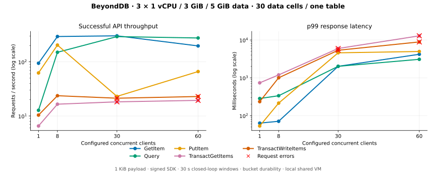

# Measure BeyondDB performance

BeyondDB has no production-qualified throughput or latency target. Use a release
binary, a repeatable signed-client workload and the deployment's actual durability
mode. Report successful throughput together with latency, sample count, errors
and resources; a failed window is not healthy capacity.

## Current local result

The [local benchmark](local-benchmark.md) records source `674e377`, Cellar `=0.1.0`,
three nodes at 1 vCPU / 3 GiB / 5 GiB each, and one table with ten data cells per
node. The separate object store and client are outside those node budgets.

| API at eight clients | Successful requests/s | p99 ms |
| --- | ---: | ---: |
| GetItem | 293.8 | 70.9 |
| Query | 150.2 | 335.7 |
| PutItem | 204.0 | 214.0 |
| TransactGetItems | 16.5 | 1193.0 |
| TransactWriteItems | 23.7 | 1002.0 |

All 20 windows covered all 30 data cells. The sweep retained 65,276 successes,
101 measured errors and 16 warmup errors; transaction APIs failed at 30/60 clients.
Internal shared-account admission refusals were recorded separately from public
errors. At eight clients, transaction p99 has fewer than 1,000 successful samples.

These short closed-loop windows share VM/storage and evolving state. They do not
measure independent-machine fleet capacity or an open-loop latency SLO. Earlier
failed trials and raw artifacts remain local; the guide records their limits.

## Run a configurable experiment

Use [scripts/perf](../scripts/perf) and the [reproduction guide](local-benchmark.md).
`setup.py init --nodes N --cells-per-node C` persists topology; `N*C` must be
2–256. Later actions use that saved plan. Do not change topology over retained
keys or state.

| Record | Why |
| --- | --- |
| Revision, binary hash, lockfile and config | Identify the executable and contracts measured |
| Cells, owners and metadata residency | Prove distribution instead of assuming it |
| Payload, keys, mix and transaction width | Make work per request comparable |
| Durability and object-store placement | Explain acknowledgement and recovery cost |
| Warmup, concurrency, drain and retries | Define elapsed time and outcome counting |
| Successful samples and failed outcomes | Qualify tail estimates and mutation ambiguity |
| Cgroup CPU/memory/I/O, disk, FDs and OOM state | Distinguish resource pressure from algorithm changes |

Run benchmarks after compilation finishes. Retain interrupted windows and avoid
concurrent host-heavy experiments. Put artifacts under
`benchmarks/YYYY-MM-DD-local-benchmark`; commit reviewed summaries and charts.

## Interpret the bottleneck

| Symptom | Investigate |
| --- | --- |
| Transaction tail/error growth | Coordinator/account paths, prepare reservations, publication and lock duration |
| Uneven owners or key pressure | Actual range distribution and LSI locality |
| Low CPU with high latency | Bucket/peer waits, admission and metadata contention |
| OOM or FD exhaustion | Store and node budgets separately; resident system cells and connections |
| More clients reduce throughput | Queueing, storage contention, closed-loop failure exits and client saturation |

Compare implementations only under matched data, durability, resources, client
settings and failure counts. Historical results from older runtimes are available
through [the evidence history](implementation-status.md#historical-evidence); they
are not current capacity or SQLite parity claims.
