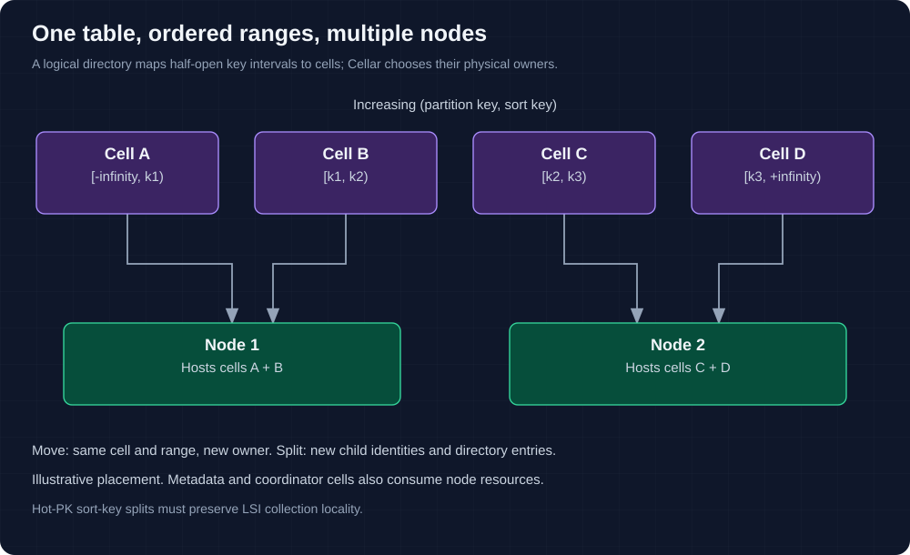

# Scale BeyondDB

A logical table spans ordered data cells. A node hosts many application and
system cells. Increasing the range count, adding nodes and raising admission
limits are different operations with different bottlenecks.

## Choose a table's Cell model

| Choice | Current behavior |
| --- | --- |
| No creation tag | Use `initial_partitions`, four by default |
| `beyonddb:cell-model=auto` | Multiple initial ranges; allow applicable splits |
| `beyonddb:cell-model=partitioned` | Same configured multi-range initial policy |
| `beyonddb:cell-model=single` | Rejected |
| Change tags later | Metadata only; does not change placement |

Initial counts are 2–256 and need not be powers of two. Default schema-aware
fences can be skewed; measure actual occupancy. A hot PK can split by SK only
without an LSI locality constraint. GSIs maintain independent ordered ranges.
See [partitioning](ordered-cell-partitioning.md).

## Capacity and failure domains

| Resource | What to count |
| --- | --- |
| CPU | Signing, expressions, routing, SQL, serialization and log/publication work |
| Memory | Resident cells, payloads, queued work, result bodies and physical reservations |
| Disk | Active data, logs, follower state and retained/retired history |
| Object store | Conditional authority traffic, latency, publication, recovery and request errors |
| Metadata | Account catalog/registration, directory pages and maintenance discovery |
| Placement | Owner distribution and actual workload, not just the number of ranges |

`max_active_cells` bounds native residency across **all** cell types. It is not a
per-table partition quota. The binary does not expose legacy disk/retained-byte
budget fields; enforce deployment limits externally and measure pressure.

Many cells on one host do not add failure isolation. Configure distinct node
names/directories and reachable private addresses, then verify native ownership.
Cellar controls physical balancing. It is separate from BeyondDB's range splits
and must not be replaced by manual lease/authority edits.

## Concurrent request admission

The current binary sets per-cell concurrency to 16 and native handler budget to
30 seconds. Queued requests, physical prepare reservations and synchronous
publication can become limiting before CPU or RAM is full. The client may also
be the bottleneck.

Pure-query backpressure is bounded. Mutation errors after submission remain
ambiguous; more retries do not create capacity. Transaction coordinator sharding
still includes a shared account registration path. The current
[local benchmark](local-benchmark.md) observed transaction errors at 30/60 clients
and internal account admission refusals.

## Expand and verify

1. Record the source/configuration, table generations, workload and current owner
   distribution. Establish a release-mode throughput/latency/error baseline.
2. Add nodes using the same fleet storage and keys, with unique identities and
   durable local paths. Preserve all existing state.
3. Observe discovery, balancing and target ownership; check ready nodes with
   signed reads and writes. Do not equate a new process with an even data load.
4. Re-run the same workload, including cross-node transactions, while measuring
   metadata, object-store and resource pressure.
5. Exercise graceful handoff and owner loss in an isolated environment before
   making an availability claim.

## Completion proof

The design targets large multi-cell deployments, but 10,000-cell/multi-TB
capacity is not a supported limit or measured guarantee. Required evidence still
includes independent-machine load, skew and hot-key handling, sustained admission
fairness, retained-history bounds, simultaneous failure recovery and operational
backup/upgrade procedures. See [performance](performance.md) and
[implementation status](implementation-status.md#open-qualification-gates).
