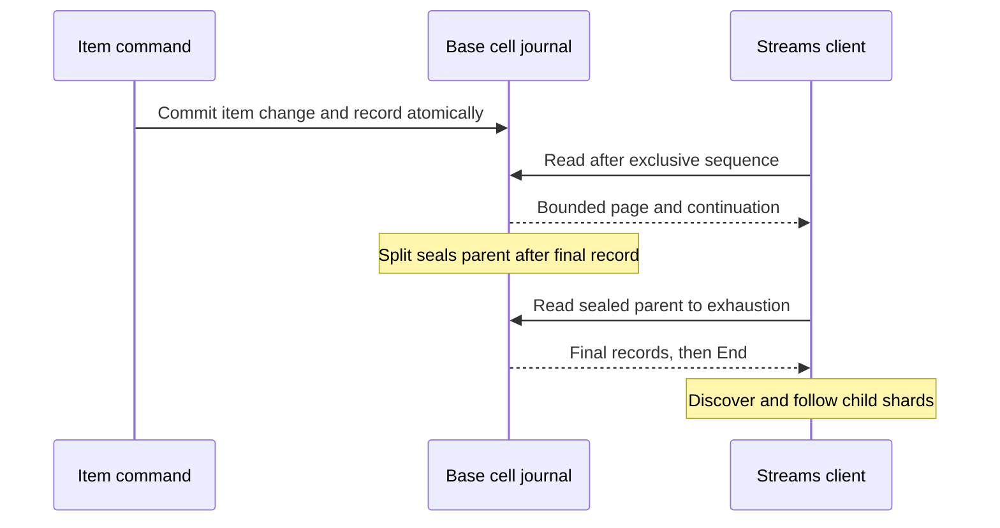

# Streams and retention

Streams is a partial public feature: a creation-time policy captures eligible
base changes and supports discovery/reads of retained generations. Runtime policy
changes through `UpdateTable` are unsupported.

## Record lifecycle

| Boundary | Current contract |
| --- | --- |
| Mutation capture | Item, LSI changes and stream intent commit in the owning command |
| Transactions | COMMIT applies images and captures changes; ABORT/rejection does not |
| No-op writes / split import | Equal images and imported copies are not new change records |
| Sequence | Stable command sequence plus operation ordinal |
| Empty open shard | Preserve the cursor and continue polling |
| Exhausted sealed shard | Explicit end; do not manufacture another iterator |
| Split lineage | Retain parent seal/history and discover children |
| Visibility | Catalog/record reads use a 24-hour cutoff, including retained deleted generations |

Known shard IDs are validated against account, table generation and installed
cell identity. Reusing a table name must not expose the old generation as the
new one. Consumers follow all shards and continuation fields; an empty page does
not mean the entire stream is empty.

## TTL and cleanup

The TTL worker submits a marked conditional delete. The owning cell rechecks
current policy and expiry before atomically deleting and capturing an eligible
REMOVE record. Expiry is asynchronous; reads may still see an expired item.

Bounded journal sweeps cover resident owners and catalog-discovered dormant or
deleted targets. Keep those discovery records and source state until retention
and pending work permit collection. Expired stream catalog-row collection and
full lifecycle qualification remain unfinished.

## Source and evidence

| Boundary | Source / current cases |
| --- | --- |
| Capture, journal pages and tails | [stream_journal](../src/stream_journal.rs) |
| Frontend storage mapping | [Streams adapter](../src/backend/streams.rs) |
| Retention commands/workers | [retention](../src/stream_retention.rs), [worker](../src/backend/stream_retention.rs) |
| TTL deletes | [TTL](../src/ttl.rs), [partition TTL](../src/partition/ttl.rs) |
| Signed write/read and restart | [stream process case](../tests/server_binary/streams.rs) |

The reviewed ExtendDB pin provides explicit continuation states for open and
exhausted shards. That shared contract does not itself prove all iterator,
lineage, view-type, byte-limit or error behavior. Policy replacement, complete
independent Streams compatibility and fleet-scale retention remain open gates.
See [CLI examples](user-guide.md#ttl-and-streams) and [API coverage](api.md#streams).
